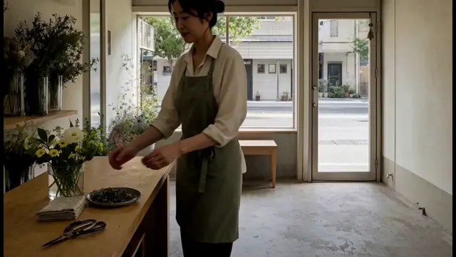
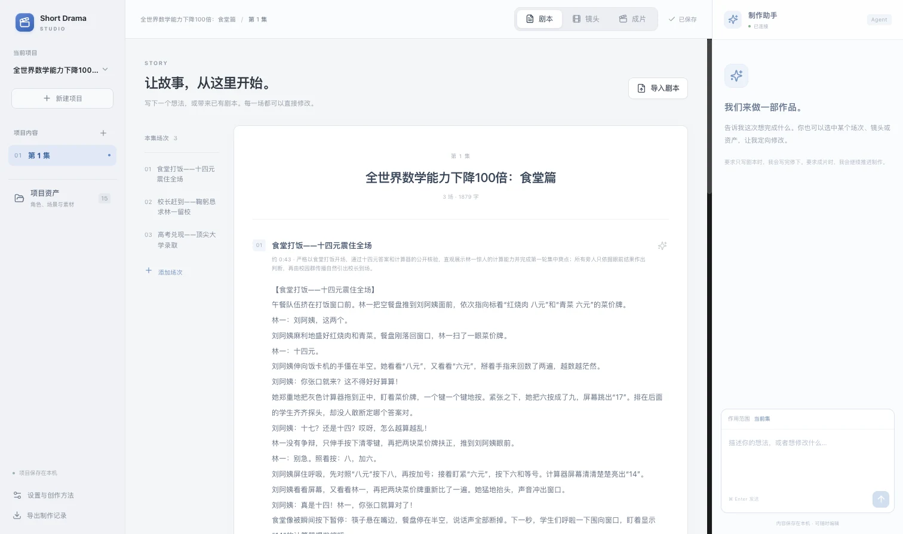
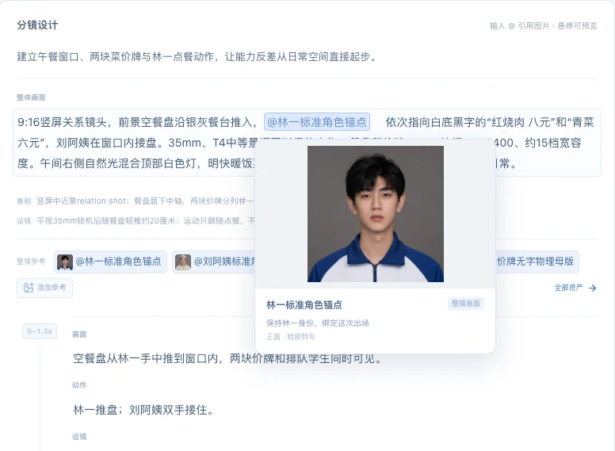
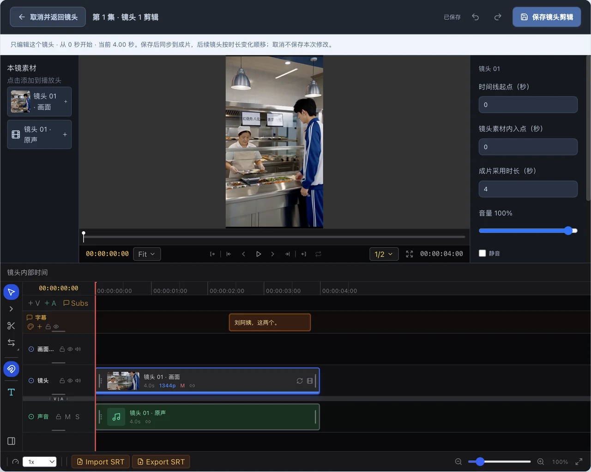

<div align="center">


# Short Drama Studio

**从剧本到成片的 AI 视频制作工作台**

[演示](#演示) · [功能](#功能) · [开始使用](#开始使用) · [常见问题](#常见问题) · [开发](#开发)

</div>

Short Drama Studio 是一款桌面视频制作工具。描述你想拍的故事，或导入已有剧本和素材，让制作助手完成分镜、图片、视频与剪辑。生成的内容会留在项目中，你可以继续改剧本、换参考图、补拍某个镜头，或亲手调整时间线。

## 演示

<a href="docs/assets/readme/shop-film.mp4"></a>

《店门开了》· 使用 Studio 制作。上方为 12 秒无声节选，[观看完整视频，含声音（34 秒）](docs/assets/readme/shop-film.mp4)。

## 功能

### 剧本、镜头和成片，放在同一个项目里

从一句话开始，也可以上传已有剧本，让助手接着做。剧本按场次呈现，镜头页同时展示分镜、参考素材和生成视频，成片页查看完整剪辑。右侧始终保留对话和任务进度，随时可以补充要求。

只想先看剧本，就让助手写到剧本为止；需要完整视频，再交给它继续制作。



### 改一个镜头，也能保留已经做好的部分

每个镜头都能单独修改分镜、替换参考图或重新生成。正文中的 `@` 引用关联实际素材，悬停即可预览，进入分镜编辑后更换。人物、场景、道具和声音集中管理，多集作品可以共用。

需要补拍时，直接说明要改的位置和希望保留的内容：

> 重做第 3 镜的画面，让父亲先看女儿，轻轻笑一下，再低头。保留原来的声音、字幕和其他镜头。

新片段可以只采用其中一段。只换画面时，已有声音和字幕继续使用，其他镜头与已保存的人工编辑也会保留。

### 在时间线上完成剪辑

裁切、拆分、移动片段，调整速度和音量，修改字幕。可以打开一个镜头精修，也可以展开全片调整节奏；单镜头的修改保存后同步到成片。

完成后选择画幅、帧率和字幕设置，导出视频与字幕文件。画面、声音和字幕仍分别保存在项目中，之后可以继续修改。

<table>
  <tr>
    <td width="50%" valign="top">
      
      <p><strong>分镜与参考图</strong><br>查看这处镜头实际使用的素材。</p>
    </td>
    <td width="50%" valign="top">
      
      <p><strong>单镜头剪辑</strong><br>调整画面、声音与字幕，保存到全片。</p>
    </td>
  </tr>
</table>

### 保存项目，接着上次的工作继续

项目和素材保存在本机。制作过程中可以暂停，重开应用后沿原任务继续。任务面板显示正在做什么、已经完成什么，以及需要处理的问题；制作记录中可以查看每次调用的模型、耗时和服务报告的用量。

保存好编辑后，可以将项目连同媒体收集为项目包，用于备份或迁移到另一台机器。

## 开始使用

### 1. 启动应用

当前运行平台为 **macOS（Apple Silicon）**，桌面包尚未公开发布。源码运行需要 **Node.js 22.12+、Python 3.13 和 uv**。

先获取源码，再在仓库根目录执行安装与启动命令：

```sh
git clone git@github.com:MicroYui/short-drama-studio.git
cd short-drama-studio

# 首次安装开发依赖
./scripts/pnpm-project.sh setup:dev

# 启动桌面应用与本地后端
./scripts/pnpm-project.sh dev
```

仓库使用受管理的 Microsoft npm 源，首次安装需要能够访问该源及 Python 依赖源。已有开发环境可以在仓库根目录直接执行 `./scripts/pnpm-project.sh dev`。更多环境与打包说明见[开发指南](docs/development.md)。

### 2. 配置生成服务

打开左下角的「设置与创作方法」，填写各项 API Key，保存并验证连接。语言和图片服务还可以设置服务地址。

| 服务 | 当前接入 |
| --- | --- |
| 语言与制作助手 | GPT-6 Astra |
| 图片生成 | GPT Image 2 |
| 视频生成 | MiniMax H3 |

AI 生成需要联网，费用由配置的服务供应商收取。项目保存、已有素材剪辑和导出在本机完成。声音可以使用生成视频的原声，也可以导入音频或录制。

### 3. 创建第一部作品

新建项目和本集，在右侧告诉助手想做什么。例如：

> 做一部 35–40 秒的温暖都市短片。故事发生在一家小店，两个人通过一个具体行动化解误会。台词和镜头由你决定，完成横屏视频、声音和中文字幕。

在「项目资产」导入要使用的图片、视频或声音，再向助手说明用途；已有文本可从「剧本」页的「导入剧本」添加。需要逐字保留的台词，直接写在要求里。想先看剧本时，加上“先写完剧本给我看，暂时不生成图片和视频”。

制作过程中，在「剧本」看场次和台词，在「镜头」看分镜与视频，在「成片」播放和剪辑。需要修改时选中相应内容，使用「请 Agent 修改」，或直接在对话中说明位置。完成后从「成片」导出。

## 常见问题

**可以用自己的图片、视频和声音吗？**

可以。导入的文件会进入项目资产，可用于参考图、镜头画面和声音。已有剧本也可以直接导入并继续编辑。

**需要安装本地视频模型或 ComfyUI 吗？**

视频生成使用 H3 API，无需安装本地视频模型。ComfyUI 是可选入口，需要自定义处理时再连接；处理结果可以回到项目中继续使用。

**暂停后会丢掉已经生成的内容吗？**

已保存的内容会保留。点击暂停后，已开始的操作会先结束并保存。需要继续时，在同一任务恢复。已经提交给供应商的生成任务可能仍在远端执行。

**项目保存在哪里，怎样备份？**

macOS 默认数据目录为 `~/Library/Application Support/ShortDramaStudio/`。使用「项目收集与迁移」导出包含媒体的项目包，再将项目包保存到备份位置。项目包不包含服务凭据。

## 开发

桌面端使用 Electron、React 和 TypeScript，本地后端使用 FastAPI 和 Python。结构化内容保存到 SQLite，图片、视频和声音以文件保存。剪辑基于 LTX Desktop，媒体导出使用 FFmpeg。

开发环境、源码入口、检查命令和打包方式见[开发指南](docs/development.md)。修改代码前请阅读 [工程约定](AGENTS.md)。

## 致谢与许可

感谢 [LTX Desktop](https://github.com/Lightricks/LTX-Desktop) 提供桌面应用与剪辑基础。Short Drama Studio 不启用或分发 LTX 模型权重。

应用与剪辑代码沿用 [Apache-2.0](LICENSE.txt)。第三方组件、制片方法和媒体运行时遵循各自的许可，详见 [NOTICES](NOTICES.md)。
