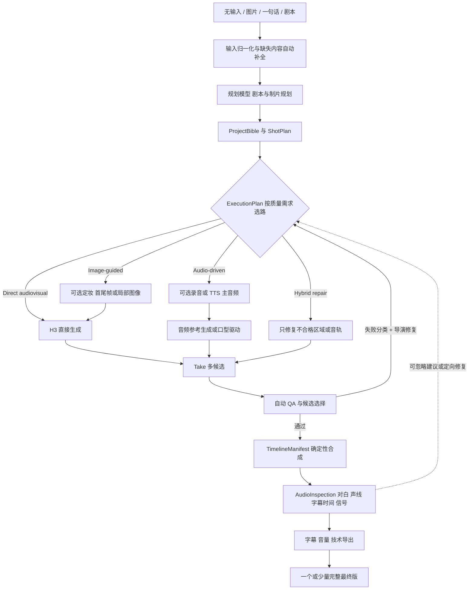

# 当前架构与技术设计

> 后续状态：Phase 29 已将创作控制面迁移为 Production Manager、Markdown Skills、统一 Tool Registry 与动态 AgentRuntime。本文保留领域模型、Provider 和媒体闭环设计；最新 Agent/Skill/Tool 分层以 [Phase 29 最终架构](40-agent-skill-tool-runtime-migration.md) 为准。

这是当前已确认的产品架构与技术设计。核心结构按真实闭环需要正常实现和迁移；H3 内部路线、GPT Image 覆盖范围、声音路线、镜头分组及后处理根据实际制片证据持续调整，只有结论不清或需要形成跨项目默认时才做受控比较。即梦、可灵、LTX Studio 和纳逗 Pro 只贡献产品机制，不进入运行时。

## 1. 产品原则

1. 无输入、若干图片、一句话和已有剧本使用同一条生产主线，只在输入归一化与剧本阶段采用不同处理契约；
2. 成片质量、连贯性和可控性优先于“是否使用某个模型”和调用成本；
3. 角色、场景、道具、服装、风格和可选声线都是版本化资产；
4. `AUTO_DRAFT` 不要求用户确认剧本、资产、分镜和单镜候选；`GUIDED` 才将它们作为可选停靠点，两种模式都不让用户面对底层 Provider 任务；
5. Direct、图像增强与音频路线可以从首轮并行比较；某个环节只要质量更好，或质量不劣且控制更强，就可以成为默认；
6. 单镜可重做，修改上游只失效真正依赖它的下游；
7. 模型能力由 Capability 明确表达，项目状态、任务状态、计费状态和 QA 状态彼此分开；
8. 开源项目或 ComfyUI 若被采用，只承担清楚边界，不形成第二套项目真相源。
9. 首版是单用户、受信环境；内容确认与访问权限是两件事，不为生产状态机引入账号、角色或租户模型。
10. 首个固定质量标杆曾选择真人都市短剧，这只限定历史验收样片，不是当前产品的 Style 默认。不同视觉形态共用项目、剧本、资产、分镜、任务、候选和时间线主线，具体选择由项目 Bible Style、Prompt Compiler、ExecutionPlan 与 Provider Capability 表达，不复制第二套工作流。
11. 首版验收单集完整闭环；ProjectBible 中的角色、场景、服装、道具和可选声线继续版本化、可跨项目或剧集复用，但暂不把多集连续性纳入首版验收矩阵。
12. 首版内容语言锁定普通话中文；通用 schema 保留 `language`、`locale` 与原始文本，但方言和多语言必须在各自声音、口型、STT、字幕和质量基准建立后才对外支持。
13. 默认 `AUTO_DRAFT` 从无输入、若干图片、一句话或已有剧本运行到完整可观看草稿，自动完成创作补全、选择 Take、QA、导演修复、定向重试和时间线组装；默认只向用户展示一个或少量完整最终版。`GUIDED` 才在剧本、定妆、分镜和候选处暂停并显示可忽略建议。只有从草稿标记为正式通过需要人工动作，草稿生成与导出不受阻。
14. 首版包含面向短剧生产的实用时间线，而非仅输出成片，也不承诺完整专业 NLE：支持 Take/Retake/Extend/Gap Fill、镜头拆分裁切排序、视频/音频/字幕轨、音量、基础转场和确定性导出；高级调色、蒙版、复杂特效、关键帧曲线和多机位留到后续版本。
15. 领域模型与模块采用复用优先：可直接参考或移植 Jellyfish 的项目/准备度/任务语义、Toonflow 的剧本与分镜规则、ViMax 的机位/首尾帧结构、Wind Comic 的成片/QA 等成熟实现；不为原创而重写，但必须适配统一 schema、单一项目真相源和已锁定产品边界。
16. 首版 UI 延续 LTX Desktop 的项目工作台、Gen Space 与时间线，增加剧本/ProjectBible、资产、分镜/连续性和 QA 视图；自动流程用阶段进度与可操作问题呈现，不要求用户维护节点图。节点画布只在后续高级调试或自定义执行需求被证明后研究。

## 2. 候选流程

图像和外部音频节点不是形式上的必经步骤，但也不以最少步骤为目标。GPT Image 2 若达到质量非劣并提高一致性，可覆盖全部适合的镜头；一个项目也可以让对白近景走音频驱动、动作镜头走直接生成、身份高风险镜头走关键帧辅助。

### `AUTO_DRAFT` 的无人值守交付契约

- 无输入：Story Planner 先内部生成和排序创意，选择一个后继续，不要求用户先填一句话；
- 仅图片：先识别可复用的人物、场景、道具和风格线索，再自动补全剧情与缺失资产；
- 一句话：扩写为可执行剧本和制片计划；
- 已有剧本：保留原文，单独生成口播、字幕与执行文本，不静默改写锁定事实；
- 运行中的普通 QA 失败由系统自动分类，Director Agent 自动比较重生成、换关键帧、拆镜和换覆盖机位，更新依赖后继续运行；
- 用户默认只看完整最终版，不审核关键帧、单镜 Take 或修复建议。`GUIDED` 保留这些停靠点，且所有建议都可忽略；
- 只在 Provider 凭证缺失、任务无法恢复、用户显式设置的成本上限或必须由人决定的核心故事分歧时才暂停。

## 3. 规划模型的位置

当前可用的 GPT-5.6-sol 可承担以下有边界角色，但架构不把工件格式绑定到模型名：

- Story Planner：一句话扩写、节拍和剧本；
- Script Guardian：锁定剧本 diff 与对白保真；
- Production Designer：ProjectBible 与资产需求；
- Director：分镜、机位、表演、镜头覆盖和分组；
- Continuity Planner：上一镜终态、轴线、视线、道具与服装；
- Route Planner：根据历史实验和镜头风险提出执行路线；
- Prompt Compiler：编译入选 Provider 的格式和参考绑定；
- Reviewer：读取候选帧、转写和技术检查，提出单变量重试。

这些角色输出相互引用的 schema，不需要为每个角色建立独立运行时。Route Planner 应依据已记录的能力和实验结果建议路线；不为展示技术栈增加步骤，但允许为质量非劣、稳定性和控制增益主动加入 GPT Image 2 等能力。

### Agent 控制面的职责

产品对用户呈现的是 AI-native Agent，而不是要求用户搭建或逐节点操作 workflow。已确认的目标控制面由同一运行时中的以下能力组成，不另建规则引擎或审批系统：

- **Agent Harness** 负责理解自然语言目标、选择 Skill、组装上下文、调用 Tools、委派子 Agent，并根据工具结果继续规划；
- **Production Skills** 封装某类成片的稳定 constitution、按职责选择的 role rubric、按当前上下文召回的经验、建议式 playbook、Critic 关注点和 Review Router 的修复归属原则。PoC 阶段不建设动态 Skill Registry、插件发现或独立 Skill 服务；当前 `ProductionProfile → ProductionSkill` 静态 Catalog 已足够。Skill 不限制全局 Tool Catalog，playbook 可由 Agent 或用户跳过、重复或覆盖。先把抖音短剧 PoC 做通，数字人口播等只是未来新增的 Skill 实现，不要求改动项目、任务、资产、Take 或时间线核心；
- **Tool Catalog** 提供可独立组合的原子能力，包括剧本规划与审阅、Multi-Agent 委派、单场/单镜规划、资产检索与派生、图像生成/编辑、H3 生成、视频观察、连续性检查、时间线局部更新和语义影响分析。Tool 返回结构化工件或证据，不暗含固定创作顺序；
- **持久化 Orchestrator** 保存 PlanningRun、AutonomousRun、任务、Take、路线计划和当前步骤，负责有限推进、并发、重试、恢复与 `SUBMIT_UNKNOWN` 对账；
- **确定性校验器** 只判断输入组合是否合法、文件是否存在、版本引用是否新鲜、Provider 状态和时间线是否可执行。

这里的 Orchestrator/状态机是 Agent 的可恢复执行底座和任务记录，不是决定创作路径的产品级 workflow。创作质量、是否补资产、是否使用视频参考、是否拆镜或换机位仍由 Agent 给出可忽略建议；Agent 可以按任务动态串联或并行调用能力。项目不使用文档 SHA、素材 hash 冻结、创意审批门或样片专用规则来代替这些判断；普通 ID、缓存键和任务 fingerprint 只服务于查找、复用与避免重复提交，不构成内容冻结。

### 自然语言修改与语义影响规划

“把许岚在办公室里的外套改成红色”不应进入一条预制换装 workflow。目标能力是由 Agent：

1. 把自然语言解析为实体、属性、适用时空/剧情范围和用户意图；范围不明确且会造成明显不同结果时再向用户确认；
2. 查询 ProjectBible、资产目录、镜头内容和版本依赖，找出该角色在指定服装状态下真正入镜的镜头，以及这些镜头使用的关键帧、参考包、Take 和时间线片段；
3. 形成可解释的 `ImpactPlan`，默认只失效受影响分支；对白、声音、字幕和没有该服装的镜头不因“可能相关”被重做；
4. 自主调用图像编辑/生成、ReferencePlan、H3、视频观察和 Timeline patch 等 Tools，检查结果后继续局部修复或完成替换；
5. 保留旧版本和可回退的入选 Take，允许用户修改范围、直接指定镜头或忽略 Agent 建议。

现有版本依赖与 `CURRENT/STALE` 已具备局部重算的底层语义；当前已交付只读 `ChangeIntent → ProjectIndex → ImpactPlan` Agent Tool，支持自然语言或显式目标 ID，并通过真实 ReferencePlan、对白、场次、镜头和 Take 依赖计算局部影响。它不会直接修改项目；后续 Change Executor 继续复用现有版本、图像、ReferencePlan、H3、检查和 Timeline Tools。不为“换衣服”“换门”或其他单例需求各建字段和流程。

语义修改对架构的最小合同如下：

- `ChangeIntent`：保存用户原话、解析出的目标实体、属性变化、适用场景/时间范围和必须保留的约束；它是一次 Agent 计划，不是新的长期业务对象；
- `ProjectIndex`：由当前 ProjectDocument、ProjectBible、ReferencePlan、任务、Take 与 TimelineManifest 按需编译的只读索引。首版不引入图数据库、向量库或第二份项目真相源；
- `ImpactPlan`：列出确定命中的上游版本、需要失效/重做的镜头分支、保持不变的工件、调用 Tools 的顺序及每项原因。LLM 负责理解与提出范围，确定性依赖查询负责校验真实 ID 和下游闭包；
- `Change Executor`：创建新版本，调用已有资产编辑、ReferencePlan、H3、检查和时间线 Tools，并按实际依赖标记 `STALE`。执行途中仍使用现有任务、Take 和恢复机制；当前影响计划已实现，通用自动执行器仍按具体 Tool 完整度逐步接入；
- 若一句话存在两个会造成明显不同重算范围的合理解释，Agent 才请求澄清；否则按最小影响范围自主执行并在结果中说明。

因此需要优先设计的是 ProjectIndex、ChangeIntent 和 ImpactPlan 的契约，不是 Skill Registry。Multi-Agent 仍由 Harness 作为一种可调用能力调度，不为每个角色建立微服务或固定流程。

## 4. 核心数据模型

### `Project`

保存项目目标、输入模式、运行模式 `AUTO_DRAFT | GUIDED`、画幅、时长、语言、当前批准版本和质量档位；成本与用量单独记录，不作为项目质量档位的硬上限。首版不增加 `owner_id`、`organization_id` 或租户字段。

### `ScriptVersion`

- `source_mode`；
- `original_text`；
- `spoken_text`；
- `subtitle_text`；
- `structured_scenes`；
- `approval_status`；
- `parent_version_id` 与变更原因。

### `ProjectBibleVersion`

- `CharacterProfile`：外观、服装、表演，以及可选参考图/音频；
- `LocationProfile`：空间布局、光线、色彩和关键视角；
- `PropProfile`：外观、状态机和持有人；
- `StyleProfile`：真人/漫剧、摄影、色彩、质感和禁用项；
- `VoiceProfile`：可选声线描述、reference audio、录音或 TTS voice。

Profile 可以只有文字，也可以引用素材库导入、用户上传、模型生成或模型修整后的素材。系统不因字段存在就自动生成对应媒体。

### `Asset` 与 `AssetVersion`

`Asset` 表示角色、服装、场景、道具、图像、视频或音频等稳定身份；`AssetVersion` 保存实际文件和可复现来源：

- `origin_type = UPLOAD | LIBRARY_IMPORT | AI_GENERATED | AI_EDITED`；
- 本地文件、外部来源 URL/素材条目 ID，以及素材库要求的普通 License/署名信息；
- `parent_version_id`，用于表示润色、补视角、换装或风格统一的派生关系；
- 使用模型时保存 Provider、模型快照、提示和输入版本；
- `DRAFT/APPROVED/SUPERSEDED` 与 `CURRENT/STALE` 状态。

素材库可以先由用户在外部挑选后导入；内置搜索连接器以后逐库增加，不改变 Asset schema，也不成为固定实验的前置条件。

### `ShotPlan`

- 叙事目的和信息增量；
- 时长、景别、机位、轴线、运镜；
- 人物位置、朝向、眼线、动作起止；
- 道具进入/退出状态；
- 对白、画外音、环境音和音乐意图；
- 与前后镜的 cut/transition 关系；
- 可否与相邻镜合并生成，以及局部返工风险。

这里的时长是最终剪辑和叙事时长，不是 Provider 请求参数。一个镜头可以短于 4 秒，也可以作为持续表演或运镜超过 15 秒；不能因为 H3 的单次窗口而强行改变导演分镜。

### `ExecutionPlan`

每个镜头或镜头组显式记录：

- `strategy = direct_audiovisual | image_guided | audio_driven | hybrid_repair`；
- 选择该路线要解决的具体问题；
- 被跳过的可选环节；
- 入选 Provider、模式与 capability snapshot；
- 输入工件版本、候选数和用量预估；
- 路线选择所依据的实验结果；
- 降级、重试和局部返工策略。

默认策略来自基准实验，而不是“步骤最少”。若 GPT Image 2 路线质量更好，或质量不劣但一致性、可控性和稳定率更高，`image_guided` 就可以成为适用镜头的默认策略。

### `RouteEvidence`

保存路线对照结论，键至少包含美术风格、镜头类型、图像/视频/音频模型快照和关键参数，值包含样本量、质量分、严重失败率、稳定率和结论。某个组合一旦证明 GPT Image 2 有增益或质量非劣，后续匹配镜头直接采用，无需每个项目重复做 A/B；只有模型版本、风格或参考方式发生实质变化时才复验。

### `ReferencePlan`

- 文本、首帧、尾帧、角色、场景、道具、视频和声音引用；
- 每个引用的 Provider role 与保留目标；
- 引用是否必需、可选或互斥；
- Provider capability 校验结果；
- 素材库、上传、生成或编辑素材的来源与版本。

`ReferencePlan` 是供应商中立意图，Adapter 再把它编译为 H3 或其他模型的具体字段。

### `GenerationTask` 与 `Take`

`GenerationTask` 记录 Provider 调用和状态；`Take` 是可观看、可评分、可选用的媒体候选。一个 Task 可以产生多个 Take。Take 的媒体可用性、QA 状态和是否入选分别保存，不压成一个枚举：生成成功只说明媒体可用，`qa_status` 为 `PENDING/PASSED/REJECTED`，`is_selected` 单独表示时间线是否采用。Provider 成功不等于 QA 通过，QA 通过也不等于自动入选。

执行层在 `ShotPlan` 与 Provider Task 之间增加可派生的生成段计划。对于 H3，每个生成段都是 4–15 秒整数，并保存所属 `shot_id`、段序号、目标剪辑区间、连续性来源和裁切余量。长镜头可对应多个 Task/Take，段间使用前段终态、尾窗、关键帧或视频参考接续；不足 4 秒的镜头至少生成 4 秒，再由 `TimelineManifest` 取所需区间。生成段是 Route Planner 编译出的技术工件，不成为新的创意分镜，也不要求用户逐段操作。

### `TimelineManifest`

唯一的成片时钟，记录：

- 视频片段入点/出点；
- 原生音轨、外部对白、环境音、音乐与 gain；
- 字幕 cue；
- 转场；
- 输出 fps、分辨率、音频规格；
- 每项来自哪个 Take 或 ScriptVersion。

无论音频来自模型、录音还是 TTS，都作为显式时间线素材管理，不做不可审计的文件裸拼接。

PoC 的 H3 `GenerationTask` 固定请求 768P；原始 Take 不被交付缩放覆盖。`TimelineManifest` 的交付预设可输出 1080×1920，但该尺寸只表示最终封装与一次性合成结果，不冒充 H3 原生生成分辨率。

### `QAReport`

身份、动作、道具、台词、说话人、口型、坏帧、美感、节奏和表演都作为类型化观察证据保存，不压成一个总分或硬通过状态。Agent 根据镜头职责、项目意图和实际取舍选择候选，并记录问题应在“重生成、换路线、局部修复或后期合成”哪一层解决；媒体不可读或 Provider 合同不合法仍属于技术执行错误。

真人和漫剧使用同一份报告结构，但检查器与阈值按 Style Profile 选择：真人重点检查身份漂移、皮肤/肢体真实性、微表情、物理运动和自然口型；漫剧重点检查线条/材质风格、角色比例、颜色、层次、有限动画与风格化口型。共享 schema 不等于强迫两种形态使用同一套视觉评分器。

### `AudioInspectionReport`

按当前 `TimelineManifest` 保存逐镜音轨信号、字幕 cue 映射、锁定对白转写、归一化后字符差异和按预期角色分组的跨镜声线诊断。语义实现通过 `AudioSemanticService` 注入；无 STT/声线模型时技术检查仍可完成，语义结论明确为 `UNAVAILABLE`，不会假装通过。报告是 Director Agent 的证据和用户可忽略建议，不是阻断草稿导出的硬审批门。

## 5. 质量驱动的路线规则

### Direct audiovisual

作为基线对照。用文本和已有必要参考直接生成视听镜头，用来衡量图像或音频增强带来的真实增益；即使它已过最低质量线，也不自动淘汰质量更高或更稳定的增强路线。

### Image-guided

从首轮就可参与比较。图像可来自素材库、用户上传、GPT Image 2 新生成或 GPT 对已有资产的修整；只要下游视频质量更好，或质量不劣但角色、场景、构图和动作状态更稳定，就可覆盖全部适合的镜头。出现动态质量下降、风格损失或表演受限时再按镜头关闭。

### Audio-driven

主音频可来自真人录音、Azure TTS 或其他入选工具，并与模型原生音频直接比较。若最终台词、声线、节奏和口型更好，或质量不劣而控制显著更强，即可采用；视频模型不能可靠遵循该音频时进入后期口型分支。

### Hybrid repair

当主体镜头已经合格、只有局部画面或音轨可进一步提升时启用。通过前后对照确认总体质量提高或至少不劣，且没有引入新的身份、时序或压缩问题；成本高低不是首要门槛。

## 6. 当前 H3 Adapter 的专属设计

当前视频生成只接 H3，以下规则只存在于 H3 Adapter：

- 单次请求时长必须是 4–15 秒整数；`ShotPlan` 不继承这个范围；
- 长镜头由 Route Planner 编译为多个合法生成段，短镜头生成安全余量后在 Timeline 裁切，任何路径都不得直接向 H3 提交超过 15 秒或非整数时长；
- 多段长镜头在段间继承可见终态并执行边界连续性检查，Director 可建议改为剪辑拆镜或换覆盖机位，但建议不阻断用户保留原长镜头；
- `frame` 路线用于精确首尾构图和动作接续；
- `reference` 路线用于角色、场景、动作或声音参考；
- Adapter 在提交前校验 frame roles 与 reference roles 的互斥；
- 相邻镜头只有在同一连续时空、总时长不超过模型窗口且整组返工可接受时才合并；
- Context-IR 只是可选提示编译步骤，不能被记为视频任务成功；
- 原生音频、reference audio 和外部主音频分别实验，不根据“支持字段”推断效果。

这些是 H3 Adapter 的约束，不应污染通用 `ShotPlan` 或迫使其他视频引擎模拟 H3。

## 7. 音频策略

建议以能力状态而非供应商名表达：

- `MODEL_NATIVE`：视频模型共同生成对白、表演、口型和环境音；
- `MODEL_NATIVE_WITH_VOICE_REF`：模型仍生成最终声音，但加入跨镜声线参考；
- `EXTERNAL_AUDIO_DRIVEN`：录音或 TTS 是批准主音频，视频必须遵循它；
- `POST_LIPSYNC`：画面合格后只修对白镜头口型；
- `VOICEOVER_EDIT`：叙事合理时使用画外音、反应镜头或道具特写。

Phase 9 已将 H3 `MODEL_NATIVE` 的检查自动化：本地 Whisper-small 默认核对锁定对白，WavLM 默认做跨镜相对声线诊断，FFmpeg/能量规则检查信号和字幕窗口；它们都位于 Provider 中立协议后。Phase 8 成片在该工具下通过，但这只是一次完整单集证据。只有后续样本出现声线漂移时启用 `MODEL_NATIVE_WITH_VOICE_REF`，台词或声音控制仍不合格时再比较真人录音/TTS 的 `EXTERNAL_AUDIO_DRIVEN`。`POST_LIPSYNC` 不预接，前三层仍无法同时满足台词、声音和口型时才评估。STT 主要用于筛查和字幕时间候选；人耳、锁定文本和画面仍共同决定正式通过。

## 8. 任务状态

已锁定的最小任务状态：

`QUEUED → SUBMITTING → ACKNOWLEDGED → RUNNING → SUCCEEDED | FAILED | CANCELLED`

额外异常：

- `SUBMIT_UNKNOWN`：提交结果不明，先对账；
- `OUTPUT_MISSING`：Provider 成功但文件未下载、已过期或本地结果缺失。

每次任务持久化 Provider task ID、请求指纹、模型与 Capability 快照、输入版本、尝试次数和恢复检查点。进程重启后从持久化状态继续查询或下载；处于 `SUBMIT_UNKNOWN` 时必须先按 Provider task ID 或请求指纹对账，不能盲目重新提交。任务成功、Take 可用、QA 通过和时间线入选必须是不同事实。

## 9. 失效传播

所有可批准产物采用 `DRAFT/APPROVED/SUPERSEDED` 版本状态，依赖关系另用 `CURRENT/STALE` 表示。创建新版本或修改上游时不覆盖、不删除旧版本，只把真正依赖它的下游标为 `STALE`；旧的已批准 TimelineManifest 与导出仍引用精确版本并可复现。

- 改台词：失效相关原生视频或外部音频、字幕和 TimelineManifest；
- 改角色资产：只失效引用该版本的关键帧和镜头；
- 改镜头时长：失效对应生成任务、字幕时段和后续时间线位置；
- 只换字幕样式：仅重渲字幕/成片；
- 只换 BGM：仅重混时间线；
- 从 Direct 切到 Image-guided：新增必要图像依赖，不回填无关镜头。

重新生成只遍历受影响分支，用户仍可查看和恢复旧 Take。普通版本依赖图足够，首版不引入事件溯源、加密承诺、篡改链等与生产闭环无关的机制。

## 10. 系统边界

首版部署模式固定为 `SINGLE_USER_TRUSTED_DESKTOP`：桌面壳启动本机 API/Worker，数据库与项目媒体保存在本机；GPT Image、H3 等外部 Provider 仍可通过云端 API 调用，不要求生成模型本地运行。产品 API 不要求登录或会话，不建立 `User`、`Organization`、`Membership`、`Role`、`Permission`、`Tenant` 等领域实体，也不在查询中增加资源归属过滤。剧本、资产、分镜和候选的 `approval_status` 只表示生产状态。Provider API Key 作为外部服务凭证由运行配置管理，与产品身份无关。

- Product API：项目、版本、资产、分镜、执行计划、候选和审批；
- Planner：当前可用 GPT-5.6-sol，输出稳定 schema；
- Provider Adapters：只接入实验证明需要的图像、视频、音频或口型能力；
- Task Worker：由 Electron 管理的独立本地 Python 进程，从 SQLite 任务表领取提交、轮询、回调、下载和恢复任务；本地 GPU 默认单任务，云端并发按 Provider capability 配置；
- Media Processor：FFmpeg/ffprobe、抽帧、转码、混音和字幕；
- Video Observation Tools：媒体探测、适应性抽帧、接触表、镜内连续性和相邻镜头边界观察；输出证据与通用 QA 问题，不直接决定修复策略；
- Audio Inspection Tools：FFmpeg 音轨提取、信号/VAD 诊断、Provider 中立 STT、锁定对白比较、说话人标签和跨镜声线检查；输出证据与通用 QA 问题，不直接阻止用户方案；
- QA：规则、模型视觉/语音审阅和人工评分；
- Route Evidence Registry：保存已验证的默认路线和适用条件；
- Storage：SQLite WAL 保存项目、版本、任务、Take、QA 与时间线元数据；本地项目目录保存原始素材、生成结果、缓存、渲染与导出，数据库记录路径、版本和校验值；
- 条件式局部修复 Adapter：只有实验确认具体工作流能提升质量时才接 ComfyUI，且不拥有项目状态。

UI 不额外建立一套“workflow 项目”。项目首页、剧本/ProjectBible、资产、分镜/连续性、Gen Space/Take/QA 和时间线读取同一 Product API；自动运行状态只是这些领域对象和 GenerationTask 的聚合视图。

闭源平台不在 Adapter 列表中。我们只复用其“资产化、可编辑分镜、时间线、Retake、音画协同”等产品思想。

LTX Desktop 引入一个实现分叉，但不改变上述领域边界：

- **已选 Desktop-first**：保留 LTX Desktop 的 Electron/React 编辑壳、媒体文件、Take/Retake/Gap Fill 和 FFmpeg 框架；FastAPI/SQLite 承担唯一项目真相源与持久化 Worker；当前视频只接 H3，GPT Image 与音频工具按实验启用；
- **未来 Server/browser**：若真实需求出现，再把同一 Product API、Task Worker 与媒体存储迁到受信服务器；首版不维护这条运行形态；
- 不同时运行一套 LTX `localStorage` 工程和一套 Jellyfish 项目数据库。无论选哪种壳，`ScriptVersion`、`ProjectBibleVersion`、`ShotPlan`、`GenerationTask`、`Take` 和 `TimelineManifest` 都只有一个权威版本。

P008 已确认短剧生产时间线，A004 已确认本地桌面优先，因此实现倾向已转向 LTX Desktop 壳。当前只复用其 Apache 应用代码，内置 LTX-2.3 及其他 LTX 权重不进入产品或本轮质量实验；视频生成固定接 H3。

已锁定的改造原则是：保留并扩展 Electron/React/FastAPI 壳、Gen Space、多 Take、Retake/Extend/Gap Fill、Source/Program Monitor、时间线、媒体导入、SRT/FCP、FFmpeg 框架、OpenAPI 类型桥与性能测试；重构或复用整合项目持久化、可恢复任务、Provider contract、短剧领域/QA/TimelineManifest，并补齐预览与导出一致性。可直接移植其他已审查项目的成熟设计或代码，但必须进入统一 schema 和单一项目真相源。当前移除或禁用 LTX、fal、Gemini 视频路径，只实现 H3 视频 Adapter；核心 contract 仍不允许 H3 专属字段反向渗透到通用领域。

## 11. 实施阶段

### Phase 0：上游基线

导入 LTX Desktop，跑通原始构建、测试与桌面打包，记录上游已有问题。

### Phase 1：统一核心与 Mock 闭环

建立 SQLite/API 领域核心与固定 fixture，实现持久化 Worker、可注入失败的 Mock Provider、恢复和失效传播；再把 Gen Space、Take/Retake/Extend/Gap Fill、时间线和导出接到统一核心，完整通过 Mock 切片。只有出现已经定义的结构性失败才回退 Jellyfish，不并行维护两个原型。

### Phase 2：H3 Provider

只接 MiniMax-H3，固定 768P，完成能力校验、持久化异步提交、轮询、下载、恢复与真实合同冒烟。

### Phase 3：资产与 GPT Image

实现上传、链接与本地素材导入、版本批准、GPT Image 生成与编辑，并验证下游 H3 动态质量。

### Phase 4：H3 视觉与镜头分组

只接 MiniMax-H3，固定 768P，完成能力校验和任务恢复，执行 Direct、Frame、Reference、Context-IR 与镜头分组实验。

### Phase 5：无人值守运行器与视频观察

把空输入、图片、一句话和锁定剧本归一为同一生产请求；实现 `AutonomousRun`、结构化规划、本地回退、一键 Mock 闭环、适应性抽帧、镜内/镜间观察，以及观察报告到 Director Agent 的可忽略建议链路。

### Phase 6：真实 H3 路线复用

已完成证据优先路线选择、真实 Take 复用、逐镜/镜间观察、全 H3 时间线和技术导出。

### Phase 7：从零真人 AUTO_DRAFT

已完成资产、关键帧、H3 异步候选、通用 QA、Director 有界修复、Take 选择、时间线和导出的可恢复编排。

### Phase 8：首次真实无人值守单集

已使用真实 GPT Image 2、GPT-5.6-sol 和 H3 768P 完成第一次从锁定剧本到 54.31 秒成片的无人值守闭环，并由用户按本轮标准暂时通过。

### Phase 9：声音、字幕与口型 QA

已完成 H3 原生音轨的 Provider 中立自动检查、锁定对白核对、跨镜声线诊断、字幕时间诊断和现有真实成片复检。Phase 11 已把参考音频作为可选输入接入，但尚未做新的真实质量探针；TTS 或外部口型仍只在后续失败证据表明能提高最终质量时接入。

### Phase 10：独立重复与三版盲评包

已完成 E007 所需的另外两次独立 `AUTO_DRAFT`，并将三版 54.31 秒成片匿名打包。用户随后以汇总定性评价替代数值 CSV，选择 C 版为当前最终版。评价同时发现：当前对白转写和声线 QA 会漏掉“设备播放被画成角色本人说话”这类声音来源语义错误。Phase 11 已补可选角色参考音频输入；用户明确本阶段不新增声音 QA，因此声音来源语义只保留为已知缺口，仍不预先搭建通用节点系统。

### Phase 11：可选角色声线输入

已完成项目级角色声线绑定、上传/麦克风录制、WAV 规范化、试听、解绑、独立重复复制，以及 Route Planner 对实际说话角色的 `reference_audio` 自动选择。绑定是可选输入，不提供时继续使用 H3 原生声音；Frame 与 Reference 互斥时由 Director/Route Agent 按画面质量选择，不建立硬阻断。

### Phase 12：跨剧本资产 Agent 与同源视图

已将照片和参考资产整理为 Agent 可调用的目录搜索、覆盖检查、资产导入、同源派生、语义审查登记和逐镜选择工具。场景先建立单张 Master Wide，再按实际分镜从同一母版派生局部、反打或交互视图；角色三视图不是硬性前置。`lineage_root_version_id` 防止母版更新后旧派生图被自动混用。工具为 Agent 提供事实和执行能力，不把建议变成用户审批门。

### Phase 13：制作类型 Prompt Policy

新建项目选择 `GENERAL_VIDEO` 或 `AI_SHORT_DRAMA`，同一 Agent Runtime 根据项目 Profile 为 Concept、Writer、Planner、Critic、Review Router、Director、Asset Reviewer、H3 Route/Prompt Compiler 和 Episode Reviewer 编译各自策略。通用视频允许氛围、留白和有意义的长镜头；抖音短剧强调好奇缺口、因果推进、可见状态变化和回收。项目、资产、H3、QA 与时间线实现仍然共用；抽帧观察、Take 比较、Schema 和 Provider 技术合同不注入品类偏好。

Planner 不再硬限定 6–10 镜，Director 也不使用固定动作数、固定信息间隔或长镜头拒绝规则。系统只保留 45–60 秒交付目标和 H3 单段 4–15 秒的当前技术边界；“镜头是否赚到时长”由 Agent 结合意图与观察证据判断，建议始终可覆盖。

### Phase 14：自定义时长与分层 Multi-Agent 长篇规划

45–60 秒只保留为首个验收样片的历史范围，不再是新项目限制。桌面端允许用户填写不少于 4 秒的任意目标时长；3/5/10/15 分钟只是抖音短剧快捷值，默认 5 分钟，通用视频默认 60 秒。快捷值不改变底层 Tools 或 AgentRun 的动态编排语义。

配置语言 Provider 时，无论时长都由 AgentRun 持有的 Content Planning Job 增量推进 Story Architect、逐场 Scene Writer、Script Critic、Review Router，以及目标需要时的 Scene Director。Story Architect 维护整集因果、全局资产、对白和场次契约；Script Critic 只报告有证据的因果、动机、伏笔回收和节奏观察；Review Router 决定每项问题的最小修复层。只有 `HIGH + STORY_ARCHITECT` 进入下一轮逐场修订，不设固定轮数；MEDIUM/LOW 保留为独立审校建议，其他问题随相关场次 handoff，不用增加解释来修复执行层问题。Scene Director 只展开当前场，并通过人物、道具、事实和待回应问题组成的 compact handoff 顺序传递连续性。所有路由可由用户覆盖，场次失败只局部修复并保留游标，不把整集重新丢给一个超长 Prompt。本阶段主要检查剧本和结构，不调用 GPT Image 或 H3。

进入故事修订前，Source Contract Agent 独立提取用户显式承诺、禁区和开放选择；Story Repair Planner 再把 routed finding 诊断为来源概念缺口、当前大纲缺陷或 Critic 越界。Repair Plan、Source Contract 和结构化修订历史共同约束 Writer，Revision Verifier 只检查计划执行、来源承诺与新引入的状态回退；具体 violation 按已保存的场次游标定向修复至验收通过，不以任意次数截断。该层不使用固定剧情规则或答案键，全部建议可由用户覆盖；正常改善不要求 Critic 零问题。

### Phase 15：持久化 PlanningRun

本阶段当时先将超过 90 秒的创建改为可恢复 `PlanningRun`。当前实现已取消时长分流：所有已配置语言 Provider 的 Agent-owned 创作都使用 AgentRun 持有的 Content Planning Job（兼容实现名仍为 `PlanningRun`）。原始请求、当前阶段、整集大纲、审稿报告、修订轮次和已完成的逐场工件均持久化；一次推进只运行一个 Agent 阶段或一场 Writer/Director。应用重启后从当前节点继续，单场失败只重试当前场。ProjectDocument 从创建开始即是唯一内容真相，`FINALIZE` 原位更新；旧 AutonomousRun 控制面已删除。

PlanningRun 不是新的工作流画布或微服务。它只是 SQLite/API 核心中的一个前置长任务状态机；语言模型调用期间不持有全局锁，前端通过阶段和场次进度自动轮询。规划阶段不调用 GPT Image 或 H3。

### Phase 16：跨剧本审稿历史

每轮 `EpisodeOutline` 和 `ScriptReviewReport` 以独立 PlanningRun artifact 保存，不随轮询重复返回。Product API 可读取单个 run 的完整历史，也可检索跨项目摘要。对比只描述各轮报告的问题数、严重度和类别名变化，不把它们当作剧本得分或答案键。最新轮比上一轮报告更多问题时，Director Agent 只给出可忽略的版本比较建议，不阻断后续规划。

### Phase 17：条件触发的 Revision Judge

当最新一轮 Script Critic 相比上一轮出现总问题数或 HIGH 增加时，PlanningRun 在 Scene Director 前插入一次 `REVISION_JUDGE`。该节点读取最近两份审稿和它们各自对应的完整大纲，由独立 GPT-5.6-sol Agent 比较实际因果、规则、可见证据、人物动机、信息密度和新引入的矛盾。结果以 `RevisionJudgeRecommendation` 保存在 PlanningRun，并通过剧本质量历史 API 展示。

Judge 只给出推荐版本、备选版本、置信度、依据和取舍，不修改 `outline_json`，不阻断 Scene Director。缺少快照、模型不可用或输出不合法时也继续使用最新版。正常单调改善不调用 Judge。这个阶段仍是纯剧本处理，不调用 GPT Image 或 H3。

### Phase 18：H3 视频参考与运镜预演路线

H3 Adapter 已把前序完整 Take、前序尾部运动窗口和低保真机位预演实现为可持久化 `H3VideoGuide`。媒体 Tool 负责裁切、去音轨、归一化和二维预演；Route Agent 结合当前镜头、来源 QA、预演基底和历史证据，在 Direct、Frame、Reference 与 guide 候选中选择，用户仍可覆盖。`AUTO_DRAFT` 在同一场内按连续性 wave 推进，使后镜能使用前镜已选 Take；不同场可并行。

真实 768P 样本显示，H3 会把原始前镜视频中的行走当作待继续内容：完整 Take 与尾窗都重启了动作，Prompt 中要求不重复并不可靠；从前镜尾帧制作预演也继承了错误覆盖和距离。改为从当前镜头已批准首帧制作预演后，反打、人物、走廊和道具连续且没有重复前镜，但仍未完成计划终态动作。因此 Agent 对同动作、相近覆盖才优先考虑完整 Take/尾窗；反打或换机位先比较 Frame，`TARGET_START_FRAME` 预演只帮助构图与粗摄影机路径，不能验证走位。

这条路线借鉴 LTX Desktop 控制视频预处理、逐帧 depth/pose Service 与 conditioning cache 的工程分层，不接入 LTX 权重，也不把 H3 `reference_video` 当作同等强度的控制通道。确定性代码只校验媒体、Provider 合同、任务状态和版本引用，不设置创意门控、场景专用字段或 hash 冻结。详见 [Phase 18 实施记录](28-phase18-h3-video-reference-previs.md)。

### Phase 19：多分钟无人值守制片衔接

`PlanningRun.FINALIZE` 在 `AUTO_DRAFT` 模式下直接建立原有 `AutonomousRun`，后续继续使用 Asset Agent、同场 continuity wave、H3 异步任务、视频 QA、Director 局部修复、Take、TimelineManifest 和导出。前端从规划节点/场次进度自然切换到制片步骤、入选镜头和任务进度；这不是第二套 runtime 或工作流画布。

长篇规模验证发现原来的三轮 Director 限额被错误解释为全剧共享。现在 `repair_round` 只是累计返工 wave，`max_repair_rounds` 是每个镜头的自动修复上限；前面镜头的返工不会耗尽后面无关镜头的机会。2 分钟 10 镜项目在中途重建 Service 后完成 4 个局部返工、120 秒 Manifest 和导出；5 分钟 20 镜项目用 40 个 Fake H3 候选完成 300 秒 Manifest。Scene Director 仍只接收当前场、compact handoff 和下一场入口。详见 [Phase 19 实施记录](29-phase19-long-form-autodraft.md)。

### Phase 20：整集 Reviewer 与关联 Director 修复

`TimelineManifest` 建立后，原有 `AutonomousRun` 进入 `EPISODE_REVIEW`。Scene Reviewer 每次只读取一个场次的锁定意图、入选 Take、clip 顺序、现有 VideoInspection 和有限 contact sheet；Episode Reviewer 再用场次摘要汇总跨场因果、连续性、人物/道具状态、已有证据支持的声音来源语义和具体剪辑材料造成的节奏问题。报告以 `EpisodeReviewReport` 持久化场次游标、发现、关联镜头、重试和局部返工结果，进程重启后继续。

只有明确关联镜头且建议局部修复的 finding 才交给现有 Director Agent；Director 仍决定重生成、换关键帧、拆镜、换机位或不修。应用修复后回到现有 Route/H3/QA/Timeline 链路并重新审阅。报告始终可忽略，模型不可用或三次阶段失败都继续导出；不运行自动 STT、声纹或音频质量 QA，也不设置整集分数、固定节拍、审批门或 hash 冻结。详见 [Phase 20 实施记录](30-phase20-episode-review-agent.md)。

Phase 8–10 三版真实语言探针表明，它能发现若干可见道具和动作连续性问题，但漏掉了人工已知的首镜空间竖缝，并因没有时间化声音证据而不判断错误说话来源。一次通用空间检查清单对照只增加报告数量而没有召回漏报，已撤回。因此整集 Reviewer 是证据汇总与 Director 建议层，不是高召回质量校验器；后续若增强，应从跨剧本逐镜观察 Tool 和证据质量入手。

### Phase 22：统一分层剧本 Tools

约 4 秒的单节点内容到数十分钟剧本共用同一组可组合能力：Story Architect 先产生不含自由对白的 Global Blueprint，Scene Writer 再以当前场节点、最近两场全文、较早场摘要和下一段节点逐场生成 `EpisodeScenePatch`。时长只影响节点数和上下文量，不引入第二套规划器。

每个剧本版本被投影为 Story Bible + Scene 文档，以 `run_id/revision_round` 隔离并通过 SQLite FTS5 检索。Scope Agent 只建议 `SCENE_PATCH / FULL_OUTLINE`，用户可指定场次覆盖。Scene Writer、检索、范围建议、局部改写和 Patch 合并均是独立 Tools；PlanningRun 只顺序调用它们并保存每场恢复点。Review Repair 也优先仅修改 Repair Plan 关联场次，全局 Blueprint 重生成只作真正全局改动的兼容路径。详见 [Phase 22 实施记录](33-phase22-hierarchical-script-tools.md)。

## 12. 当前不做

- 不调用或依赖即梦、可灵、LTX Studio、纳逗 Pro；
- 不做注册、登录、账号中心、RBAC、多租户、团队成员和分享权限；
- 不为了灵活性同时接十几个 Provider；
- 不做独立的多 Agent 微服务群；
- 不把 ComfyUI 图作为项目数据库；
- 不先做复杂协作、市场、分发和平台运营；
- 不接入抖音账号、自动发布或运营管理；首版边界止于成片、字幕、项目清单、素材和 QA 工件导出；
- 不默认增加加密证据链、对抗评测或与短剧质量无关的安全框架；
- 不为展示技术栈接入对质量和控制均无增益的能力；GPT Image 2 等有明确正向预期的能力可从首轮基准开始集成。
