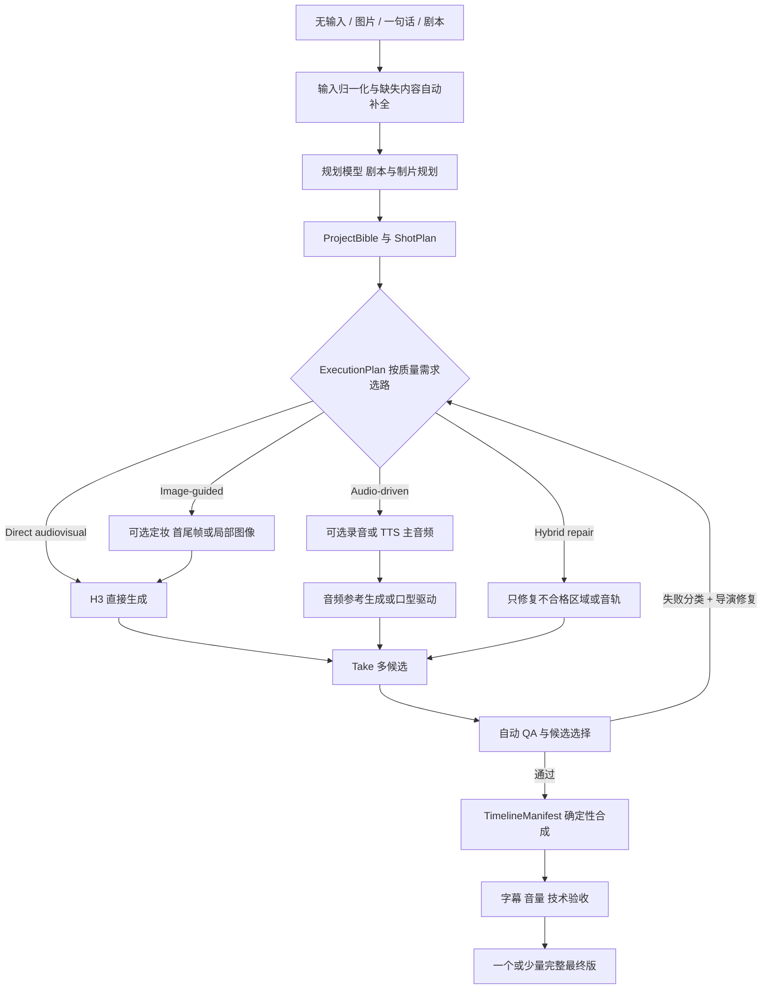

# 当前架构与技术设计

这是当前已确认的产品架构与技术设计。核心结构按 Mock 闭环需要正常实现和迁移；H3 内部路线、GPT Image 覆盖范围、声音路线、镜头分组及后处理仍由固定实验决定。即梦、可灵、LTX Studio 和纳逗 Pro 只贡献产品机制，不进入运行时。

## 1. 产品原则

1. 无输入、若干图片、一句话和已有剧本使用同一条生产主线，只在输入归一化与剧本阶段采用不同处理契约；
2. 成片质量、连贯性和可控性优先于“是否使用某个模型”和调用成本；
3. 角色、场景、道具、服装、风格和可选声线都是版本化资产；
4. `AUTO_DRAFT` 不要求用户确认剧本、资产、分镜和单镜候选；`GUIDED` 才将它们作为可选停靠点，两种模式都不让用户面对底层 Provider 任务；
5. Direct、图像增强与音频路线可以从首轮并行比较；某个环节只要质量更好，或质量不劣且控制更强，就可以成为默认；
6. 单镜可重做，修改上游只失效真正依赖它的下游；
7. 模型能力由 Capability 明确表达，项目状态、任务状态、计费状态和 QA 状态彼此分开；
8. 开源项目或 ComfyUI 若被采用，只承担清楚边界，不形成第二套项目真相源。
9. 首版是单用户、受信环境；内容确认与访问权限是两件事，不为生产状态机引入账号、角色或租户模型。
10. 首版只交付真人都市短剧；真人与漫剧共用项目、剧本、资产、分镜、任务、候选和时间线主线，差异由 `StyleProfile`、Prompt Compiler、ExecutionPlan、Provider Capability 与 QA Profile 表达，不复制第二套工作流。
11. 首版验收单集完整闭环；ProjectBible 中的角色、场景、服装、道具和可选声线继续版本化、可跨项目或剧集复用，但暂不把多集连续性纳入首版验收矩阵。
12. 首版内容语言锁定普通话中文；通用 schema 保留 `language`、`locale` 与原始文本，但方言和多语言必须在各自声音、口型、STT、字幕和质量基准建立后才对外支持。
13. 默认 `AUTO_DRAFT` 从无输入、若干图片、一句话或已有剧本运行到完整可观看草稿，自动完成创作补全、选择 Take、QA、导演修复、定向重试和时间线组装；默认只向用户展示一个或少量完整最终版。`GUIDED` 才在剧本、定妆、分镜和候选处暂停并显示可忽略建议。只有从草稿标记为正式通过需要人工动作，草稿生成与导出不受阻。
14. 首版包含面向短剧生产的实用时间线，而非仅输出成片，也不承诺完整专业 NLE：支持 Take/Retake/Extend/Gap Fill、镜头拆分裁切排序、视频/音频/字幕轨、音量、基础转场和确定性导出；高级调色、蒙版、复杂特效、关键帧曲线和多机位留到后续版本。
15. 领域模型与模块采用复用优先：可直接参考或移植 Jellyfish 的项目/准备度/任务语义、Toonflow 的剧本与分镜规则、ViMax 的机位/首尾帧结构、Wind Comic 的成片/QA 等成熟实现；不为原创而重写，但必须适配统一 schema、单一项目真相源和已锁定产品边界。
16. 首版 UI 延续 LTX Desktop 的项目工作台、Gen Space 与时间线，增加剧本/ProjectBible、资产、分镜/连续性和 QA 视图；自动流程用阶段进度与可操作问题呈现，不要求用户维护节点图。节点画布只在后续高级调试或自定义执行需求被证明后研究。

## 2. 候选流程

图像和外部音频节点不是形式上的必经步骤，但也不以最少步骤为目标。GPT Image 2 若达到质量非劣并提高一致性，可覆盖全部适合的镜头；一个项目也可以让对白近景走音频驱动、动作镜头走直接生成、身份高风险镜头走关键帧辅助。

### `AUTO_DRAFT` 的无人值守交付契约

- 无输入：Story Planner 先内部生成和排序创意，选择一个后继续，不要求用户先填一句话；
- 仅图片：先识别可复用的人物、场景、道具和风格线索，再自动补全剧情与缺失资产；
- 一句话：扩写为可执行剧本和制片计划；
- 已有剧本：保留原文，单独生成口播、字幕与执行文本，不静默改写锁定事实；
- 运行中的普通 QA 失败由系统自动分类，Director Agent 自动比较重生成、换关键帧、拆镜和换覆盖机位，更新依赖后继续运行；
- 用户默认只看完整最终版，不审核关键帧、单镜 Take 或修复建议。`GUIDED` 保留这些停靠点，且所有建议都可忽略；
- 只在 Provider 凭证缺失、任务无法恢复、用户显式设置的成本上限或必须由人决定的核心故事分歧时才暂停。

## 3. 规划模型的位置

当前可用的 GPT-5.6-sol 可承担以下有边界角色，但架构不把工件格式绑定到模型名：

- Story Planner：一句话扩写、节拍和剧本；
- Script Guardian：锁定剧本 diff 与对白保真；
- Production Designer：ProjectBible 与资产需求；
- Director：分镜、机位、表演、镜头覆盖和分组；
- Continuity Planner：上一镜终态、轴线、视线、道具与服装；
- Route Planner：根据历史实验和镜头风险提出执行路线；
- Prompt Compiler：编译入选 Provider 的格式和参考绑定；
- Reviewer：读取候选帧、转写和技术检查，提出单变量重试。

这些角色输出相互引用的 schema，不需要为每个角色建立独立运行时。Route Planner 应依据已记录的能力和实验结果建议路线；不为展示技术栈增加步骤，但允许为质量非劣、稳定性和控制增益主动加入 GPT Image 2 等能力。

## 4. 核心数据模型

### `Project`

保存项目目标、输入模式、运行模式 `AUTO_DRAFT | GUIDED`、画幅、时长、语言、当前批准版本和质量档位；成本与用量单独记录，不作为项目质量档位的硬上限。首版不增加 `owner_id`、`organization_id` 或租户字段。

### `ScriptVersion`

- `source_mode`；
- `original_text`；
- `spoken_text`；
- `subtitle_text`；
- `structured_scenes`；
- `approval_status`；
- `parent_version_id` 与变更原因。

### `ProjectBibleVersion`

- `CharacterProfile`：外观、服装、表演，以及可选参考图/音频；
- `LocationProfile`：空间布局、光线、色彩和关键视角；
- `PropProfile`：外观、状态机和持有人；
- `StyleProfile`：真人/漫剧、摄影、色彩、质感和禁用项；
- `VoiceProfile`：可选声线描述、reference audio、录音或 TTS voice。

Profile 可以只有文字，也可以引用素材库导入、用户上传、模型生成或模型修整后的素材。系统不因字段存在就自动生成对应媒体。

### `Asset` 与 `AssetVersion`

`Asset` 表示角色、服装、场景、道具、图像、视频或音频等稳定身份；`AssetVersion` 保存实际文件和可复现来源：

- `origin_type = UPLOAD | LIBRARY_IMPORT | AI_GENERATED | AI_EDITED`；
- 本地文件、外部来源 URL/素材条目 ID，以及素材库要求的普通 License/署名信息；
- `parent_version_id`，用于表示润色、补视角、换装或风格统一的派生关系；
- 使用模型时保存 Provider、模型快照、提示和输入版本；
- `DRAFT/APPROVED/SUPERSEDED` 与 `CURRENT/STALE` 状态。

素材库可以先由用户在外部挑选后导入；内置搜索连接器以后逐库增加，不改变 Asset schema，也不成为固定实验的前置条件。

### `ShotPlan`

- 叙事目的和信息增量；
- 时长、景别、机位、轴线、运镜；
- 人物位置、朝向、眼线、动作起止；
- 道具进入/退出状态；
- 对白、画外音、环境音和音乐意图；
- 与前后镜的 cut/transition 关系；
- 可否与相邻镜合并生成，以及局部返工风险。

### `ExecutionPlan`

每个镜头或镜头组显式记录：

- `strategy = direct_audiovisual | image_guided | audio_driven | hybrid_repair`；
- 选择该路线要解决的具体问题；
- 被跳过的可选环节；
- 入选 Provider、模式与 capability snapshot；
- 输入工件版本、候选数和用量预估；
- 路线选择所依据的实验结果；
- 降级、重试和局部返工策略。

默认策略来自基准实验，而不是“步骤最少”。若 GPT Image 2 路线质量更好，或质量不劣但一致性、可控性和稳定率更高，`image_guided` 就可以成为适用镜头的默认策略。

### `RouteEvidence`

保存路线对照结论，键至少包含美术风格、镜头类型、图像/视频/音频模型快照和关键参数，值包含样本量、质量分、严重失败率、稳定率和结论。某个组合一旦证明 GPT Image 2 有增益或质量非劣，后续匹配镜头直接采用，无需每个项目重复做 A/B；只有模型版本、风格或参考方式发生实质变化时才复验。

### `ReferencePlan`

- 文本、首帧、尾帧、角色、场景、道具、视频和声音引用；
- 每个引用的 Provider role 与保留目标；
- 引用是否必需、可选或互斥；
- Provider capability 校验结果；
- 素材库、上传、生成或编辑素材的来源与版本。

`ReferencePlan` 是供应商中立意图，Adapter 再把它编译为 H3 或其他模型的具体字段。

### `GenerationTask` 与 `Take`

`GenerationTask` 记录 Provider 调用和状态；`Take` 是可观看、可评分、可选用的媒体候选。一个 Task 可以产生多个 Take。Take 的媒体可用性、QA 状态和是否入选分别保存，不压成一个枚举：生成成功只说明媒体可用，`qa_status` 为 `PENDING/PASSED/REJECTED`，`is_selected` 单独表示时间线是否采用。Provider 成功不等于 QA 通过，QA 通过也不等于自动入选。

### `TimelineManifest`

唯一的成片时钟，记录：

- 视频片段入点/出点；
- 原生音轨、外部对白、环境音、音乐与 gain；
- 字幕 cue；
- 转场；
- 输出 fps、分辨率、音频规格；
- 每项来自哪个 Take 或 ScriptVersion。

无论音频来自模型、录音还是 TTS，都作为显式时间线素材管理，不做不可审计的文件裸拼接。

PoC 的 H3 `GenerationTask` 固定请求 768P；原始 Take 不被交付缩放覆盖。`TimelineManifest` 的交付预设可输出 1080×1920，但该尺寸只表示最终封装与一次性合成结果，不冒充 H3 原生生成分辨率。

### `QAReport`

严重失败与排序分开：角色身份、动作、道具、台词、说话人、口型和坏帧是硬门槛；美感、节奏和表演用于候选排序。报告同时记录问题应在“重生成、换路线、局部修复或后期合成”哪一层解决。

真人和漫剧使用同一份报告结构，但检查器与阈值按 Style Profile 选择：真人重点检查身份漂移、皮肤/肢体真实性、微表情、物理运动和自然口型；漫剧重点检查线条/材质风格、角色比例、颜色、层次、有限动画与风格化口型。共享 schema 不等于强迫两种形态使用同一套视觉评分器。

## 5. 质量驱动的路线规则

### Direct audiovisual

作为基线对照。用文本和已有必要参考直接生成视听镜头，用来衡量图像或音频增强带来的真实增益；即使它已过最低质量线，也不自动淘汰质量更高或更稳定的增强路线。

### Image-guided

从首轮就可参与比较。图像可来自素材库、用户上传、GPT Image 2 新生成或 GPT 对已有资产的修整；只要下游视频质量更好，或质量不劣但角色、场景、构图和动作状态更稳定，就可覆盖全部适合的镜头。出现动态质量下降、风格损失或表演受限时再按镜头关闭。

### Audio-driven

主音频可来自真人录音、Azure TTS 或其他入选工具，并与模型原生音频直接比较。若最终台词、声线、节奏和口型更好，或质量不劣而控制显著更强，即可采用；视频模型不能可靠遵循该音频时进入后期口型分支。

### Hybrid repair

当主体镜头已经合格、只有局部画面或音轨可进一步提升时启用。通过前后对照确认总体质量提高或至少不劣，且没有引入新的身份、时序或压缩问题；成本高低不是首要门槛。

## 6. 当前 H3 Adapter 的专属设计

当前视频生成只接 H3，以下规则只存在于 H3 Adapter：

- `frame` 路线用于精确首尾构图和动作接续；
- `reference` 路线用于角色、场景、动作或声音参考；
- Adapter 在提交前校验 frame roles 与 reference roles 的互斥；
- 相邻镜头只有在同一连续时空、总时长不超过模型窗口且整组返工可接受时才合并；
- Context-IR 只是可选提示编译步骤，不能被记为视频任务成功；
- 原生音频、reference audio 和外部主音频分别实验，不根据“支持字段”推断效果。

这些是 H3 Adapter 的约束，不应污染通用 `ShotPlan` 或迫使其他视频引擎模拟 H3。

## 7. 音频策略

建议以能力状态而非供应商名表达：

- `MODEL_NATIVE`：视频模型共同生成对白、表演、口型和环境音；
- `MODEL_NATIVE_WITH_VOICE_REF`：模型仍生成最终声音，但加入跨镜声线参考；
- `EXTERNAL_AUDIO_DRIVEN`：录音或 TTS 是批准主音频，视频必须遵循它；
- `POST_LIPSYNC`：画面合格后只修对白镜头口型；
- `VOICEOVER_EDIT`：叙事合理时使用画外音、反应镜头或道具特写。

当前先验证 H3 的 `MODEL_NATIVE`；只有跨镜声线漂移时启用 `MODEL_NATIVE_WITH_VOICE_REF`，台词或声音控制仍不合格时再比较真人录音/TTS 的 `EXTERNAL_AUDIO_DRIVEN`。`POST_LIPSYNC` 不预接，前三层仍无法同时满足台词、声音和口型时才评估。STT 主要用于筛查和字幕计时；人耳、锁定文本和画面仍共同决定是否通过。字幕计时优先采用已验证可靠的 Provider 对齐数据，其次是 TTS word-boundary 或 STT 对齐，最后允许人工微调并回写时间线。

## 8. 任务状态

已锁定的最小任务状态：

`QUEUED → SUBMITTING → ACKNOWLEDGED → RUNNING → SUCCEEDED | FAILED | CANCELLED`

额外异常：

- `SUBMIT_UNKNOWN`：提交结果不明，先对账；
- `OUTPUT_MISSING`：Provider 成功但文件未下载、已过期或本地结果缺失。

每次任务持久化 Provider task ID、请求指纹、模型与 Capability 快照、输入版本、尝试次数和恢复检查点。进程重启后从持久化状态继续查询或下载；处于 `SUBMIT_UNKNOWN` 时必须先按 Provider task ID 或请求指纹对账，不能盲目重新提交。任务成功、Take 可用、QA 通过和时间线入选必须是不同事实。

## 9. 失效传播

所有可批准产物采用 `DRAFT/APPROVED/SUPERSEDED` 版本状态，依赖关系另用 `CURRENT/STALE` 表示。创建新版本或修改上游时不覆盖、不删除旧版本，只把真正依赖它的下游标为 `STALE`；旧的已批准 TimelineManifest 与导出仍引用精确版本并可复现。

- 改台词：失效相关原生视频或外部音频、字幕和 TimelineManifest；
- 改角色资产：只失效引用该版本的关键帧和镜头；
- 改镜头时长：失效对应生成任务、字幕时段和后续时间线位置；
- 只换字幕样式：仅重渲字幕/成片；
- 只换 BGM：仅重混时间线；
- 从 Direct 切到 Image-guided：新增必要图像依赖，不回填无关镜头。

重新生成只遍历受影响分支，用户仍可查看和恢复旧 Take。普通版本依赖图足够，首版不引入事件溯源、加密承诺、篡改链等与生产闭环无关的机制。

## 10. 系统边界

首版部署模式固定为 `SINGLE_USER_TRUSTED_DESKTOP`：桌面壳启动本机 API/Worker，数据库与项目媒体保存在本机；GPT Image、H3 等外部 Provider 仍可通过云端 API 调用，不要求生成模型本地运行。产品 API 不要求登录或会话，不建立 `User`、`Organization`、`Membership`、`Role`、`Permission`、`Tenant` 等领域实体，也不在查询中增加资源归属过滤。剧本、资产、分镜和候选的 `approval_status` 只表示生产状态。Provider API Key 作为外部服务凭证由运行配置管理，与产品身份无关。

- Product API：项目、版本、资产、分镜、执行计划、候选和审批；
- Planner：当前可用 GPT-5.6-sol，输出稳定 schema；
- Provider Adapters：只接入实验证明需要的图像、视频、音频或口型能力；
- Task Worker：由 Electron 管理的独立本地 Python 进程，从 SQLite 任务表领取提交、轮询、回调、下载和恢复任务；本地 GPU 默认单任务，云端并发按 Provider capability 配置；
- Media Processor：FFmpeg/ffprobe、抽帧、转码、混音和字幕；
- QA：规则、可选 STT、模型视觉审阅和人工评分；
- Route Evidence Registry：保存已验证的默认路线和适用条件；
- Storage：SQLite WAL 保存项目、版本、任务、Take、QA 与时间线元数据；本地项目目录保存原始素材、生成结果、缓存、渲染与导出，数据库记录路径、版本和校验值；
- 条件式局部修复 Adapter：只有实验确认具体工作流能提升质量时才接 ComfyUI，且不拥有项目状态。

UI 不额外建立一套“workflow 项目”。项目首页、剧本/ProjectBible、资产、分镜/连续性、Gen Space/Take/QA 和时间线读取同一 Product API；自动运行状态只是这些领域对象和 GenerationTask 的聚合视图。

闭源平台不在 Adapter 列表中。我们只复用其“资产化、可编辑分镜、时间线、Retake、音画协同”等产品思想。

LTX Desktop 引入一个实现分叉，但不改变上述领域边界：

- **已选 Desktop-first**：保留 LTX Desktop 的 Electron/React 编辑壳、媒体文件、Take/Retake/Gap Fill 和 FFmpeg 框架；FastAPI/SQLite 承担唯一项目真相源与持久化 Worker；当前视频只接 H3，GPT Image 与音频工具按实验启用；
- **未来 Server/browser**：若真实需求出现，再把同一 Product API、Task Worker 与媒体存储迁到受信服务器；首版不维护这条运行形态；
- 不同时运行一套 LTX `localStorage` 工程和一套 Jellyfish 项目数据库。无论选哪种壳，`ScriptVersion`、`ProjectBibleVersion`、`ShotPlan`、`GenerationTask`、`Take` 和 `TimelineManifest` 都只有一个权威版本。

P008 已确认短剧生产时间线，A004 已确认本地桌面优先，因此实现倾向已转向 LTX Desktop 壳。当前只复用其 Apache 应用代码，内置 LTX-2.3 及其他 LTX 权重不进入产品或本轮质量实验；视频生成固定接 H3。

已锁定的改造原则是：保留并扩展 Electron/React/FastAPI 壳、Gen Space、多 Take、Retake/Extend/Gap Fill、Source/Program Monitor、时间线、媒体导入、SRT/FCP、FFmpeg 框架、OpenAPI 类型桥与性能测试；重构或复用整合项目持久化、可恢复任务、Provider contract、短剧领域/QA/TimelineManifest，并补齐预览与导出一致性。可直接移植其他已审查项目的成熟设计或代码，但必须进入统一 schema 和单一项目真相源。当前移除或禁用 LTX、fal、Gemini 视频路径，只实现 H3 视频 Adapter；核心 contract 仍不允许 H3 专属字段反向渗透到通用领域。

## 11. 实施阶段

### Phase 0：上游基线

导入 LTX Desktop，跑通原始构建、测试与桌面打包，记录上游已有问题。

### Phase 1–3：统一核心与 Mock 闭环

建立 SQLite/API 领域核心与固定 fixture，实现持久化 Worker、可注入失败的 Mock Provider、恢复和失效传播；再把 Gen Space、Take/Retake/Extend/Gap Fill、时间线和导出接到统一核心，完整通过 Mock 切片。只有出现已经定义的结构性失败才回退 Jellyfish，不并行维护两个原型。

### Phase 4：H3 视觉与镜头分组

只接 MiniMax-H3，固定 768P，完成能力校验和任务恢复，执行 Direct、Frame、Reference、Context-IR 与镜头分组实验。

### Phase 5：资产与 GPT Image

实现上传、素材导入、GPT Image 生成与编辑，并执行下游 H3 动态质量实验。

### Phase 6：声音、字幕与口型

先验证 H3 原生声音，再依据失败证据接参考音频、TTS/STT 或外部口型，完成字幕和音画验收。

### Phase 7：自动成片与完整验收

接入 GPT-5.6-sol 的规划、审片、路线选择和局部重试，完成三次独立 `AUTO_DRAFT` 与人工盲评。

### Phase 8：证据驱动增强

仅依据前述实验结果决定 ComfyUI 局部修复和内置素材库等增强，不预先搭建通用节点系统。

## 12. 当前不做

- 不调用或依赖即梦、可灵、LTX Studio、纳逗 Pro；
- 不做注册、登录、账号中心、RBAC、多租户、团队成员和分享权限；
- 不为了灵活性同时接十几个 Provider；
- 不做独立的多 Agent 微服务群；
- 不把 ComfyUI 图作为项目数据库；
- 不先做复杂协作、市场、分发和平台运营；
- 不接入抖音账号、自动发布或运营管理；首版边界止于成片、字幕、项目清单、素材和 QA 工件导出；
- 不默认增加加密证据链、对抗评测或与短剧质量无关的安全框架；
- 不为展示技术栈接入对质量和控制均无增益的能力；GPT Image 2 等有明确正向预期的能力可从首轮基准开始集成。
