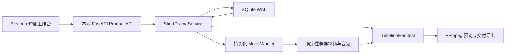

# Phase 1：供应商中立 Mock 垂直切片

## 结果

Phase 1 已在 LTX Desktop 上游工程历史上完成一个可运行的 AI 短剧桌面工作台。固定真人都市悬疑短剧《别相信我》可以从项目输入一路生成到 8 镜、50 秒的可播放 Mock 成片，并导出带字幕/无字幕 MP4、SRT、ASS、`TimelineManifest` 和技术 QA。此阶段不调用 H3、GPT Image、TTS、STT 或任何闭源平台；它证明的是产品核心、任务恢复和媒体装配正确，不代表真人生成质量已经通过。

工程阶段称为 Phase 1；它对应 [固定输入实验方案](05-experiment-plan.md) 中的“Phase 0：Mock 工程全链路”。前者描述实施顺序，后者描述实验层级，两者指向同一个 Mock 闭环。

## 实现结构



- Electron 只启动轻量 `short_drama_server.py`，不再进入 LTX 模型下载、权重加载、LoRA、fal 或 Gemini 流程；
- Renderer 通过生成自 FastAPI OpenAPI 的类型调用 Product API，项目真相不保存在 `localStorage`；
- `ShortDramaService` 统一项目、剧本、资产、分镜、任务、Take、QA、时间线和导出；
- SQLite 使用 WAL。`projects` 保存完整强类型领域文档，`generation_tasks`、`provider_submissions`、`takes` 和 `exports` 保存需要独立查询与恢复的生命周期记录；
- Mock Worker 当前作为本地 Python 服务内的单工作器循环运行，任务与恢复状态全部持久化。以后拆成独立进程或接云端异步 Provider 不需要改变领域和 API 合约；
- 本地项目目录保存 Take、音频、字幕、Manifest、QA 和成片文件。

## 已走通的产品契约

### 输入与规划

- `IDEA_EXPANSION` 与 `SCRIPT_LOCKED` 共用同一条 ProjectBible → ShotPlan → ExecutionPlan → ReferencePlan 主线；
- 锁定剧本分别保存 `original_text`、`spoken_text` 与 `subtitle_text`；
- 固定 fixture 保存林夏、周衡、雨夜便利店、红色录音笔、五句锁定台词和 8 个镜头；
- Direct audiovisual、Image-guided、Audio-driven、Hybrid repair 四种执行策略都能被通用 schema 表达，但本阶段只由 Mock 执行。

### 任务、恢复与局部返工

- 正常状态：`QUEUED → SUBMITTING → ACKNOWLEDGED → RUNNING → SUCCEEDED`；
- 支持 `FAILED`、`CANCELLED`、`SUBMIT_UNKNOWN` 和 `OUTPUT_MISSING`；
- 中断在 `RUNNING` 的任务可在服务重启后继续；中断在 `SUBMITTING` 的任务先转为 `SUBMIT_UNKNOWN`，必须对账后才能决定重试；
- request fingerprint 与 provider submission 记录防止同一未知提交被重复 POST；这是普通工程对账，不是密码学锁定；
- 支持取消、保留历史的重试、未知提交对账、缺失输出恢复；
- 支持生成、Retake、Extend、Gap Fill，多次生成不会覆盖旧 Take；
- 切换 Take 只失效当前 Manifest；修改一条台词会建立新 `ScriptVersion`，只将引用该台词的镜头及 Take 标为 `STALE`。

### Take、时间线与导出

- 固定样片每镜生成 2 个候选，共 16 个 Take，并自动选择每镜第一个通过 QA 的候选；
- 每个 Mock Take 为 432×768、30fps、H.264/AAC 的确定性竖屏媒体，含程序化便利店画面、人物/道具提示和音频占位；
- `TimelineManifest` 精确引用入选 Take，保存独立视频、音频和字幕轨；固定样片为 8 个视频片段、8 个音频片段、5 个字幕 cue、50 秒；
- 导出为 1080×1920、H.264 High、YUV420P、BT.709、CRF 18、AAC 48kHz/192kbps；
- 同时输出 `final-clean.mp4`、`final-subtitled.mp4`、SRT、ASS、Manifest JSON 和技术 QA JSON；
- 预览直接播放当前 Manifest 对应的最新导出。桌面交互验证中切换镜头 1 的候选后，旧 Manifest 立即失效；重建并再导出后，预览显示新的 `SHOT 01 TAKE 2`，证明预览和交付引用同一选择。

## 桌面工作台

当前桌面应用包含：

- SQLite 项目列表、固定样片初始化、创意/锁定剧本新建；
- 概览、剧本、资产、分镜、候选、时间线和 QA 视图；
- 一键“生成完整 Mock 草稿”；
- 每镜单独生成、Retake、Extend、Gap Fill；
- Take 视频预览、QA 分数、切换入选；
- 任务历史与取消、继续、重试、对账、恢复输出；
- 台词版本修改和局部失效反馈；
- Manifest 重建、带/无字幕导出及最终成片预览。

应用不含账号、登录、权限、团队或发布功能。Bearer token 只用于 Electron 与本机随机端口 Python 服务之间的进程会话，不是产品用户体系。

## 验证结果

| 检查 | 结果 |
| --- | --- |
| TypeScript + Pyright | 通过，0 errors / 0 warnings |
| 后端完整回归 | 571/571 通过，32.15 秒 |
| 新增短剧集成测试 | 两种输入、SQLite WAL、任务异常与恢复、进程重启、8 镜闭环、局部失效、Retake/Extend/Gap Fill 均通过 |
| 媒体技术 QA | 尺寸、帧率、音轨、时长、Manifest 时钟、SRT/ASS 和带/无字幕导出均通过 |
| 开发模式桌面 E2E | 实际点击完成 16 Take、50 秒时间线、换 Take、重建 Manifest、再导出与播放 |
| 前端/Electron 构建 | Renderer、main、preload 均通过；Renderer 主包约 283 kB |
| macOS unpacked app | 成功生成 1.2 GB arm64 `Short Drama Studio.app`，深度签名校验通过，包内轻量服务与短剧模块齐全 |

公司开发机运行 pnpm 时使用内部 Feed：

```bash
pnpm_project() {
  npm_config_registry=https://packagefeedproxy.microsoft.io/npm/ \
    npm exec --yes --package=pnpm@10.30.3 -- pnpm "$@"
}

pnpm_project typecheck
pnpm_project backend:test
pnpm_project openapi:generate
CSC_IDENTITY_AUTO_DISCOVERY=false pnpm_project build:fast
```

## 有意保留的边界

- Mock 视频、音频和 QA 是确定性工程占位，不用于判断真人脸、表演、口型、声线或跨镜视觉质量；
- 当前工作器是本地 Python 服务内的持久化单工作器，不是 Redis/Celery 或额外守护进程；H3 接入时可在不改任务表与状态机的前提下增加异步轮询；
- UI 已覆盖闭环操作，但复杂 NLE 编辑、最终视觉精修、素材库连接器和 Provider 设置不在本阶段；
- 旧 LTX Desktop 模型运行代码仍保留在上游目录以维持工程历史与测试，但新应用入口和产品主线不导入或调用它；
- 本阶段未产生任何付费生成调用。

## 下一阶段

下一阶段只接 MiniMax-H3 作为视频 Provider，固定 768P。先实现 capability 校验、持久化提交/轮询/恢复、离线响应合约与最小真实冒烟，再按 [E003/E005](05-experiment-plan.md) 比较 Direct、Frame、Reference 和镜头分组。H3 的真实人声、台词和口型只记录能力证据；若原生路线不足，再按既定顺序考虑 reference audio、真人录音或可替换 TTS/STT。
