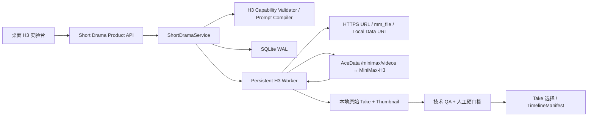

# Phase 2：MiniMax-H3 768P Provider 与真实证据门

## 当前状态

Phase 2 的工程闭环已经落地：MiniMax-H3 是当前唯一真实视频 Provider，通过 AceData Cloud 网关调用；所有请求固定为 `768P`，Direct、首帧、首尾帧和 Reference 都由同一套项目、任务、Take、QA 与 `TimelineManifest` 核心承载。离线合约、状态恢复、媒体下载和桌面实验台已通过自动测试。

AceData API Token 已由用户在桌面应用内保存并通过只读连接验证。镜头 1 的 Direct 5 秒合同冒烟已经完成远端创建、轮询、下载、自动技术 QA 与人工听看。RouteEvidence 记录为 `REVIEWED`、硬门槛不通过、`3.0/5`；它只证明真实媒体闭环成立，不构成质量路线通过。此后 Phase 4 已继续积累 Frame/Reference 真实质量证据，当前结果统一记录在 [Phase 4 实验文档](13-phase4-h3-visual-route-experiment.md)，不再沿用本节最初的 `UNKNOWN` 快照。

## 当前接入契约快照

快照日期：2026-08-15。模型能力边界参考 MiniMax 官方资料，实际传输实现依据 AceData Cloud 的 MiniMax H3 接口：

- 创建：`POST https://api.acedata.cloud/minimax/videos`。AceData 文档声明 `async: true` 会立即返回 `task_id`，但 2026-08-15 的真实账号请求明确返回 `bad_request_error: async is not supported by the MiniMax H3 V2 contract`；Adapter 只在这个确定的 4xx 拒绝下移除 `async` 并安全回退一次，其他提交错误仍不自动重试；
- 查询、最近任务和取消/删除统一使用 `POST /minimax/tasks`，分别传 `action=retrieve/retrieve_batch/delete`；
- 鉴权为 `Authorization: Bearer <AceData API Token>`；
- 本地参考素材按 AceData 文档转换为 Base64 Data URI；也支持公网 HTTPS URL 和已有 `mm_file://{file_id}`；整个请求体不超过 64 MB，大文件优先使用公网 URL；
- 模型固定 `MiniMax-H3`，PoC 分辨率固定 `768P`；
- 时长为 4–15 秒整数；Direct 与 Reference 明确提交 `9:16`，Frame 由输入图决定画幅；
- 内容类型为 `text`、`image_url`、`video_url`、`audio_url`；
- Frame roles 与 Reference roles 互斥；Reference 最多 9 图、3 视频、3 音频，混合输入总数最多 12；
- 远端状态为 `queued/running/succeeded/failed/cancelled`；AceData 的 `delete` 对 queued 执行取消，对已完成任务删除记录，running 不允许操作；
- 任务查询窗口为最近 7 天，输出 URL 有时效，因此成功后立即下载到项目目录；
- 当前成本快照仍按 MiniMax 官方费率估算：768P 输出 `$0.08/秒`，Reference 视频输入 `$0.08/秒`，前 5 张输入图免费、之后 `$0.04/张`，Reference 音频输入免费。AceData 实际扣费以平台账单为准；价格只记录，不主导质量路线。

AceData 契约支持仅尾帧，但首版产品路线已经确认只开放首帧和首尾帧；仅尾帧属于后续高级能力，不在本轮为扩大功能面而加入。

2026-08-17 的同一账号已能接受 `async: true`。当前文档示例返回 `task_id` 与 `trace_id`；Adapter 的外部响应模型已补充 `trace_id` 并忽略其他新增字段。当天两条已成功计费并生成的请求曾因旧严格模型误记为 `SUBMIT_UNKNOWN`，系统从使用历史取回远端 ID 后只做对账和下载，没有重复提交。旧客户端未保存原始 2xx body，因此“额外 `trace_id` 触发解析失败”是基于当前文档形状与代码路径的高置信根因，而不是对旧响应的逐字节取证。随后 S07 的真实异步创建已直接取得并保存远端 task ID，验证新解析路径可用。

## 实现结构

通用领域只增加 `provider/model/route/resolution/provider_run_id` 等跨 Provider 事实。MiniMax 请求、响应、上传缓存、价格快照和远端用量保存在 Provider 专有记录中，不把 H3 字段扩散到 `ProjectDocument`。

SQLite schema 版本 2 增加：

- `provider_runs`：请求、远端最新状态、输出 URL、本地下载路径、用量和价格快照；
- `provider_uploads`：沿用现有表名，按本地文件路径、大小和修改时间缓存已编码的 AceData 媒体引用；它不是额外的外部上传系统；
- `route_evidence`：镜头、路线、Take、生成/对账/恢复状态、技术检查、人工硬门槛、评分与备注。失败、取消、提交未知和输出缺失不会伪装成“仍在等待”。

## 请求编译与能力校验

Phase 2 当时的 `build_h3_prompt` 针对固定样片《别相信我》，从 `ScriptVersion`、`ProjectBible`、`ShotPlan` 和连续性起止状态编译人物、服装、便利店空间、红色录音笔、动作方向与台词说话人。这些都是该样片的项目内容，不是 H3 通用默认。当前 Prompt Compiler 只翻译项目已声明的 Style、镜头职责和连续性事实，不自行追加真人、电影感、皮肤质感或固定运动。用户可以显式覆盖 prompt，但不静默修改锁定剧本。

联网前执行：

- 非空 prompt、最多 7000 字；
- 4–15 秒整数；
- Direct 不接受媒体；
- `FRAME_FIRST` 必须恰有一张首帧；
- `FRAME_FIRST_LAST` 必须恰有一张首帧和一张尾帧；
- Reference 至少一个 reference input；
- role 与图像/视频/音频类型匹配；
- Frame 与 Reference 不混用；
- 输入数量、扩展名、单文件大小和本地路径存在性检查。

公网 URL 的像素、编码、帧率和媒体时长无法在不下载素材的前提下可靠确认，因此仍由 MiniMax 做最终媒体校验；本地视频下载后再由 FFmpeg 做输出技术 QA。

## 持久化状态与恢复

正常路径：

`QUEUED → SUBMITTING → ACKNOWLEDGED → RUNNING → SUCCEEDED`

- `QUEUED` 阶段完成本地素材 Data URI 编码与最终请求编译；只有请求已持久化、下一步将实际 POST 时才进入 `SUBMITTING`；
- 创建成功后保存 MiniMax `task_id` 和 request fingerprint；
- `ACKNOWLEDGED/RUNNING` 可在应用重启后继续轮询；
- 成功后立即下载原始 MP4、生成缩略图、记录远端 usage 和价格快照；
- 下载成功只创建 `PENDING` Take，不自动通过、不自动入选。

异常路径：

- 创建请求被明确拒绝：`FAILED`；
- 创建发生网络中断、5xx 或成功响应缺少合法 `task_id`：`SUBMIT_UNKNOWN`；
- 应用在 `SUBMITTING` 中断：重启后转 `SUBMIT_UNKNOWN`；
- `SUBMIT_UNKNOWN` 绝不自动重新 POST：若远端任务存在，则从 AceData 最近任务中核对并显式绑定 `task_id`；若结合最近任务、用量或账单确认请求从未创建，则显式填写核对依据并转为 `FAILED`，之后才允许建立新重试；
- 远端成功但 URL 缺失、过期或下载/解析失败：`OUTPUT_MISSING`；恢复时重新查询最新 URL 并下载，不重新生成；
- 本地尚未提交的任务可以直接取消；远端 queued 先查询再调用取消；远端 running 按官方限制拒绝取消；
- `FAILED/CANCELLED` 重试会建立新任务、新 fingerprint 和新 `RouteEvidence`，保留全部历史。

Mock Worker 的“运行队列”只消费 `provider=mock`，不会误触发真实 H3 付费提交。H3 由实验台显式创建后每 10 秒轮询一次，即使远端连续返回同一状态也会继续轮询；也可手动推进，关闭应用不会丢失任务。

## 输出、费用与审片

H3 原始输出不转码覆盖，保存在项目 `takes/<shot>/h3-<task>.mp4`。自动检查：

- 竖屏且接近 9:16；
- 短边为 768P 级别；
- 实际时长与请求时长误差不超过 0.75 秒；
- 存在音轨；
- FFmpeg 可读取并能生成缩略图。

技术检查不判断真人身份、表演、台词、声线、口型、空间、道具或动作连续性。审片人必须播放真实 Take，填写硬门槛、0–5 分和具体备注。技术门槛未通过时，系统不允许人工标记为硬通过；人工通过后仍需显式“选入时间线”。正式路线稳定性仍按既定 5/10/20 样本和至少三人盲评执行。

## 首次真实合同冒烟：镜头 1 Direct

执行日期：2026-08-15。

- 第一次创建在获得远端 ID 前被 AceData 明确拒绝：`bad_request_error: async is not supported by the MiniMax H3 V2 contract`。该请求没有创建远端任务、没有记录费用，失败任务与 `RouteEvidence` 被保留；
- Adapter 增加精确兼容逻辑后建立新重试任务：仍先按文档发送 `async: true`，只在上述确定 4xx 下移除该字段回退一次；重试成功取得远端 ID，并经历 `queued → running → succeeded`；
- 请求为 `MiniMax-H3 / 768P / 9:16 / 5s / Direct`，内容是雨夜便利店外缓慢推近、最终形成两人对峙，无计划对白；
- 输出已下载为原始 MP4：`768×1344`、`5.17s`、`24fps`、H.264，带 AAC 32kHz 双声道音轨；自动技术门槛全部通过；
- 本地价格快照记录 `$0.40`，AceData 实际扣费仍以平台账单为准；
- 辅助抽帧观察：从店外推入店内的空间与镜头运动连贯，两名人物外观和构图在该 5 秒内较稳定，没有出现额外人物；明确缺陷是店招生成乱码，红色录音笔被误生成成带天线的红色对讲机；
- 音轨技术检查为存在、综合响度约 `-15.0 LUFS`、True Peak 约 `-0.4 dBFS`；用户已实际听审并确认声音没有明显问题；
- 用户确认店招乱码、红色录音笔变成对讲机两项视觉失败。RouteEvidence 已保存为 `REVIEWED`、人工硬门槛不通过、`3.0/5`，Take 为 `REJECTED` 且未选入时间线；这条合同冒烟只确认 AceData/H3 的真实接口与媒体闭环可用，不能据此宣称 Direct 质量通过。

## 桌面实验台

新增“H3 实验”页：

- 保存、清除和验证 AceData API Token；响应永不返回 Token；`ACEDATACLOUD_API_KEY` 环境变量优先于本地配置，并兼容旧的 `MINIMAX_API_KEY`；
- 镜头 1/2/5/8 的 Direct、首帧、首尾帧与 Reference 四路线证据矩阵；
- Direct、首帧、首尾帧、Reference 路线选择；
- 本地文件、公网 URL 与已有 MiniMax `mm_file` ID 输入；本地文件提交时转换为 Data URI；Reference 可动态加入最多 9 图、3 视频、3 音频，并在混合总数 12 的上限内预检；
- 显式区分 `CONTRACT_SMOKE` 与 `QUALITY_PROBE`，临时素材的合同冒烟不会冒充质量结论；
- 未显式选择时默认为 `CONTRACT_SMOKE`；证据矩阵以 `Q/C` 区分质量与合同证据，并优先展示质量证据；
- 免费请求预览与真实 768P 提交；
- 自动轮询、手动推进、取消、保留历史重试、输出恢复；
- 已创建后继重试的失败任务仍保留历史，但不再作为总览阻断项或提供重复重试按钮；
- `SUBMIT_UNKNOWN` 最近任务读取、远端 ID 显式绑定，以及确认远端未创建后的显式失败恢复；
- Provider run、远端 ID、状态、错误和费用展示；
- 真实视频播放、技术门槛、人工审片和 Take 选择；`CONTRACT_SMOKE` Take 可审片记录但不能选入正式时间线。

平台仍不增加登录、权限、团队、多租户或发布模块。

## 离线验证

新增 AceData 响应形状 fixture：create、queued、running、succeeded、failed 和 list。测试覆盖：

- `/minimax/videos`、`/minimax/tasks`、Bearer header、`async: true` 和固定 `MiniMax-H3/768P/9:16` 请求体；
- 本地素材 Data URI 编码以及公网 URL、`mm_file` 引用；
- Direct/Frame/Reference 编译和非法组合联网前拒绝；
- Reference 混合多素材、9 图/3 视频/3 音频分项上限和 12 个总上限；
- 本地媒体引用缓存；
- queued/running/succeeded、远端取消和 running 不可取消；
- `SUBMIT_UNKNOWN` 不重复提交、远端任务显式绑定、确认未提交后再重试；
- `SUBMITTING` 重启恢复；
- `OUTPUT_MISSING` 重新查询和下载；
- 768P 级真实 FFmpeg 媒体摄取、费用计算、人工审片与 Take 入选；
- 配置 API 不泄露 Key；
- 合同冒烟与质量探针的时间线选择边界；
- Mock 队列与 H3 队列隔离；
- Phase 1 八镜 Mock 闭环回归。

最终离线验证结果：

- 后端整库当前 `614/614` 通过；本轮 H3 恢复与参考规划相关定向回归 `13/13` 通过；
- TypeScript `tsc --noEmit` 通过，Python Pyright 为 `0 errors / 0 warnings`；
- OpenAPI JSON 与 TypeScript 类型连续生成结果一致；
- 使用本仓库的实际候选素材完成 6 组无网络请求预编译：镜头 2 Direct、镜头 1/5/8 首帧、镜头 1/5 多图 Reference；全部为 `MiniMax-H3/768P`，Frame 使用自适应画幅，Direct/Reference 为 `9:16`；
- Vite renderer、Electron main/preload 和 unpacked macOS 应用构建通过；
- 最终 `.app` 通过 `codesign --verify --deep --strict`；398MB arm64 ZIP 及 blockmap 生成成功，ZIP 完整性检查通过；
- electron-builder 的 DMG 步骤两次在 macOS 临时卷卸载处报告 `disk4 资源忙`，发生在应用签名与 ZIP 已成功之后，属于本机打包环境问题，不影响当前可运行 `.app`、ZIP 或 H3 代码验收；
- AceData 免费连接验证与首个 768P Direct 合同冒烟均已完成，人工审片结论已持久化；最新 unpacked macOS 应用在最终代码上重新构建并运行通过。arm64 ZIP 已在审片完成后重新生成，签名校验和压缩完整性检查通过。

## 首批真实证据计划

| 镜头 | 风险覆盖 | 首批请求 | 当前证据 |
| --- | --- | --- | --- |
| 1 | 空间建立、雨夜、推镜 | Direct 5s；临时便利店首帧做合同冒烟；批准首帧后做 F1 质量探针 | `Direct CONTRACT_SMOKE / REVIEWED / HARD_FAIL / 3.0`；Frame/Reference `UNKNOWN` |
| 2 | 林夏正脸、8s 锁定中文台词、轻推 | Direct；角色/场景 Reference；批准首帧 F1 | `UNKNOWN / NOT_RUN` |
| 5 | 手部、红色录音笔、人物闭嘴、画外音 | Direct；临时录音设备图做合同冒烟；批准道具/角色 Reference 与首尾帧 F2 | `UNKNOWN / NOT_RUN` |
| 8 | 左手拿道具、转身、推门、动作接续 | Direct；临时便利店图做合同冒烟；上一镜批准尾帧或连续性首帧 F1；必要时 F2 | `UNKNOWN / NOT_RUN` |

Direct 不依赖外部视觉资产，可先做最小真实 API/媒体冒烟。仓库新增 [Phase 2 素材候选](../assets/phase2/README.md)，包含有来源记录的便利店、录音设备原图和 768×1366 裁切，只允许作为 Frame/Reference 合同冒烟。可识别的库存人物未纳入项目资产；Frame/Reference 的质量探针不能使用程序化 Mock 或不匹配库存图冒充批准资产，需要用户上传、合规素材库或 GPT Image 生成编辑后再运行。

Phase 2 只有在以下事实被记录后才关闭：凭证验证成功；至少一个 Direct 768P 任务完成创建、轮询、下载和人工审片；镜头 1/2/5/8 的计划路线获得实际 `RouteEvidence`，或明确记录某路线因缺少合格资产而保持 `UNKNOWN`，不能把“接口存在”写成质量通过。

当前关闭条件已满足：Direct 合同冒烟得到真实 `RouteEvidence`，其视觉硬门槛失败被如实保留；其余首批 Frame/Reference 与镜头 2/5/8 路线因没有批准的角色、场景和道具资产而继续保持 `UNKNOWN`，留给后续资产与质量实验阶段，不为关闭 Phase 2 追加低质量付费样本。
