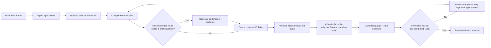

# Phase 7：从零真人 AUTO_DRAFT

> 历史阶段文档，仅记录当时实现，不是当前运行入口。现行架构见 [Phase 29](./40-agent-skill-tool-runtime-migration.md)，共享生产流程见 [`end_to_end.md`](../backend/short_drama/skills/workflows/end_to_end.md)。

## 目标

Phase 7 把现有的输入规划、资产工作台、H3 Route Planner、持久化 Worker、视频观察、Director Agent、TimelineManifest 和导出串成一条可恢复的真人草稿流水线。用户可以只给一句话、几张图、完整剧本或不提供内容；启动后不需要逐镜确认，系统最多把若干完整成片交给用户最终选择。

这里的“自动”不等于隐藏不确定性。Agent 会自动采用推荐路线，但路线、关键帧、拆镜、换机位和 QA 结论都可被用户覆盖。系统只在当前选择缺少可执行输入、Provider 提交结果未知或重试次数耗尽时停在 `NEEDS_ATTENTION`，不把导演建议本身变成审批门。

## 为什么采用可恢复推进，而不是一个长请求

GPT Image 通常同步返回，H3 则是异步任务。完整单集可能跨越数十分钟，不能让一个桌面 HTTP 请求一直等待。真人 `AUTO_DRAFT` 因此采用：

1. 启动项目和 `AutonomousRunRecord`；
2. 每次调用只推进有限个可持久化动作；
3. Provider 尚未完成时返回当前状态，由桌面自动轮询；
4. 应用关闭、网络中断或进程重启后，从 SQLite 中的任务、Take、RoutePlan 和 Run 状态继续；
5. `SUBMIT_UNKNOWN` 不重复提交，等待用户或 Provider 对账。

这不是第二套运行时。真实草稿复用现有 `image_tasks`、`generation_tasks`、`h3_provider_runs`、`RouteEvidence`、`VideoInspectionReport` 和 `TimelineManifest`。

## 状态流程

## 资产自动准备

从零规划先产生角色、场景和道具的文字资产。真人路线在缺少可用图片时为每个核心资产生成一张无文字的制片参考板：

- 角色：同一真人、同一发型与服装的正面全身、四分之三、侧面和脸部近景；
- 场景：同一空间的建立、反打和互动方向，保持入口、柜台、窗户等拓扑一致；
- 道具：产品外观、尺度和持用状态，避免品牌字样与乱码。

GPT-5.6-sol 使用图片工具比较生成结果与资产描述，输出通用问题、分数和是否建议采用。通过者写回普通 `AssetVersion` 审批；失败者在有限次数内带问题摘要重试。用户上传并批准的图片直接复用，不会为了调用 GPT Image 而重新生成。

高风险镜头若 Route Planner 推荐首帧路线，系统再用已批准的角色、场景和道具图片生成镜头起始关键帧。首尾帧不是默认成对生成：尾帧可能增加表演僵硬和错误插值，只有路线证据或 Director 明确推荐时才使用。

## 长镜头与视频工具

长镜头不靠一张首帧和尾帧判定。每个候选都调用现有 Agent 工具：

- `probe_video`：时长、分辨率、帧率和音轨；
- `sample_video`：开头、结尾、均匀时刻和高变化点；
- `inspect_video`：镜内时间序列接触表，以及上一镜末段到当前镜开端的边界接触表。

采样上限随镜头时长提高，但稀疏抽帧不能证明某动作没有发生。观察器只报告可见证据；候选裁判再根据技术门、通用问题严重度和当前镜头意图给出采用建议。音频存在性可以自动检查，逐字对白、说话人和声线在 STT/声纹工具接入前保持明确边界，不把图片观察冒充声音证据。

## 自动修复边界

候选不通过时，Director Agent 比较四种通用策略：提示重试、换关键帧、拆镜、换覆盖机位。每次采用都会更新镜头依赖并重新编译路线；旧 Take 保留历史但退出当前时间线。默认最多两轮，耗尽后返回完整项目和问题，不无限烧额度。

门、把手、推拉、进出方向等都属于当前镜头意图，不进入平台级专用数据模型。系统沉淀的是空间连续性、接触连续性、人物朝向、构图质量等失败分类和通用修复策略。

## 第一阶段验证

先用 Fake GPT Image、Fake H3 和 Fake GPT-5.6-sol 完整走通：

- 从零文字资产到已批准图片；
- 推荐关键帧的准备与 H3 输入绑定；
- H3 排队、提交、轮询、下载和重启恢复；
- 自动抽帧、镜间边界、候选采用与时间线；
- Provider 失败、`SUBMIT_UNKNOWN`、资产拒绝和 Director 有界返工；
- 关闭应用后继续推进，不重复创建已存在的任务。

只有离线状态机稳定，且出现既有证据无法回答的质量问题时，才新增真实 H3 样本。

## 实施结果

Phase 7 的离线工程门已经通过：

- Fake GPT Image、Fake MiniMax-H3、Fake GPT-5.6-sol 从空输入跑到完整导出，最终每个镜头均选中 H3 Take；
- H3 等待期间重建 `ShortDramaService`，运行从 SQLite 中的任务和路线继续，没有重复提交；
- 后续镜头均生成 `SHOT_BOUNDARY` 观察，推荐首帧镜头完成图片生成、语义检查和 H3 输入绑定；
- 首镜候选被通用构图 QA 拒绝后，Director 自动修改供应商中立的镜头意图、使旧 Take 失效、重新编译路线并用新 Take 收敛；
- 缺少 GPT Image 配置时持久化为 `NEEDS_ATTENTION`，不会悄悄回退为 Mock；图片候选被语义检查拒绝后可携带问题摘要重试一次；
- 桌面创建页支持 `REAL_H3` / `MOCK` 目标，真实运行自动轮询并显示当前步骤、等待原因和返工轮次；本地浏览器检查发现并修复了运行级阻断没有计入“需要处理”的显示问题；
- 后端全量 `641 passed`，Pyright 严格检查、TypeScript `tsc --noEmit` 和 Vite 生产构建通过。

本轮没有调用真实付费 Provider，因此以上只证明状态机、恢复、媒体工具调用和界面闭环，不证明新项目的真实画面质量。下一项真实证据仍应是从零项目的完整真人运行，而不是继续修复已通过样片中的单个门镜头。逐字对白、说话人和跨镜声线自动检查仍需 STT/音频工具阶段补齐。
