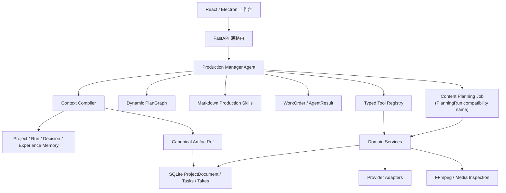

# Phase 29：Agent / Skill / Tool 运行时迁移与最终架构

## 结论

本阶段将项目的创作与制片控制面收敛为：

`Production Manager Agent + Markdown Production Skills + Typed Tool Registry + Dynamic AgentRuntime`

其中：

- **Tool** 是可独立调用的稳定能力，负责读取、修改、生成、检查或组装真实工件；
- **Skill** 是可审阅、可编辑的文件化知识：当前活动 Production Method Catalog 只包含 8 个来源可核验的 MiniMax-H3 官方仓库收录 Skill adapter，上游来源混合且只供维护；Format 只保留本地 schema/profile 映射，不自建领域创作理论；
- **Agent** 理解用户目标，根据当前工件动态制定或修订计划，组合 Tools，并在需要专业角色时委派子 Agent；制作类型由用户或请求选择 `ProductionProfile`，再由 Production Manager 确定对应的 Skill 映射，不由 Agent 自行更换格式 Skill；
- **Agent Harness** 只保留运行时所需的类型、依赖、持久化、恢复、有限推进和外部任务对账，不替 Agent 写死创作流程。

`ProjectDocument` 及其版本化剧本、资产、分镜、Take 和时间线工件仍是唯一项目内容真相源。AgentRuntime 只保存“当前要做什么、为什么、做到哪里、接下来做什么”，不复制第二份 ProjectDocument。桌面端的默认新建项目和新 `AUTO_DRAFT` 制作已切到 AgentRun：调用 `POST /api/short-drama/agent-projects`，先建立负责总调度的 AgentRun，再由共享 `project.create` Tool 创建权威项目。

首次剧本规划在职责上称为 **Content Planning Job**，当前代码、SQLite 记录和内部合同继续沿用兼容实现名 `PlanningRun`，本次不做全量类型重命名。它不是第二套项目控制面，只是 `planning.advance` Tool 背后的领域子任务和持久化内容规划游标：已配置语言模型的 Agent-owned 创作无论时长或 `GUIDED/AUTO_DRAFT` 模式，`project.create` 都先写入同一项目 ID 的 `INPUT` scaffold 与当前 AgentRun 拥有的 Content Planning Job，随后 Production Manager 每个 Action 只推进一个规划单元；FINALIZE 再把同一 ProjectDocument 更新为 `PLANNED` 或 `SCRIPT_READY`。不带 owner 的兼容创建只建立不补写创意的本地 scaffold，不允许语言 Provider 走同步整稿入口。AgentRun 决定是否、何时推进以及作业结束后的下一步；Content Planning Job 只拥有恢复内容规划所需的游标和中间工件，不拥有资产、生成、检查或时间线编排。旧 `AutonomousRun` 控制面已删除；Provider Task 继续使用自己的任务状态机完成提交、轮询、下载和结果对账。

内容作业先保存 `StorySourceContract`（用户承诺/禁区/开放选择）与 `StoryIntent`（观众体验、戏剧引擎、推进策略、调性/可信度、受保护元素和偏移风险）。`SCRIPT_LOCKED` 普通文本中的有声台词由 Agent 按完整语义结构化到 `StorySourceContract.locked_dialogue`；调用方也可以直接传入结构化条目。确定性代码只检查文本逐字存在、原始顺序和调用方结构未被改变，不用正则、冒号格式或关键词推断 speaker、旁白或内心音。`EndingContract` 另行保护本集兑现、线索闭合与续集策略；`ProjectBible.style` 只保存视觉、摄影、材质、色彩与声音表达。这些都是项目工件的不同责任，不相互代替。

当前不抽象通用 `ChildJob`。Content Planning Job 与 Provider Task 的状态、结果和恢复语义不同；在尚未出现多个具有相同生命周期的同级领域作业前，提取共同父模型只会模糊责任。未来只有在资产规划、批量生成等作业真实出现重复的创建、推进、取消和恢复合同时，再从已有实现中提取最小公共接口。

当前责任拓扑统一为 `Leader → Worker → Verifier`。Content Planning Job 使用可恢复游标持久化蓝图、逐场 Writer Worker 产出、Verifier 验收和必要的原 Worker 聚焦修订。Issue Ledger 仍保留问题证据和修复交接；`SCRIPT_CRITIC`、`STORY_REPAIR`、`REVIEW_ROUTER`、`FINAL_COLD_READ` 只作历史数据或状态兼容，不再对应活动链路中的独立 Agent/Skill。修订以受影响场次为单位持久化，不设固定轮数、问题数、严重度或总超时门槛。

## 1. 最终分层



### 1.1 交互层

用户操作的仍是项目、剧本、资产、分镜、候选 Take、检查结果和时间线。Agent 运行面向用户展示目标、当前计划、已完成动作、待处理问题和下一步，但不要求用户维护节点图。

### 1.2 Production Manager

Production Manager 是一次制片目标的根 Agent，负责：

1. 读取项目当前 `ProductionProfile` 和用户目标；
2. 编译最小必要 `ContextPack`；
3. 获取当前可用 Skill 和 Tool 描述；
4. 生成带依赖的动态 `PlanRevision`；
5. 执行已就绪 Tool Call，或通过 `WorkOrder` 委派专业角色；
6. 根据 Tool 结果、AgentResult 和用户新指令继续、跳过、并行或修订计划；
7. 在每个有意义的边界写入恢复检查点。

它不是固定的角色转移表。当用户只要修改第三场的一句台词时，Agent 可以直接计划“语义影响分析 → 局部 Patch → 受影响镜头复核”，无需重跑整部剧的默认 playbook。

对应实现位于 `backend/short_drama/production_manager.py`。`LanguageProductionPlanner` 使用已配置语言模型基于完整语义生成计划；用户或测试也可直接提交类型化 `AgentPlanProposal`。未配置语言模型时，`LocalProductionPlanner` 只确认已经存在的终态事实，例如导出已完成、或调用方明确不要求导出且时间线已就绪；GUIDED bootstrap 建立项目后也可以结束在用户可继续编辑的状态。任何尚需创作、选择 Provider 路线、挑选候选或安排下游 Tool 的非终态目标，都必须由语言 Planner 或调用方显式计划，Local fallback 不根据 stage、目标文字、关键词或 Tool Catalog 猜路线。

`PlanRevision.goal_complete` 是 Agent 对“整个 Run 目标是否已满足”的显式反馈，不是“当前计划的 Steps 是否跑完”的别名。当当前 PlanGraph 完成但 `goal_complete=false` 时，Production Manager 会用最新 ContextPack 自动追加新 PlanRevision；只有 `goal_complete=true` 才将 AgentRun 置为 `COMPLETED`。单次 advance 的有限执行只是 HTTP 返回与进度可观察性边界，不是剧本质量门禁；审校/修订本身不用固定轮数、问题数或总超时代替 Agent 的语义判断。

### 1.3 AgentRuntime

AgentRuntime 是格式中立的可恢复控制面：

- `AgentRun`：目标、根 Agent、活动 Skill 和运行状态；
- `PlanRevision`：Agent 当次制定的计划版本，包含独立的 `goal_complete` 判断；
- `PlanStep`：Tool Call、Delegation、Artifact Patch、User Input 或 Checkpoint；
- `PlanGraph`：只根据依赖与动作状态计算就绪步骤，不内置内容制作顺序；
- `ActionRecord`：记录真实执行的输入摘要、结果摘要、工件引用和错误；
- `AgentRunSnapshot`：运行、当前计划、动作、记忆和待回复委派的最小恢复集。

Plan 是 Agent 可修订的工作假设，不是业务真相源。每次重新规划追加新的 `PlanRevision`，不覆盖项目工件，也不要求预先枚举所有可能的创作分支。旧持久化 PlanRevision 没有 `goal_complete` 字段时按 `false` 恢复，不需要为此写一次性数据迁移。

进程重启时，已持久化的完成、等待和用户输入状态原样恢复；遗留的 `IN_PROGRESS` WorkOrder 转为 `NEEDS_ATTENTION`。其中正在执行且结果尚未持久化的 specialist turn 标记为 `INTERRUPTED` 并写入结果未知证据，交给专业 Agent 检查规范项目状态后决定对账、重试或换路线，不自动重放 Tool。`project.create` 和 `planning.advance` 会先根据已持久化的 ProjectDocument 与 Content Planning Job（当前 `PlanningRun`）游标对账：领域结果已经存在时补记 Action 完成并从最新游标继续，确实无法确认的 Tool Action 才进入等待和重新规划。

### 1.4 Agent API

新控制面通过薄 HTTP 路由对外暴露：

- `GET /api/short-drama/agent-runtime/capabilities`：查看已注册 Tools 与 Markdown Skills；
- `POST /api/short-drama/agent-projects`：默认新建/bootstrap 入口，先创建 AgentRun，再执行 `project.create`，返回项目 ID 与当前 AgentRun；
- `POST/GET /api/short-drama/projects/{project_id}/agent-runs`：创建或列出项目 AgentRun；对确定性本地制作可显式传入当前 Run 的 `execution_target` 与 `render_export`；
- `GET /api/short-drama/agent-runs/{run_id}`：读取当前 snapshot、就绪步骤和 ContextPack；
- `POST /api/short-drama/agent-runs/{run_id}/replan`：让 Agent 重新规划，或直接提交可检查的新计划；
- `POST /api/short-drama/agent-runs/{run_id}/advance`：有限执行 1–8 个已就绪动作；
- `POST /api/short-drama/agent-runs/{run_id}/user-input`：回复真正需要用户决定的步骤；
- `GET /api/short-drama/agent-work-orders/{work_order_id}`：读取委派、精简上下文和角色 system prompt；
- `POST /api/short-drama/agent-work-orders/{work_order_id}/execute`：使用已配置语言模型执行专业 Agent；
- `POST /api/short-drama/agent-work-orders/{work_order_id}/result`：提交外部、人工或测试 AgentResult。

`advance.max_actions` 是防止单次请求无界运行的普通调度边界，不是创作步骤门禁。Agent 可随时发起下一次 advance 或 replan。

### 1.5 代码责任边界

| 模块 | 拥有的责任 | 不应拥有的责任 |
| --- | --- | --- |
| `production_manager.py` | 根 Agent 协调、计划/重新规划、有限推进、委派与用户回复 | 项目业务数据的第二份实现 |
| `agent_runtime/` | 运行、计划、Action、记忆、ContextPack 和 WorkOrder 持久化 | 品类 Prompt、Provider 选型或固定制片顺序 |
| `skills/` | 人可审阅的共享制片流程、品类原则、角色 Prompt 和类型制作重点 | 副作用、任务状态、项目案例经验和 Tool Schema |
| `tools/` | 可发现合同、参数校验、薄适配与统一结果 | 复制 Domain Service 的业务逻辑 |
| `service.py` | 依赖组合、领域能力与内部可恢复作业 facade | 新的 Agent 计划模型、Skill 内容或 Tool Registry 实现 |
| Provider / Worker / Media | 真实外部调用、轮询、下载、恢复、检查与 FFmpeg | 品类创作策略 |

这样可以继续复用已经稳定的领域能力，同时把 Agent 控制面从大型 Service 中拆出；不需要为了形式上的“重构完成”一次性重写已通过回归的媒体制片核心。

### 1.6 默认路径与内部恢复边界

当前产品默认路径是：

```text
桌面端新建 GUIDED / AUTO_DRAFT
→ POST /agent-projects
→ 预分配 project_id 并创建 AgentRun
→ project.create Tool
  ├─ 未配置语言模型的兼容创建：只写入无创意补写的本地 scaffold
  └─ 已配置语言模型的 Agent-owned 创作：写入 INPUT scaffold + Content Planning Job（PlanningRun）
→ 若存在未完成 Content Planning Job，由 planning.advance 每个 Action 推进一个持久化规划单元
→ FINALIZE 在同一 project_id 上写入 PLANNED ProjectDocument
→ 编译对应 Markdown Skill
→ LanguageProductionPlanner 或 LocalProductionPlanner 产生下一个 PlanRevision
→ Tool / WorkOrder / USER_INPUT
→ 基于最新 ContextPack 继续重规划，直到 goal_complete=true
```

用户在已有项目上点击新的 Agent 制作任务时，直接调用 `POST /projects/{project_id}/agent-runs`。桌面端只为本次从默认入口启动的 `AUTO_DRAFT` Run 保持自动续跑，并统一调用 `POST /agent-runs/{run_id}/advance`：后端根据 WorkOrder 的 `next_owner`，优先推进一个可由 Worker 继续的独立 Team batch，否则推进一个 Leader Action/重规划单元。同一 Worker 持有责任时，一次无人值守调用可连续执行已持久化的“模型决策 → Tool → 原 Worker”回合；每个回合仍独立落盘和可观察，不跨越 `LEADER_REPLAN` 或 `USER_INPUT`，也不隐藏固定创作重试或 Worker 返回后的 Leader 重规划；批次失败直接可见并停止。真实 H3 仍根据项目阶段、MiniMax 任务状态、Take、Manifest 与 Export 的实际变化决定退避等待。续跑持续到完成、失败、明确 `USER_INPUT` 或进入确需人工处理状态；GUIDED 与 Agent 面板手动 Run 保持停靠式交互。

同一项目无人值守推进期间，桌面端保留项目切换、刷新、Agent Run/WorkOrder 只读查看，但不挂载会主动写入的 Script、Assets、Shots、H3、Takes、Timeline 与 QA 面板，并在父级写处理器再次校验运行状态；这样 H3 面板的内部轮询也不会与 Agent 同时修改 `ProjectDocument`。当前桌面窗口一次只启动一个无人值守续跑，新建项目或启动另一个 `AUTO_DRAFT` 会等当前 Run 完成或暂停。进程重启后只恢复最新项目未结束且显式标记为 `unattended` 的 AgentRun；`WORKER_DECISION/WORKER_TOOL` 会由统一 `advance` 续跑，只有 `USER_INPUT` 或真正无法自主推进的状态才暂停并在 Agent 控制面展示。桌面端不查询、展示或推进独立 PlanningRun；Agent-owned Content Planning Job（当前 `PlanningRun`）只由所属 AgentRun 通过 `planning.advance` 推进。

### 1.7 这几层与 workflow 的关系

最终结构是“一个通用 Agent 控制循环 + Agent 动态计划 + 少量可恢复子流程”，不是一条覆盖所有视频类型的固定 workflow，也不是多条完整 workflow 让 Agent 任意挑选：

| 层 | 本质 | 顺序由谁决定 |
| --- | --- | --- |
| AgentRuntime / Production Manager | 通用的 plan → act → observe → replan 控制循环 | Harness 只保证状态、依赖、有限推进和恢复 |
| PlanRevision / PlanGraph | 本次目标的动态执行计划 | 根 Agent 根据 ContextPack、Skill 和 Tools 生成并可随时替换 |
| Markdown Skill / playbook | 某类视频与某角色的制作方法、Prompt 和建议路径 | Agent 参考，不是可执行 DSL 或强制状态机 |
| Typed Tool | 原子、稳定、跨视频类型复用的业务能力 | Agent 选择调用；Tool 内不决定整部视频流程 |
| Content Planning Job（当前 `PlanningRun`）/ Provider Task | 分别处理内容规划游标或外部任务对账的领域子流程；当前不共享通用 `ChildJob` | AgentRun 决定何时推进，子流程内部只约束各自必要顺序 |

因此数字人口播、AI 短剧和动漫共享同一套项目、剧本、资产、生成、检查与时间线 Tools；区别主要来自加载的 Markdown Skill、角色 system prompt、当前目标与工件上下文。具体 Style 是项目工件，不由 Profile 写死。只有“上一规划单元必须先持久化”“Provider 任务必须先提交再轮询”这类正确性顺序留在状态机里。

## 2. 统一 Tool Registry

### 2.1 Tool 的责任

Tool 只表达一个可独立调用的能力。`ToolSpec` 包含稳定 ID、版本、类别、说明、效果类型、幂等提示、标签、强类型输入/输出与处理函数。`ToolResult` 统一返回状态、输出、`ArtifactRef`、提示和错误。

`READ | WRITE | EXTERNAL` 用于让 Agent 理解副作用、调度重试和向用户说明外部调用，它不是 RBAC、安全策略或 Tool 许可门。

### 2.2 目录与类别

```text
backend/short_drama/tools/
├── contracts.py
├── registry.py
├── defaults.py
├── project/
├── planning/
├── artifact/
├── script/
├── shot/
├── image/
├── video/
├── audio/
├── route/
├── timeline/
├── qa/
├── task/
├── change/
└── agent/
```

当前默认适配器将已有项目、可恢复规划、资产、剧本、分镜、图像、视频、音频、时间线、QA、任务、H3 路由和语义变更能力接入同一 Registry。长规划通过 `planning.advance` 每次推进一个持久化单元；语义变更的 Registry ID 为 `change.preview` 和 `change.apply`。`agent.delegate` 适配器只在宿主显式注入 Agent runtime delegator时注册；Production Manager 的 `DELEGATION` PlanStep 不会伪装成一个默认可用的领域 Tool。所有适配器只做参数校验与返回封装，不复制业务实现；Repository、锁、Provider Client 与私有 helper 继续留在 Domain Service 内部。

Tool ID 不包含内容类型。例如数字人、AI 短剧和动漫都使用同一个 `script.revise_lines`、`video.inspect_take` 和 `timeline.rebuild`，不创建按风格拆分的重复能力。

Production Manager 在计划接收和 Tool 真正调用前都校验当前项目：显式 `project_id`、只携带 `task_id`/`take_id` 的操作、ToolResult 与 AgentResult ArtifactRef 都必须回到父 Run 项目。`project.create` 只允许 bootstrap 预分配的 project_id，不允许已有项目 Run 借缺省 ID 旁路创建新项目。这是防止业务数据串项目的正确性约束，不是 Tool 权限系统。

### 2.3 能力与 Provider 的边界

全局 Registry 只注册已有真实实现的能力。数字人虚拟主播生成、专用口型驱动、动漫补帧或二维骨骼等未接入的 Provider 能力可以在 Skill 中被记为后续可选能力，但不注册伪 Tool，也不把 Prompt 文档写成已可执行的产品能力。

## 3. Markdown Production Skills

### 3.1 为什么改为文件

共享制片流程、品类原则、角色 Prompt 和制作重点需要被产品、编剧、导演和工程共同审阅，不适合长期埋在大型 Python 数据结构中。现在通用流程与各类型 Skill 分开管理：

```text
backend/short_drama/skills/
├── README.md
├── shared/roles/*.md
├── workflows/
│   └── end_to_end.md
├── methods/minimax_h3_<method>/      # 8 个官方仓库收录 Skill 的本地薄 adapter
│   └── SKILL.md
├── official/minimax_h3/<skill>/     # pinned commit 的 23 个 Markdown/TXT + 8 个 meta.yaml
├── translations/minimax_h3/<skill>/ # 官方英文附属 references 的忠实中译
├── formats/<format>/
│   ├── SKILL.md
│   └── playbooks/default.md
└── providers/<provider>/
    ├── SKILL.md
    └── references/*.md
```

`workflows/end_to_end.md` 保存现有工件与 Tool 的通用交接说明；`shared/roles` 保存 Leader、Worker 和 Verifier 使用的通用专业职责；格式 `SKILL.md` 只保存 profile/schema 适配。八个 MiniMax-H3 Method adapter 保留上游 `meta.yaml` 供内部版本维护，Agent-facing 标签保持中性，并按角色从 `official/minimax_h3` 和 `translations/minimax_h3` 加载上游原文/忠实中译的精确 section。Provider Skill 只负责把 provider-neutral 镜头事实翻译成特定模型语法，不承担剧情、镜头决策或请求提交。

Production Manager 先阅读八个官方仓库收录 Production Method adapter 的紧凑说明和支持角色，根据完整项目语义显式选择零个或多个。Loader/编译器只检查 ID 与角色支持，不使用关键词、正则、trigger words、题材枚举或必选数量替 Agent 做选择。角色 Prompt 按“共享中文职责 → Format schema/profile adapter → 上游 Method 的角色相关精确 section → 当前任务数据”组合。H3 GPT 编译入口另叠加 `providers/minimax_h3` Prompt Skill。

Production Manager 的计划修订可保留、替换或移除上游 Method IDs；专业 Worker/Verifier 只加载自己角色真正支持的上游 section。`CreatorInterests` 只能影响候选排序，不得作为运行时路由输入或权限边界。

### 3.2 Skill 负责与不负责的事

Skill 负责：

- 官方原文中的制作方法、工件合同和评审维度；
- 共享中文职责与 Leader/Worker/Verifier 分工；
- 本地 schema/profile 与官方方法的薄映射；
- 对共享 Tools 的使用重点与结果解释。

Skill 不负责：

- 不保存项目状态、Agent 进度或 Provider 任务；
- 不定义第二套 Tool Schema；
- 不直接发起外部调用；
- 不用题材枚举、关键词路由或固定数量选择 Skills；
- playbook 不是可执行 DSL、强制工作流、Tool allowlist 或内容审批门。

官方源文中的 Hub/Canvas 操作、强制确认、固定时长和固定重试次数会被原样保留用于溯源，但不成为当前 Harness 的执行契约。

`StorySourceContract`、`StoryIntent`、`EndingContract` 与 `ProjectBible.style` 均是项目工件，不是 Skill 默认值。四视图或轻量群像资产、场景俯视/全景/功能区 coverage、时间线分镜的镜头/动作/台词/情绪拆分，以及 H3 中将 `@` alias 解析为真实 AssetVersion 与 Provider 媒体标签，分别属于资产、导演和 Provider 层。共享 Story Architect 不加载这些下游规则，免得为某个模型的输入格式反向改写故事。

## 4. 多视频类型：共享能力，分离制作方法

当前本地 Format schema/profile adapter 包含：

| ProductionProfile | 本地适配责任 | 方法边界 |
| --- | --- | --- |
| `GENERAL_VIDEO` | 通用项目字段和工件映射 | 不自建通用创作方法 |
| `AI_SHORT_DRAMA` | 短剧、单集、资产、镜头、Take 和时间线映射 | 不自建爽剧、真人短剧或动态漫方法 |
| `DIGITAL_HUMAN` | 数字人项目字段和工件映射 | 不代表专用口型、主播或驱动方法已接入 |
| `ANIME` | 动漫项目字段和工件映射 | 不代表补帧、骨骼或动态漫方法已接入 |

四种 profile 使用同一项目、剧本、资产、分镜、生成任务、Take、QA 和时间线核心。差异由本地 schema/profile 和当前项目上下文表达；可核验的制作方法来自 3 个 MiniMax Design 项目 Workflow 与 8 个 MiniMax-H3 任务 Method，视听特化来自 `ProjectBible.style`。`drama-series` 已提供通用短剧/漫剧主骨架，不再把通用真人短剧、动态漫或爽剧整体记为能力缺口。

“存在数字人或动漫 profile adapter”只证明项目能保存和交接相应工件，不自动证明专用虚拟主播、口型、补帧、动画 Provider 或对应制作方法已经接入。

### 4.1 MiniMax Design 定点审查后的目标补充

2026-09-04 对 MiniMax Design 3.0.11 安装包、公开 Agent Team 文档、H3 Skills 和 ComfyUI 插件做了定点审查，详见 [MiniMax Design、Agent Team 与 H3 Skills 蓝图](43-minimax-design-agent-team-product-blueprint.md)。审查结论是运行时底座无需推倒重做；以下核心能力现已在单机后端落地。

1. **渐进式上下文**：Root Planner 和 Specialist 先读紧凑 Role/Method/Tool Catalog；Agent 显式选择 Method/Role/Tool ID 后，再加载该角色需要的官方原文/忠实中译精确 section、Tool Schema 与工件内容。Loader 只校验 ID 和角色支持，不用关键词或正则路由。
2. **`ContextManifest`**：Leader 为每个 WorkOrder 选择当前目标、精确 ArtifactRef 版本、相邻边界、必须继承的决定、经验标签和预期输出，代替对子 Agent 广播全项目记忆。
3. **派生 Shared Board**：`ProductionBoardView` 从 ProjectDocument、AgentRun、Actions、WorkOrders、Decisions、AgentResults 和 Issue Ledger 投影当前目标、任务、工件、阻塞和下一步，不建立第二份可写真相。子 Agent 的中间进度可以简单 append-only `WorkOrderProgressEntry` 保留，无需事件溯源。
4. **轻量本地 TeamExecutor**：已支持认领当前计划中 `next_owner=WORKER_DECISION/WORKER_TOOL` 的多个独立 WorkOrders，并行运行语言/只读工作，并通过 Production Manager 统一项目写通道串行化 WRITE/EXTERNAL Tool。无人值守入口会在同一 Worker 所有权内自动续跑已落盘的模型/Tool 回合，减少空的客户端轮询；`LEADER_REPLAN` 交回统一 advance 的 Leader 路径，`USER_INPUT` 明确暂停；Worker batch 失败可见且不自动重放。PlanRevision 使用显式 `carried_work_order_ids` 决定保留的后台工作，旧计划迟到结果只做历史交接。单用户桌面端不需要 Redis、Celery、租约或分布式 Agent 服务。
5. **统一 Method 工件**：版本化 `ProductionDocument` 为品牌事实、文案锁、教学结构、参考拆解、音乐结构等中间成果提供稳定 identity、不可变 snapshot、当前项目内可解析的精确来源 ArtifactRef 和通用 Artifact Tools/API，不把它们继续只留在 Prompt 或另建方法状态岛；具有领域不变量的音频文档只能由专用操作写入。
6. **音乐主轴后端闭环**：Master Audio、AudioStructureMap、TimedTextLock、音频 Tools/API、TimelineManifest 投影和导出换轨已经接通；`time_origin + duration` 定义成片长度，画面按需尾帧保持或裁切，导出统一规范声画长度；本机不能测量的节拍维度明确留空，不由 Agent 臆造。
7. **H3 五模式精确交接**：`DIRECT/FRAME_FIRST/FRAME_LAST/FRAME_FIRST_LAST/REFERENCE` 共享完整 freshness、current-approved 资产检查、可恢复 asset preparation 和独立 `state_revision`，旧计划或旧关键帧不能被误用于新提交。

MiniMax-H3 官方方法文件按 pinned commit 原样复制到本地；薄 adapter 只处理当前角色和工件映射。原文中属于 MiniMax Design 产品的 trigger words、Hub/Canvas、硬确认点、固定时长和固定返工次数不会被转为当前 Harness 的执行契约。ProjectDocument 仍是唯一内容真相。

## 5. ContextPack 与四层记忆

### 5.1 记忆边界

| 层 | 保存内容 | 不保存内容 |
| --- | --- | --- |
| `ProjectMemory` | 项目摘要、稳定约束、关键 `ArtifactRef` | 完整 ProjectDocument 副本 |
| `RunMemory` | 当前焦点、已完成动作、阻塞、开放问题、下一步 | 无界增长的对话全文 |
| `DecisionMemory` | 已确认决定、理由和相关工件 | 未确定猜测 |
| `ExperienceMemory` | 可复用教训、适用范围、证据、信心和标签 | 无条件的“永久规则” |

`ArtifactRef(project_id, artifact_type, artifact_id, version)` 是 AgentRuntime、ToolResult、WorkOrder 和 AgentResult 共享的工件引用。需要执行时再从权威项目数据解析。用户只修改一部分时，Agent 通过项目摘要、已确认决定和精确工件引用恢复全局，而不把整个项目和历史对话重新塞入每次调用。

DecisionMemory 按项目召回：当前 Run 的决策排在最前，其后是项目级决策，再其后是同项目其他 Run 中的近期决策。因此新的局部修改 Run 会继承项目已确认的设定，但当前 Run 中的最新选择保持优先。

ExperienceMemory 有明确的沉淀入口。完成的 WorkOrder 带有 findings 或 decisions 时，Production Manager 调用 `distill_experience_from_result()`，自动带入项目、活动 Skill、证据和工件引用。去重键是同一 project/skill scope 中规范化后的 `summary + applicability`；命中时复用原 ID，合并新证据、标签和工件引用，置信度只向更高等级更新。不将每个普通 Tool 输出无差别写入长期经验。

### 5.2 ContextPack 编译

Context Compiler 根据当前目标、活动 Skill ID、请求的 ArtifactRef、运行检查点和经验标签编译有界上下文：

```text
ContextPack
= objective
+ active Skill ids
+ project summary and constraints
+ confirmed decisions
+ relevant experiences
+ resolved artifact summaries
+ recent action digests
+ blockers, open questions and next actions
```

默认 Tools 返回的 project/script/bible/scene/shot/character/asset/reference pack/timeline/task/image task/Take/H3 route/provider run/export/检查报告等 ArtifactRef，都从现有 ProjectDocument 或 SQLite Repository 解析为精简 ArtifactSummary，不复制第二份数据。真正不存在或版本无法定位的引用显式返回在 `unresolved_artifact_refs`，不由 Agent 猜测对象。Production Manager 再根据活动 profile 和当前角色单独编译 Skill system prompt，与 ContextPack 一起交给 Agent。ContextPack 是每次 Agent 调用的投影，可以重新编译，不成为新真相源。

除了条目数量上限，Context Compiler 还对人类可读内容使用默认 `24_000` 字符预算。objective、项目摘要、Run focus、约束/问题/下一步、ArtifactSummary、DecisionMemory、ExperienceMemory 和 ActionDigest 都会按字段上限截断或在预算用尽时停止加入。这是便于预测 Prompt 大小的普通字符预算，不是模型 Token 计费器；稳定 ID 和 ArtifactRef 结构仍保留，不会为了截断文本而变成不可解析的引用。

## 6. Multi-Agent 通信合同

主 Agent 不把整段历史对话转发给子 Agent，而是发送结构化 `WorkOrder`：

- `objective` 与 `why_now`；
- 由 ArtifactRef 构成的精确 `scope`；
- 必须保留的约束与已确认决定；
- 开放问题；
- 期望输出 Schema；
- 可检查的验收条件。

`assigned_agent`/`recipient_role` 只记录接收任务的 Agent 身份，不承载专业职责。每个专业委派都由 Production Manager 根据完整目标语义显式选择 `production_skill_role`；WorkOrder Prompt 编译只读取这个字段，不根据接收者名字或用户文本做关键词路由。

子 Agent 返回结构化 `AgentResult`：

- 一段简洁结论；
- 新建/修改的 ArtifactRef；
- findings、decisions 与 assumptions；
- 未解问题与建议的下一步；
- 支持结论的 evidence refs。

这个合同保证信息足够自包含，又避免无关对话、大段 Prompt 和重复项目数据在 Agent 之间传递。专业 Agent 可以因内容类型获得不同的角色 Prompt，但仍通过同一 WorkOrder/AgentResult 合同与共享 Tools 工作。

### 6.1 Tool-capable specialist

内置 `LanguageSpecialistAgent` 不只能根据静态 Prompt 返回文本。它获得与 Production Manager 同一份 Tool Catalog，但一次外部 `execute` 不运行隐藏循环：若当前没有待执行请求，本次只让模型决定返回 AgentResult 还是请求一个 Tool；若 Agent 请求 Tool，系统先把 Tool 名称、参数和理由作为 `REQUESTED` turn 写入 `WorkOrder.specialist_turns` 并返回。下一次 `execute` 只把该 turn 标为 `IN_PROGRESS`、执行一个 Tool、持久化结果为 `COMPLETED` 后返回；再下一次才让 Agent 读取累积历史并继续判断。

这是一条单步持久化和可观察性边界，不是 Tool 次数上限。专业 Agent 可以在后续调用中基于新证据继续请求 Tool，直到它或 Production Manager 认为目标已完成、需要改计划或确实需要用户输入。

若进程在 Tool 执行中重启，恢复逻辑将对应 turn 标为 `INTERRUPTED`，把结果未知写入同一条 turn，并将 WorkOrder 置为 `NEEDS_ATTENTION`。下一次只把中断记录作为历史交回 Agent，由它检查规范项目状态并语义决定对账、重试或换路线；Harness 不自动重放可能已经产生副作用的 Tool。

专业 Agent 仍需要已配置的语言模型。`LocalProductionPlanner` 不为根 Agent 编写非终态路线，也不伪造一个“本地专业导演”；未配置语言模型且调用方没有提交显式计划时，运行保留当前工件并进入可解释的等待/配置状态。

专业 Agent 的 Tool 调用使用同一个项目范围 invoker，不绕过根 Agent 的 ID 归属和 ArtifactRef 结果检查。

### 6.2 AgentResult 的比例适当校验

AgentResult 提交时只做普通的结构与完成性检查：

- `PARTIAL` 和 `FAILED` 允许保留未完整输出，便于上层重规划；
- `COMPLETED` 不能同时携带 `unresolved_questions`；
- WorkOrder 提供 `acceptance_criteria` 时，完成结果至少要有 finding、decision、新建/更新工件、evidence ref 或建议下一步中的一种结构化依据；
- `expected_output_schema` 对完成结果校验常用 JSON Schema 子集，包括基本类型、object required/properties、array items/长度、string 长度、number 范围和 enum。

这些检查不尝试用机械规则判断导演方案“艺术质量是否足够好”，也不引入审批门。输出结构或完成状态自相矛盾时，Production Manager 把合同错误转成可见的运行冲突，而不将错误结果写入已完成 WorkOrder。

## 7. 用户局部修改：语义 plan / apply

语义修改拆为两个可组合阶段：

### 7.1 `plan-change`

- 解析用户原话或显式目标；
- 基于当前 ProjectDocument 按需建立只读 ProjectIndex；
- 返回可编辑 `ImpactPlan`；
- 列出确定命中、需要失效的下游和保持不变的分支；
- 无项目写入、无 Provider 调用。

### 7.2 `apply-change`

- 校验编辑后的计划仍属于当前项目与可编辑范围；
- 为 Script、ProjectBible、Asset 或 Shot 创建新版本/局部更新；
- 只将真正依赖变更的 ReferencePlan、ExecutionPlan、Take 和 TimelineManifest 标记为 `STALE`；
- 保留无关镜头、旧版本和已有 Take；
- 返回应用结果、失效范围和验证摘要。

Apply 本身不伪装成图像/视频已重新生成。它只执行语义变更和真实依赖失效；之后 Production Manager 再根据实际需要调用资产、图像、ReferencePlan、H3、检查和时间线 Tools。因此用户只改一部分时，Agent 既能理解全局，又不会将整部项目重做。

## 8. 八阶段迁移结果

| 阶段 | 结果 | 主要位置 |
| --- | --- | --- |
| 1. 统一 Tool 合同 | 类型化 Registry、发现、调用和统一结果封装 | `backend/short_drama/tools/` |
| 2. Skill 文件化 | 共享流程、类型原则、角色 Prompt 和制作重点移入中文 Markdown | `backend/short_drama/skills/` |
| 3. 动态 AgentRuntime | AgentRun、带 `goal_complete` 的 PlanRevision/PlanGraph、ActionRecord、跨 Run 记忆、字符预算 ContextPack、委派合同 | `backend/short_drama/agent_runtime/` |
| 4. Production Manager | 从用户目标与当前工件制定/修订计划，调用 Tool 或委派子 Agent，并在有/无语言模型时选择相应 Planner | `production_manager.py` |
| 5. 语义变更执行 | `ImpactPlan` 可编辑预览与局部 apply，精确失效下游 | `change_planner.py` / `change_executor.py` |
| 6. 多格式适配 | General、AI 短剧、数字人、动漫共享 Tools，Format 只保留 schema/profile 映射；具体方法来自官方 Method，Style 属于项目 Bible | `skills/formats/` |
| 7. 默认路径收口 | 新建 GUIDED/AUTO_DRAFT 经 `/agent-projects` 进入 AgentRun；删除旧 Run 公开路由与桌面端恢复链 | Agent API / desktop Agent panel |
| 8. Design/Agent Team 能力补齐 | Production Method Catalog、渐进 Tool Schema、ContextManifest、精确工件交接、ProductionBoardView、append-only 进度、本地 TeamExecutor 与计划交接语义 | `skills/methods/`、`agent_runtime/`、`production_board.py`、`team_executor.py` |

此次迁移采取增量内部切换：先将稳定领域能力包装为 Tools，再把 Skill 从 Python 数据结构移到 Markdown，最后引入 AgentRuntime 和 Production Manager。旧 PlanningRun/AutonomousRun 接口不保留兼容入口；独立 PlanningRun 与 AutonomousRun 控制面均已删除。内部只保留同一 ProjectDocument、AgentRun 拥有的 Content Planning Job（当前兼容实现名 `PlanningRun`）和 Provider Task 的必要恢复语义，不重建第二套数据源，也不提前建立通用 `ChildJob`。

## 9. 已实现与待 Provider 验证的边界

### 已实现的工程能力

- 可发现、强类型、可注入的 Tool Registry 及现有能力适配器；
- 四类本地 Format schema/profile adapter、八个按上游 `source` 区分的 MiniMax-H3 Method、角色精确 section 加载和分角色渐进 Prompt 编译；
- Story Orientation 形成并持久化 `StorySourceContract`、`StoryIntent`；`SCRIPT_LOCKED` 普通文本被语义结构化为 `locked_dialogue`，代码只做逐字/顺序保护；`EndingContract` 与剧本版本共同保存；
- Leader → Writer Worker → Verifier 的内容作业责任拓扑、Issue Ledger 和逐场定向修订游标；Critic、Repair、Review Router 和 Final Cold Read 只作历史状态兼容；
- 动态 PlanGraph、计划修订、Action 记录、SQLite 恢复和有界 ContextPack；
- `goal_complete` 驱动的目标反馈循环，以及 Tool 失败、WorkOrder 返回和用户输入后的动态重规划；
- Project/Run/Decision/Experience 四层记忆，包括当前 Run 优先的项目跨 Run 决策召回、结果经验沉淀和去重；
- 默认 24,000 字符内容预算及 ArtifactSummary/ActionDigest/记忆文本截断；
- WorkOrder/AgentResult 委派闭环、显式 `production_skill_role`、持久化 `ContextManifest`、`specialist_turns` 单步请求/结果、append-only `WorkOrderProgressEntry`、中断恢复、完成合同校验与可调用共享 Tools 的内置专业 Agent；
- Root Planner 与 Specialist 的紧凑 Tool Catalog 及 Agent 显式 schema 渐进披露；
- 由 ProjectDocument/AgentRun/PlanningRun/WorkOrder/Result/Issue Ledger 派生的 `ProductionBoardView`，不建立第二份可写真相；
- 单进程 `LocalTeamExecutor`：并行推进独立 WorkOrders，串行化同项目 WRITE/EXTERNAL Tool，并通过 `carried_work_order_ids` 避免旧计划结果污染新计划；
- 通用版本化 `ProductionDocument` 及其 create/revise/get/list Artifact Tools/API，为不同 Production Method 提供统一结构化工件；
- 版本化 Master Audio、实测 AudioStructureMap、精确 TimedTextLock、音频 Tools/API、TimelineManifest 投影与导出换轨；
- H3 五类合法路线、首/尾/首尾帧 asset preparation、父计划完整 freshness 与精确 `state_revision` handoff；
- 语义变更的无副作用 plan 和局部 apply；
- capability catalog、Agent 项目 bootstrap、AgentRun 创建/查询/重新规划/推进/用户回复与 WorkOrder 回传 API；
- 未配置语言模型时只确认终态事实、不推断创作或 Provider 路线的 `LocalProductionPlanner` fallback；
- 桌面端默认新建与新自动制作进入 AgentRun/Agent 面板；
- 保留 AgentRun 拥有的 Content Planning Job（当前 `PlanningRun`）恢复、ProjectDocument、Provider Task 和 Timeline 的数据语义；场景及跨场修订不再受 40/12 低常数创作上限约束；不保留旧公开接口。

### 仍需真实 Provider 或跨项目样本确认的能力

- Production Manager 是否会选择合适且克制的官方 Method 组合；
- Leader/Worker/Verifier 是否在改正具体问题时保护原稿优点；
- `drama-series` 在通用真人短剧、动态漫和爽剧等不同项目中的真实剧本质量、节奏与回报仍需样本验证；
- 角色四视图/群像轻量资产、场景 coverage、分镜 timeline beats 和真实 H3 媒体绑定的组合是否在完整播放中提高连贯性；
- 数字人主播的身份稳定、长口播口型、声线与稳定演播；
- 动漫角色 model sheet、线条/材质一致、风格化动作与补帧路线；
- 不同内容类型下默认 Tool 组合的成片质量与稳定性；
- 真实多 Agent 长运行中的上下文量、委派粒度、Method 选择与重新规划策略。

这些是产品/质量验证项，不影响当前架构分层成立，也不应被 Mock、Prompt 文档、Schema 或类型检查提前宣称为已达到生产质量。

## 10. 普通产品工程边界

本架构特意不增加与制片闭环无关的复杂性：

- 不增加创意审批门、Tool 执行门或独立策略引擎；
- 不建立文档冻结层、SHA256 锁定、密码学承诺或防篡改证据链；
- 不引入图数据库、第二项目真相源、事件溯源或 Agent 微服务集群；
- 不因为存在 Multi-Agent 就建立红队、对抗评测或安全审计框架；
- 不用固定镜头数、每 N 秒信息点或类型模板阻止 Agent 采用更合适的创作路径。

需要保留的确定性约束只包括 Schema、真实 ID、项目范围、依赖闭包、文件存在性、Provider 参数合法性、任务恢复/对账与时间线可执行性。这些是普通的正确性控制，不替代 Agent 的内容判断。

## 11. 最终验收标准

以下是最终交付的验收口径，不在命令实际完成前预先标记为“通过”：

1. 桌面端新建 GUIDED/AUTO_DRAFT 通过 `POST /api/short-drama/agent-projects` 创建 AgentRun，再由 `project.create` 产生权威 ProjectDocument；
2. Tool Registry 可列出和调用已注册能力，错误参数、未知 Tool 与处理失败都返回统一结果；
3. 通用角色职责、Format schema/profile adapter 和八个官方 Production Method adapter 分别在 `skills/shared/`、`skills/formats/`、`skills/methods/` 的 Markdown 中审阅；官方 23 个源文件保持原样，Agent 从紧凑 Catalog 显式选择；
4. Agent 可创建带依赖的计划、计算就绪步骤并替换计划；当当前 PlanGraph 完成但 `goal_complete=false` 时继续重新规划，只有 `goal_complete=true` 才完成整个 Run；
5. 进程重启后可恢复当前 PlanRevision、Action、RunMemory 和待回复 WorkOrder；计划记录缺失 `goal_complete` 时使用模型默认值 `false`；
6. 新 Run 能按“当前 Run 优先”召回项目内已确认决定，完成的有价值 AgentResult 能按 project/skill scope 沉淀并去重经验；
7. ContextPack 除条目数之外受默认字符预算约束，会截断 ArtifactSummary、ActionDigest 与记忆文本，但保留稳定 ID 和 ArtifactRef；
8. WorkOrder/AgentResult 能通过精确 `ContextManifest` 完成上下文编译、渐进 Tool Schema、中间进度、专业 Agent Tool 调用与结果回传，并对完成结果执行比例适当的 Schema/完成性校验；
9. `plan-change` 保持无副作用，`apply-change` 保留旧版本并只失效真正受影响分支，不隐式调用付费 Provider；
10. AutonomousRun 旧控制面已删除；已配置语言模型的 Agent-owned 创作无论时长都由当前 AgentRun 拥有，并通过 `planning.advance` 逐步推进 Content Planning Job（当前兼容实现名 `PlanningRun`）；语言 Provider 不再有同步整稿规划入口，Provider Task 状态机仍独立对账；
11. Production Method 可通过版本化 ProductionDocument 交接结构化工件；音乐主轴可从已批准 Master Audio 形成结构分析、精确文字和最终换轨；H3 五类路线与 preparation 使用精确新鲜度和状态版本；
12. 全量回归包含后端测试、Pyright strict、TypeScript strict、OpenAPI 产物、前端构建、文档链接和 `git diff --check`。

验收结果由最终交付轮次按实际命令更新；当前不用真实付费媒体 Provider 调用来代替架构和回归验收，也不将未完成的数字人/动漫真实质量实验记为通过。

### 11.1 2026-09-01 最终工程验收结果

- `./scripts/pnpm-project.sh backend:test`：810 项后端测试全部通过；
- `./scripts/pnpm-project.sh typecheck`：TypeScript strict 与 Pyright strict 均通过，Pyright 为 0 errors / 0 warnings；
- `./scripts/pnpm-project.sh openapi:generate`：FastAPI OpenAPI JSON 与 TypeScript 类型重新生成成功；
- `./scripts/pnpm-project.sh build:frontend`：React renderer、Electron main 与 preload 均完成生产构建；
- 文档本地链接检查与 `git diff --check` 通过；
- 默认 Mock Agent 项目回归已从 `project.create` 运行到 `EXPORTED`，并确认只使用 AgentRun、Tools 与领域任务；
- 当前能力目录实际加载 63 个共享 Tools 与 4 个 Markdown Production Skills。

本轮没有调用 GPT Image 2、MiniMax-H3、Azure Speech 或其他付费 Provider。真实数字人、动漫和长时间多 Agent 成片质量仍按第 9 节的产品实验边界处理，不混入本次工程验收结论。

### 11.2 2026-09-04 早期 Agent Team 快照（已被当前 Skill 目录调整取代）

- `./scripts/pnpm-project.sh backend:test`：1076 项后端测试全部通过；
- `./scripts/pnpm-project.sh typecheck:py`：Pyright strict 为 0 errors / 0 warnings；
- `./scripts/pnpm-project.sh typecheck:ts`：TypeScript strict 通过；
- `./scripts/pnpm-project.sh openapi:generate`：FastAPI OpenAPI JSON 与 TypeScript 类型生成成功，连续两次生成的 SHA-256 一致；
- `./scripts/pnpm-project.sh build:frontend`：React renderer、Electron main 与 preload 生产构建通过；
- 57 个 Markdown 文件的本地链接目标检查与 `git diff --check` 通过；
- 当时的运行时快照曾包含 7 个本地综合 Method 和 8 个官方仓库收录 Method。前者已退出活动 Catalog；当前只保留 8 个依据上游 `source` 分类的 Method adapter。

本次验收没有调用真实付费媒体 Provider。它确认的是合同、恢复、调度和工件交接已形成可运行后端闭环；不同 Skill 组合与真实 H3 成片质量仍是下一阶段的作品实验。
