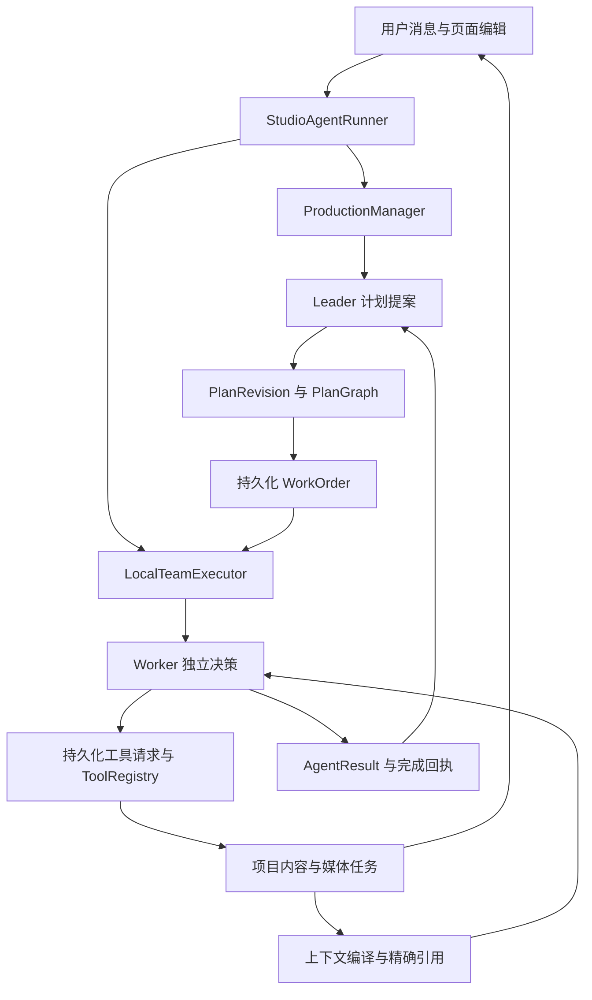
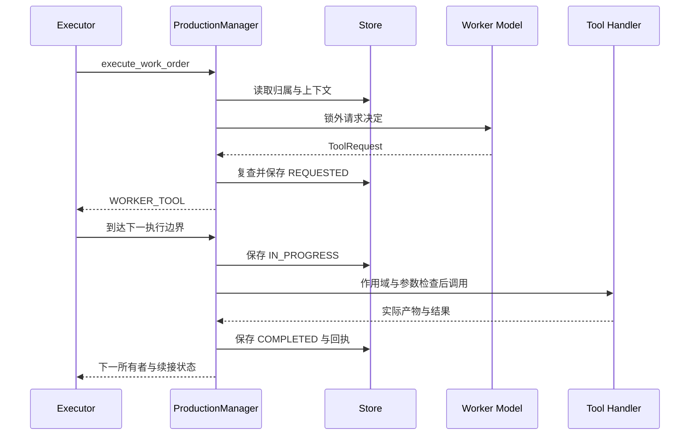

# 01 Multi-Agent 实现详解：交互、上下文、工具与调度

[学习地图](README.md) · [145 项工具全目录](01a-tool-catalog.md) · [完整并行推演](01b-multi-agent-walkthrough.md) · [纠错与恢复](02-correction-consistency-recovery.md)

本章按当前源码解释“系统到底怎么运作”。历史耗时单独标明来源，教学 JSON 和时间线不冒充真实 Trace。先读本章建立对象与调用链，再用并行推演检验自己能否连续解释，工具目录用来追查具体能力。

## 1. 一句话说清架构，再解释每个名词

**这是同一可信本地进程中的 Leader 协调、多 Worker 独立决策、共享业务存储交接的 Agent 系统。** Leader 产生可修订依赖计划；Worker 获得目标明确的 WorkOrder，在独立上下文中反复选择动作；Runtime 保存状态并控制谁可以继续；Tool handler 修改同一项目或与 Provider 交互。

“独立”主要指目标、上下文、工作笔记、调用历史、结果合同和执行状态独立。默认语言模型来自同一个有效配置源，不是每个角色训练一套模型。一个基础模型可以服务多个独立决策循环；是否有实际收益还要用对照实验判断。



图中有两个循环：Worker 的“观察—判断—工具—观察”局部循环，以及 Leader 的“分工—接收交付—调整计划”全局循环。任一 Worker 读一次工具，不必都让 Leader 再推理一次。

三个容易混淆的角色要先拆开：

| 名称 | 实际职责 | 是否就是一个 LLM |
| --- | --- | --- |
| `StudioAgentRunner` | 接收用户消息、唤醒、推进主循环、收取 Future、决定何时交还产品界面 | 否，是确定性运行代码 |
| `ProductionManager` | 管理计划应用、工单状态、工具边界、结果合并与上下文 | 否；它通过 `LanguageProductionPlanner` 调用 Leader，通过 Specialist 调用 Worker |
| Leader / Worker | 依据任务语义作计划或具体执行决定 | 是本项目的语言决策职责；每次调用由外层代码组装输入 |

因此“我让主 Agent 管理几个子 Agent”只讲了一半。真正实现必须说明：计划存在哪里，状态何时变更，谁派发线程，完成结果怎样返回，旧结果怎样失效。

源码入口：[studio_runtime.py](../../backend/short_drama/studio_runtime.py)、[production_manager.py](../../backend/short_drama/production_manager.py)、[team_executor.py](../../backend/short_drama/team_executor.py)。

## 2. 有哪些 Agent，为什么这样划分

### 2.1 当前公开给新计划的 11 种专业职责

`_ACTIVE_PRODUCTION_SKILL_ROLES` 是当前可选择的职责目录。不是启动时创建 11 个常驻线程，也不是每个目标都按顺序调用 11 个角色。同一职责可以有多个工单，例如两个人物分别交给两个 ASSET_BUILDER。

| 专业职责 | 适合交付什么 | 最少充分上下文的例子 | 交接结果的例子 |
| --- | --- | --- | --- |
| CONCEPT | 概念、创意方向、内容设定 | 用户目标、体裁、已有核心设定 | 已保存概念文档、明确决定 |
| WRITER | 场次正文、台词、定向剧本修改 | 相关场次、角色与因果边界 | 实际保存场次及精确引用 |
| PLANNER | 当前制作规划、必要制作约束 | 当前目标、项目事实、现有工作与能力条件 | 可执行规划内容；不自动等同于顶层 Leader |
| REVISION_VERIFIER | 检查一次修订是否满足要求 | 具体修改要求、相关前后证据、当前内容 | 明确通过项、缺陷、证据限制 |
| DIRECTOR | 镜头、构图、时段描述、局部导演决定 | 当前场次、相关镜头、相邻进入/退出状态 | 当前镜头或分镜组及引用 |
| ASSET_PLANNER | 资产与工作项、真实依赖、复用安排 | 剧本/Bible/分镜的相关事实、现有资产索引 | 稳定 item/work-item 及用途 |
| ASSET_BUILDER | 图片准备、派生、生成和局部修复 | 指定工作项、brief、选定参考与来源 | 可用媒体、实际用途与剩余缺项 |
| ASSET_VERIFIER | 观察资产是否满足具体用途 | 实际候选像素、brief、指定使用需求 | 有范围的观察结论，而非凭文件名认可 |
| ROUTE_PLANNER | 当前镜头组的生成路线 | 该组镜头、时窗、可用输入、Provider 限制 | 保存的路线及准备条件 |
| VIDEO_PROMPT_COMPILER | 将当前组信息编译为视频输入 | 精确单元、选中媒体、动作与连续性约束 | prompt、输入顺序、精确路线引用 |
| EPISODE_REVIEWER | 指定片段或本集的连续性检查 | 实际采用范围、相关报告、必要音频证据 | 可定位的发现与剩余检查 |

枚举和历史文件中还保留 CRITIC、STORY_REPAIR、FINAL_COLD_READ、REVIEW_ROUTER、ASSET_REVIEWER 等兼容职责。不能把兼容枚举数量说成当前实际 Agent 数量。

### 2.2 拆分依据是可交付边界，而不是头衔越多越好

一个值得独立委派的任务通常满足三点：有独立专业判断或可并行耗时；能够给出足够小的输入；能用真实工件或明确观察交接结果。

“准备角色 A 的参考图”适合独立工单。“把上一步 ID 抄给下一步”通常不适合再创建一个 Agent。“检查视觉”和“检查对白”可有不同证据，但不意味着必须每镜启动两位独立审阅者；一次工单也可以选择合适工具完成相称检查。

同一个镜头尚未决定动作时，过早并行制作相互依赖的首尾状态图，可能把一个没有收敛的创意放大为多份付费返工。并行前要先判断输入是否足够稳定，返回结果能否被其他任务直接使用。

### 2.3 嵌套模型调用不等于新增 Agent

`route.compile_h3_prompt`、部分 `qa.*`、`shot.director_advice` 等工具内部会调用模型。当前执行路径里，它们仍属于调用者的工具操作；没有因为多一次模型推理就自动获得新的 WorkOrder、独立队列和结果所有权。

Trace 成本必须包括这些内部调用。调度图中的 Worker 数量也不能直接当成整套系统同时请求模型的绝对数量：Leader 的后台规划与工具内调用需要分别统计。

## 3. Agent 之间到底怎样交互

### 3.1 当前主要是结构化交接，不是群聊

| 方向 | 实际载体 | 接收方如何使用 | 避免的失真 |
| --- | --- | --- | --- |
| Leader → Worker | PlanStep → WorkOrder + ContextManifest | 编译本工单输入，开始独立循环 | 不把完整 Leader 历史转发给所有人 |
| Worker → Runtime | SpecialistToolRequest / ReadBatch / AgentResult | 持久化、执行或提交结果 | 模型不能直接宣布数据库已写入 |
| Worker → Leader | 已保存结果、精确引用、完成回执、必要失败请求定位 | Leader 下次输入中的完成目录与当前状态 | 不只传一句“图片做好了” |
| Worker A → Worker B | 共享项目工件、输出槽、相关完成交接、媒体观察快照 | B 按明确对象 ID 读取或获得相关投影 | 不广播 A 的全部推理与工具历史 |
| 用户 → 全部执行者 | 当前项目编辑、pending messages、goal 最新要求 | 下一边界接管，并重新检查当前内容 | 旧工单不能压过已生效修改 |

这是一种“共享工件承载事实、运行协议承载控制”的协作方式。可以用共享黑板作类比，但不能据此声称项目接入了某个特定消息总线框架。

### 3.2 默认没有 Worker 递归派生子 Agent

Leader 的 `DELEGATION` 计划步骤由 PM 调用 `AgentRuntime.create_work_order`。源码也定义了 `agent.delegate` ToolSpec，但 `ShortDramaService` 默认构造 Registry 时没有传 `agent_delegator`，所以它没有注册到默认产品工具目录。

Worker 遇到需要改变上游语义或工作范围的问题，通常提交 `PARTIAL / LEADER_REPLAN`，由 Leader 修改计划或再委派。不要把当前拓扑描述成任意深度的 Agent 树，也不要把我们研究材料时使用的外部助手能力算进产品能力。

证据：[Service 装配](../../backend/short_drama/service.py)、[工具默认注册](../../backend/short_drama/tools/defaults.py)、[委派扩展定义](../../backend/short_drama/tools/agent/__init__.py)、PM 中的 `ActionKind.DELEGATION` 分支。

### 3.3 Worker A 的结果怎么准确交到 B

以图片构建者 A 和视频准备者 B 为例：

1. A 通过工具生成或导入图片，handler 保存 AssetVersion、文件路径、来源和实际状态；返回完整 ArtifactRef。
2. A 在结果中说明这张图完成什么用途，保留实际限制，可引用 `saved_tool_result_sequences` 让 Runtime 补入原保存回执。
3. Leader 得到已完成交付，不用从自然语言中猜媒体 ID。新的 B 工单明确选择相关工作项、图片或生成组。
4. B 的初始 ContextPack 来自自身 manifest；动态 working_set 还能补入与这些明确 ID 相交的完成交接和媒体观察。
5. B 如需完整参数或报告，按保存的 context_ref 回读；如要修改内容，读取当前对象并检查来源是否仍有效。

`completed_work_handoffs` 会排除 stale_handoff，并且对 Worker 按明确对象/媒体选择过滤。共同拥有一个 project、全片 storyboard 或整张 asset_plan 引用，不足以把所有兄弟任务结果全部注入 B。

`observed_media_handoffs` 还可以提供未完成、甚至后来取消工单里已经完成的媒体观察。历史图片的某个事实仍有参考价值，不代表旧任务恢复执行，也不代表该观察在后续剪辑范围变化后仍然适用。

源码：[leader_context.py](../../backend/short_drama/agent_runtime/leader_context.py)、[media_handoffs.py](../../backend/short_drama/agent_runtime/media_handoffs.py)。这是比“所有 Agent 共享一份 memory”更准确的解释：**事实可共享，选择性投影；控制权不共享，按状态交接。**

### 3.4 工件引用、调用引用与输出槽解决不同问题

- `ArtifactRef` 指向已存在的项目工件及版本，回答“依据和产物是什么”。
- `ToolAttemptRef` 指向已持久化的一次工具尝试，回答“当时到底提交了什么、返回了什么”；失败请求没有成功工件时也可交接。
- `project.bind_output_slot` 把精确工件绑定到稳定语义用途，回答“这个用途现在采用谁”，有 expected_revision 防止同槽覆盖。
- `working_notes` 是本 Worker 的当前工作笔记，回答“接下来打算做什么”；不能替代前三者。

如果 A 的 AssetPlan 保存失败，B 只收到错误摘要，重新拼一个巨大请求往往会丢失正确内容。明确交接 ToolAttemptRef 后，B 可以取回原始参数，只修错的部分；这是交接粒度的优化，不是提示词更长。

## 4. WorkOrder 是怎样被创建和管理的

### 4.1 从计划字段到运行合同

Leader 选择 `assigned_agent` 显示名称，还必须选择 `production_skill_role`。代码不从“资深导演”“图片专家”这类自由文本名称猜实际职责。资产角色缺省的 prompt stage 可补为 ASSETS，但职责本身必须显式给出。

PM 把 PlanStep 转为 WorkOrder 时，会保留 source plan/action 身份，校验精确工件和相邻边界，再把结构化任务数据存入 `task_inputs`。`_delegation_task_inputs` 会剔除委派控制字段，保留其他业务参数；显式 task_inputs 与同名顶层业务值冲突会报错，防止静默丢任务范围。

| WorkOrder / Manifest 字段 | 为什么存在 | 少了它会发生什么 |
| --- | --- | --- |
| objective、why_now | 本次做什么，为什么现在需要做 | Worker 只按角色漫游，做出与当前目标无关的内容 |
| task_inputs | 工作项、生成组、具体选择等结构化参数 | 靠自然语言猜 ID，选择范围丢失 |
| scope / required_artifacts | 必需的精确工件 | 把不存在或过时版本当依据 |
| adjacent_boundaries | 相邻范围的输入/输出边界及引用 | 各段各自正确却接不上 |
| constraints、confirmed_decisions | 已确认限制与决定 | 不必要地推翻共同前提 |
| inherited_decision_ids | 复用真实 DecisionMemory | 相同决定各说各话、无法定位来源 |
| tool_attempt_refs | 原调用定位 | 接手失败草稿只能重造请求 |
| expected_output_schema、acceptance_criteria | 额外交付形状与完成要求 | 只返回概述，无法供下一任务使用 |
| expected_output_slot_ids | 明确需要的语义输出位置 | 产物有了却无法判断交付用途 |
| source_plan_revision_id / active_plan_revision_id | 原始来源与当前仍有效归属 | 换计划时误取消被保留任务，或误接纳旧结果 |
| next_owner | 下一步由 Worker 决策、工具、Leader 或用户负责 | 用 NEEDS_ATTENTION 猜测该不该全局停住 |

**scope 是上下文与工作合同，不是完整的逐字段权限沙箱。** 当前有项目/run/引用归属校验与业务版本检查，但没有证明“Worker 在 scope 之外的任何字段都绝不可能修改”。约束文字也不会自动变成数据库行级 ACL。面试要把实际保证和设计意图分开。

### 4.2 一个真实字段形状的委派例子

下面是教学 PlanStep，所有 ID 均为示意。真实运行只能使用此前工具返回并可解析的 ID/version；不能复制示例发给产品。

```json
{
  "id": "prepare-prop-label",
  "title": "准备道具的准确标签",
  "kind": "DELEGATION",
  "assigned_agent": "道具标签制作者",
  "production_skill_role": "ASSET_BUILDER",
  "production_prompt_stage": "ASSETS",
  "instructions": "完成指定道具工作项的准确文字图，保存可用图片与实际用途。",
  "arguments": {
    "why_now": "第一生成组已经确定必须看清这张标签。",
    "task_inputs": {
      "asset_id": "asset-prop-demo",
      "work_item_id": "work-label-demo",
      "clip_group_id": "group-1-demo"
    },
    "constraints": ["文字须按当前 brief 逐字保留", "不改其他角色和场景"],
    "confirmed_decisions": ["优先使用确定性文字排版"],
    "acceptance_criteria": ["已保存实际图片", "明确图片身份、用途与未满足项"]
  },
  "depends_on": [],
  "artifact_refs": [
    {"project_id": "p-demo", "artifact_type": "asset_plan", "artifact_id": "asset-plan-demo", "version": 7}
  ]
}
```

这个工单没有规定工具调用次数。Worker 可以读取工作项后直接排版；若已有合适结果也可以复用。只有输入不足、上游要求矛盾或目标范围要改变时才需要向 Leader 升级。

### 4.3 同时跟踪生命周期和下一执行者

`DelegationStatus` 有 PENDING、IN_PROGRESS、COMPLETED、NEEDS_ATTENTION、FAILED、CANCELLED。`next_owner` 有 WORKER_DECISION、WORKER_TOOL、LEADER_REPLAN、USER_INPUT。

例如一次模型已经选好了工具，工单可处于 `NEEDS_ATTENTION + WORKER_TOOL`。它需要程序继续执行，不是在请求用户批准。普通局部参数错误也可以由原 Worker 修复，不能每次都暂停全片。

工具轮次另有 REQUESTED、IN_PROGRESS、COMPLETED、INTERRUPTED。轮次 COMPLETED 表示调用处理已结束；ToolResult 内部仍可能 INVALID_ARGUMENTS 或 FAILED。工单、工具轮次、远端任务、用户目标有不同的完成定义。

模型定义：[models.py](../../backend/short_drama/agent_runtime/models.py)；创建逻辑：[runtime.py](../../backend/short_drama/agent_runtime/runtime.py) 的 `create_work_order`。

## 5. Leader 的上下文怎样组装

Leader 负责决定接下来安排什么，主要需要全局概览、真实新增结果和未解决事项。它不需要默认看到每个 Worker 的完整工具输入输出。

`ContextCompiler.compile` 的默认选择上限是 16 个工件、12 条决定、8 条经验、8 条最近动作；这些是该 ContextPack 的参数默认值，不能误说成完整模型请求最多只有这些信息。

| 输入层 | 当前来源与策略 | 用途 |
| --- | --- | --- |
| goal | original_request、current_goal、latest_user_instructions | 保留完整原意和最新补充，避免只依据压缩进度摘要 |
| ContextPack | 项目摘要、当前焦点、约束、blockers、决定、经验、当前工件、最近动作 | 建立本次规划视图 |
| current_plan | 当前 AgentPlanProposal | 看依赖、在途工作和当前目标完成判断 |
| working_set | 已有读取的范围化结果、完成交接、媒体观察、保存回执投影 | 让实际新结果推动规划，不重复全历史 |
| available_tools | 当前执行目标过滤后的短目录 | 知道有何能力可发现 |
| tool_schemas | 已发现或由当前工件关联预加载的精确输入合同 | 生成可执行参数 |
| available_production_methods | 方法用途、支持职责、requirements 等 | 语义选取本次方法 |
| output_contracts / feedback | 计划和 schema 请求合同、上一错误反馈 | 修复协议错误，不执行残缺计划 |

工件选择首先考虑显式请求和最近动作观察到的引用，再结合 run/project memory 与决定引用。当前资产计划索引有专门优先级，避免大正文挤掉可分工目录。当前结果与调用定位也优先于背景性长段落，防止“Worker 做完了，Leader 下轮却没看到”。

相关 GenerationPlan/Unit 的全局交接可对齐当前项目版本；Worker 的显式内容 manifest 则强调被选择的精确版本。不能把 Leader 概览刷新规则照搬成“把所有 Worker 的旧 version 数字改成最新即可”。

`leader_read_working_set` 与完成交接有自己的 token 限额，再由整份请求预算约束。默认 ContextPack 的 24,000 字符局部预算不是 258,000-token 模型总预算，也不是所有请求的大小。完整预算含提示、schema、工作集、正文、输出/推理余量及封装预留，见[第 03 章](03-context-memory-rag.md)。

## 6. Worker 的上下文怎样组装

### 6.1 每轮从持久化状态重建，不依赖活着的聊天对象

`execute_work_order` 每次通过 `get_work_order` 获得当前视图，工厂构建 Specialist，绑定当前工具目录后调用模型。长程连续性主要依赖持久化工单和工作集，而不是一个 Python Agent 对象一直驻留内存。

模型输入可以按下列层次解释：

```text
instructions
  common runtime rules
  worker responsibilities + response protocol
  current format / role / stage / selected method prompt
payload
  goal: original request + current goal + latest user instructions
  work_order: objective, task_inputs, constraints, acceptance, working_notes...
  context: manifest selected artifacts, decisions, experience, exact references
  working_set: retained reads, receipts, entities, repair state, related handoffs...
  available_tools: short discovery catalog
  tool_schemas: exact contracts loaded for this work
  response_schemas + schema/protocol feedback
visual_input
  actual images from the immediately relevant persisted tool results
```

`work_order` 的模型序列化明确排除了原始 `specialist_turns`、重复的 `context_manifest`、协议反馈存储字段和 loaded_tool_schema_ids；这些信息分别投影到更合适的输入区域。没有把完整工单 JSON、全历史、完整项目再重复三遍。

### 6.2 初始工件由 Manifest 精确选择

`compile_for_work_order` → `_compile_manifest` 的主要动作是：

1. 读取本工单已保存的 manifest 和 parent run。
2. 合并 required_artifacts 与相邻边界里的工件引用，按精确身份去重。
3. 校验同项目、对象存在、解析后的身份与所选版本一致；缺失就报 ContextManifestResolutionError，不能编造正文。
4. 解析明确继承的 Decision ID，以及本 run 的 ToolAttemptRef。
5. Worker 只有带 experience_tags 才选择经验，候选 limit=32，按项目、skill 和标签过滤，再受预算限制。Leader 的默认 experience_limit=8 是另一条路径。
6. 必需工件、明确决定与调用定位优先保留；无法装入时显式失败，而不是无声删掉依赖。
7. 输出 ContextPack；`model_context_dump` 把重复 ArtifactRef 编成 artifact_index，在各处引用短 ID。

这个索引只是**本次输入的紧凑别名**。它不替代真实项目 ID/version，也不是让后续工具猜 `artifact-3` 永远代表同一件东西。

### 6.3 相邻边界有一个必须如实说明的实现缺口

`ContextBoundary` 可以保存 relationship、artifact_refs 和 guidance。但当前 `_compile_manifest` 明确投影的是其中的 artifact_refs；`LanguageSpecialistAgent.execute` 又从 work_order 输入排除了整个 context_manifest。沿这条内置 Worker 路径，没有看到 relationship/guidance 被另行显式加入模型输入。

所以不能声称“只把进入/退出状态文字放入 adjacent_boundaries.guidance，Worker 一定能看见”。当前若它是硬要求，应同时放进实际可见的 instructions、constraints 或 task_inputs，并引用真实邻接工件。这里是本次源码检查发现的待补验证点，未在本轮修改产品。

后续最小验证应检查**最终发送给模型的 payload** 是否含邻接关系与 guidance，再决定怎样补投影；只测试 Pydantic 能保存 ContextBoundary 不足以证明模型收到了它。这也是面试中区分“数据结构设计过”与“端到端链路接通”的好例子。

### 6.4 Skills、角色、Style 分别怎样进输入

本节是概览。目录管理、选择持久化、阶段覆盖、缓存生效、嵌套调用与真实迭代展开在 [01C Skill 管理](01c-skills-management.md)；进度如何进入每次决策展开在 [01D 持续进度](01d-progress-and-next-action.md)。

`get_work_order` 使用显式 production_skill_role 和 stage，调用 `compile_production_prompt`。组合包括：共同职责、体裁规范、该角色的体裁补充、已选方法的角色/阶段片段、适用的叙事方法。共用前后文按来源去重，方法 requirements 会描述依赖的外部执行接口。

当前方法库有 27 项，但不把 27 项原文装入每个 Worker。selected_skill_ids 在建 manifest 时来自 run 的当前激活方法；编译时再按支持的角色/阶段过滤，不能说 Leader 为每个工单配置了一个独立的工具权限集合。

Style 是项目偏好并可由用户覆盖；Skill 是知识与方法；Tool 是可执行接口。导入一个讲外部软件的 Skill，不代表已经给 Agent 接好了该软件，更不代表能调用任意命令。

证据：[production_profiles.py](../../backend/short_drama/production_profiles.py)、[skills/loader.py](../../backend/short_drama/skills/loader.py)、[Worker 职责](../../backend/short_drama/prompts/runtime/worker.md)、[Leader 职责](../../backend/short_drama/prompts/runtime/leader.md)。默认语言配置见 [language_defaults.py](../../backend/short_drama/language_defaults.py)；实际生效必须查请求与 Trace。

## 7. 长程 Worker 的工作集为什么不会只剩最后一条消息

`SpecialistWorkingSet` 的核心是把调用流水重建为当前可用事实：

| 部分 | 保存什么 | 为什么不用完整历史代替 |
| --- | --- | --- |
| latest_handoff / latest_read_batch | 最近立即有用的工具结果或同一次决策的完整读批 | 下一次判断需要看到刚读回来的内容 |
| read_observations | 各个独立对象和读取范围的最新读取 | 不能读了镜头 2 就挤掉镜头 1 |
| entities / tool_checkpoints | 对象身份、任务状态、已完成操作的紧凑记录 | 避免重复入队、登记和重复推理 |
| tool_attempt_observations / pending_tool_repairs | 失败调用定位和具体待修问题 | 不用把整份失败大请求反复回灌 |
| saved_tool_result_index | 可作为完成依据的保存轮次 | 减少模型抄 ID、路径、尺寸造成错误 |
| completion_handoffs / media_observations | 与当前明确选择相关的其他工单交付 | 让共享事实可见，同时控制污染 |
| working_notes | 当前判断、未解决点、下一步，最多 8,000 字符 | 续跑有方向，但笔记不是权威项目状态 |

读取去重不能只用 tool_name。`artifact.read_current(scene_id=A)` 与 `artifact.read_current(scene_id=B)` 应同时保留；相同范围再读时，才替换旧观察。制作文档按 document ID 保留当前读到的正文，旧版本全文不反复累积。其他读取以规范化后的完整参数为 key，保留分页、选择范围和必要数组顺序。

新近写入可能使旧读取失效，工作集会对相应观察做退休/更新处理。需要精确原文时，大结果先持久化，再用 context_ref 和 JSON pointer 代替；`agent.read_context` 可以分页回读。**回读快照回答“当时是什么”，当前读取回答“现在是什么”**，修改前必须知道自己需要哪一种。

真实迭代中，按工具名覆盖读取曾导致不同镜头/工作项互相挤掉，Worker 反复回读；整份项目和大 schema 也会挤占预算。当前通过范围化读取、目录/正文分离、精确回执与整份请求预算共同处理。效果口径与限制见[实验复盘](04-evolution-and-experiments.md)，不能把某一段 JSON 缩小比例当成整片加速比例。

## 8. 工具如何赋予、发现和约束

### 8.1 五层机制，不能统称“权限”

| 层 | 当前怎么做 | 是否等于禁止调用其他工具 |
| --- | --- | --- |
| 注册 | Service 与 PM 构建共享 ToolRegistry | 未注册的 ID 无法由该 Registry 执行 |
| 运行目录 | `_tools_for_execution_target` 按 MOCK / REAL_H3 隐藏冲突执行器 | 是当前目录过滤；执行时仍校验目标 |
| 预加载 | 按职责、stage、已返回媒体、历史发现加载 schema | 否，目的是少一次发现往返 |
| 语义职责 | Skill、WorkOrder 范围、constraints | 不是完整权限沙箱 |
| 执行校验 | 项目/run/调用引用归属、typed 参数、版本与业务条件 | 真正执行前的可达检查；各工具条件不同 |

当前默认服务装配后 145 个工具，14 类；真实 H3 目录 139 个。完整列表、实际输入输出模型及 Mock/历史限制见[工具全目录](01a-tool-catalog.md)。能力不是只有“搜索、写文件、调用 API”三个抽象名。

当前内置工具没有通用 shell、任意 Python、浏览器点击接口。`task.run_workflow` 是已接通 ComfyUI 工作流执行，不是任意 Computer Use。`artifact.search_stock` 是配置过的素材源检索，也不是一个通用浏览器 Agent。

### 8.2 每个角色默认获得哪些完整 schema

所有 Worker 公共起点：`artifact.read_current`、`agent.read_context`。下面的工具是在此基础上合并去重的**起始合同**，其他目录能力仍可发现。

| 条件 | 额外预加载 |
| --- | --- |
| Leader 初始 | `artifact.get_production_document`，加上两个公共读取工具 |
| STORY stage | `script.save_scene` |
| STORYBOARD stage | `shot.save_current`、`shot.get_storyboard` |
| POST stage | `timeline.read_editorial`、`timeline.edit_clips`、`timeline.export_editorial`、`timeline.read_export` |
| VISUAL_GEN stage | `route.prepare_h3_group`、`route.h3_capability_profile` |
| WRITER | `script.save_scene`、`artifact.create_assets` |
| DIRECTOR | `shot.save_current` |
| ASSET_PLANNER | `artifact.get_asset_work_context`、`artifact.patch_asset_plan` |
| ASSET_BUILDER | `artifact.get_asset_work_context`、`artifact.patch_asset_plan_fields`、`image.capability`、`image.enqueue`、`image.view` |
| ASSET_VERIFIER | `artifact.get_asset_work_context`、`artifact.inspect_asset`、`image.view`，但仅实际注册 ID 才进入请求 |
| VIDEO_PROMPT_COMPILER | `route.get_generation_unit_context`、`route.h3_capability_profile`、`route.compile_h3_prompt`、`route.plan_h3` |
| ROUTE_PLANNER | `route.get_generation_unit_context`、`route.h3_capability_profile`、`route.plan_h3` |
| EPISODE_REVIEWER | `timeline.read_editorial`、`video.inspect_take` |
| CONCEPT、PLANNER、REVISION_VERIFIER | 没有额外的 role 起始映射；仍有公共、stage 与动态发现能力 |

POST 优先于一般 role 的预加载，所以 DIRECTOR 做后期时不再额外套用普通导演 role 起始组。ASSETS 没有单独 stage 映射，按 role 补。

这里还有一个静态接线细节：预加载表包含 `artifact.inspect_asset`，但默认注册目录里没有这个 ID。加载阶段会按实际 tools_by_id 过滤，因此不会凭空获得该合同。实际资产视觉观察工具是 `qa.inspect_asset_version`。不能把预加载常量表直接抄成“已经可调用的能力”；这处映射值得后续修正，本轮只如实记录。

源码：[tool_context.py](../../backend/short_drama/agent_runtime/tool_context.py)。这两个表还说明为什么职责标签与工具能力不一一对应：导演到后期阶段需要剪辑工具，而不是只允许“导演工具”。

### 8.3 媒体状态会触发相邻合同预加载

`media_tool_schema_ids` 看当前工单 scope 和成功工具返回的对象类型：有 h3_group_operation 时预加载组状态读取；有 generation_task 时预加载 `task.get/advance`；有 Take 或成功视频结果时预加载 `video.inspect_take`、`audio.transcribe_native`、`route.review_h3_take`、`video.select_take`；有 video_inspection 时预加载已有报告读取。

这只减少“我已经拿到视频，却还要先问一次如何检查”的往返。它不自动判定候选通过，也不自动采用视频。代码：[media_tool_schemas.py](../../backend/short_drama/agent_runtime/media_tool_schemas.py)。

### 8.4 先看目录，再按需拿 schema

模型最初看到的 `available_tools` 是短目录：id、截短用途、effect；Worker 对 READ 还提供 idempotent 元数据以判断读批。完整 input_schema 仅为当前已加载工具附上。

需要陌生能力时，可返回：

```json
{
  "requested_tool_schema_ids": ["image.compose_text_plate"],
  "rationale": "标签需要逐字准确，先确认本地排版参数。"
}
```

程序查 Registry，把当前完整定义加入 tool_schemas，记住已发现 ID，再调用模型决定。此时没有执行排版业务工具；但消耗了一次发现往返。未知 ID 或重复索取已加载合同会得到结构化反馈，不能无限自转。

已发现的 ID 持久化到 run/WorkOrder；重启后从当前 Registry 重建 schema，而不是依赖旧 Python 对象内存。当前计划已用工具、失败修复需要的工具和历史调用也会补入定义。

稳定目录和合同在 `ordered_agent_model_payload` 中排在动态状态之前，以利稳定前缀复用；这不能保证供应商缓存命中，更不能直接推成确定的延迟收益。

## 9. 一次工具调用，完整走过哪些状态

当前兼容客户端请求 `/responses`，把工具定义与响应合同放进文本输入。此路径没有向 Provider 注册原生 `tools/function_call` 或服务端 strict 输出 schema；模型返回文本 JSON，本地解析后执行。不要说“用了 function calling 所以参数天然可靠”。

Worker 可返回四类结构：schema 请求、单工具请求、独立只读批次、最终工单结果。单工具请求例如：

```json
{
  "tool_name": "agent.read_context",
  "reason": "取回已保存布局的准确参数。",
  "arguments": {
    "project_id": "p-demo",
    "run_id": "run-demo",
    "snapshot_id": "context-demo",
    "pointer": "/arguments",
    "offset": 0,
    "limit": 6000
  },
  "working_notes": "已找到布局来源；读回参数后只修正本次要求的文字位置。"
}
```

仍是教学 ID。真实执行路径按顺序如下：

1. **短锁读状态**：检查 run 可执行、工单仍属于当前计划、是否已有 REQUESTED 工具。若已有，先执行它，不重新问模型生成一份。
2. **编译并解锁推理**：begin_work_order → get_work_order → 角色/上下文/工具绑定；慢语言调用在运行锁外。
3. **再次检查归属**：模型返回后重取当前工单与 run。若已过期，记录旧交接；不执行它刚提出的新工具。
4. **先落盘意图**：保存 SpecialistTurnRecord，含 sequence、tool_name、arguments、reason，状态 REQUESTED；更新 working_notes，next_owner=WORKER_TOOL。
5. **下一执行边界**：处理用户消息/暂停，确认任务仍有效；把工具轮次置 IN_PROGRESS。
6. **执行真实检查**：PM 校验作用域；Registry 校验 typed 输入；handler 校验当前业务内容与来源，再进行真实操作。
7. **验证并保存回执**：output_model 校验结果，保存 status、artifact_refs、receipt 等；轮次进入 COMPLETED。已开始工具即使工单随后被取消，也必须保存实际结果，不能凭此恢复旧所有权。
8. **确定谁继续**：可机械推进的媒体生命周期保存下一工具；否则 WORKER_DECISION 重新构建工作集。任务已交付则提交 AgentResult，必要改范围则交 Leader。



输入校验错误时 handler 尚未运行；输出校验错误时 handler **已经运行**。后者保留工件/receipt 并提示先检查实际结果，不能按一次普通 JSON 失败就重复付费或重写。不同 phase 的错误要采取不同恢复策略。见 [registry.py](../../backend/short_drama/tools/registry.py)。

一次 read batch 最多 2–4 项，必须 READ、idempotent、参数已知且彼此独立。它们仍逐项持久化、校验和执行，减少的是模型往返，**当前并不是同一 Worker 的工具并行执行协议**。第二个调用要用第一个刚返回的 ID，就不满足独立条件。

## 10. 并行到底发生在哪里

### 10.1 第一层：哪些计划步骤可以开始

`PlanGraph.ready_steps` 只考虑当前计划拥有的动作，包括明确 inherited_action_ids 继承的历史动作。步骤未成功、未尝试，且所有 depends_on 的步骤都有 SUCCEEDED 动作，才属于 ready。

已尝试后失败的步骤不会因为还在图里就无限重新 ready。需要由后续语义规划决定修复或新路线。DELEGATION 动作不会在工单刚发出时就算交付成功，否则所有下游会抢跑。

计划验证会检查 step ID 唯一、依赖存在、无环等结构。但 DAG 合法不等于业务依赖完整：两个步骤都没写 depends_on，却实际修改同一段故事，仍可能互相冲突。

### 10.2 第二层：哪些已创建工单可以占执行槽

`LocalTeamExecutor` 默认 max_workers=4，持有一个后台 ThreadPoolExecutor。它先收取已经 done 的 Future，再选工单，不等待整批结束。选择条件包括：

- PENDING 或 NEEDS_ATTENTION，且 next_owner 是 WORKER_DECISION / WORKER_TOOL。
- run 没有完成、失败或取消；有计划来源的工单 active_plan 必须匹配 run 当前计划。
- 不在 claimed 集合，不已有登记 Future，不被当前明确审阅范围阻挡。
- continuation_not_before 已到期。
- 存在剩余槽位；名额按该 Executor 的 claimed 集合控制，不应凭空理解成每个项目都另有 4 个。

候选按存储的 updated_at 升序、id 升序提供；这不是完整优先级队列。claim 集合与 Future 登记在锁保护下避免同一工单重复派发。新近完成的 Future 未收取前也仍被登记，不能提前重复启动同一单。

某次收取发现执行错误时，先把错误交给上层分类，不在同一次收取里继续盲目 claim 新工作。语言传输错误、领域失败、需要 Leader 重规划的状态并不是同一种恢复路径。

### 10.3 一个槽不应该等于一张工单从头跑到尾

Worker 在一个 Future 内可以持续推进自己的决策与工具，但每个回合落盘并保存必要续接后，会检查有没有有效 ready peer。有则结束本次 Future、释放 claim；下次正常选择时继续原工单。

因此让出槽位不等于取消任务、重建模型记忆或重新生成媒体。working_notes、pending Tool、工具结果都已经持久化。没有 ready peer 时继续执行，避免无收益切换。

公平性是协作式的：正在同步等待的 HTTP 请求不会被任意抢占。四个慢操作都在进行时，第五个任务仍可能等待；当前没有严格实时调度保证。

### 10.4 媒体轮询可以不占槽，也不调用 LLM

`_queue_deterministic_continuation_unlocked` 针对明确支持的 typed 成功结果，保存下一机械动作。例如图片入队后推进同一任务；视频已知 task ID 时在下次到期轮询。视频等待默认间隔为 15 秒，以 continuation_not_before 表示，不让一个线程睡满等待时间占住槽。

这不是“每个 EXTERNAL 工具都可自动重试”。只对已实现的生命周期和明确条件续接；失败、未知提交、终态或需要判断的情况交回 Worker。是否改 prompt、换图、重新付费生成，需要新的语义决定或明确恢复事实。

### 10.5 读、写、慢操作怎样并存

| 机制 | 保护对象 | 不保证什么 |
| --- | --- | --- |
| claims lock | 同一 Executor 的工单认领与 Future 状态 | 不保护远端 API，也不是跨机租约 |
| run lock | 计划/工单状态快照、归属检查与应用 | 不应覆盖整个慢 LLM 请求 |
| Team 项目写通道 | 已知待执行 WRITE 工具的同项目串行推进 | EXTERNAL 不因此持有整个项目锁 |
| PM 项目工具锁 | 实际 WRITE 调用路径的同项目互斥 | 不等于全部用户 HTTP 写入也只经过这里 |
| Repository 事务与合并 | 实际内容保存、原子写入、当前冲突保护 | 不把本地数据库和远端 Provider 变成同一事务 |
| 版本与来源检查 | 输入、镜头、组或采用范围当前是否仍相容 | 只有互斥没有这些检查，仍可顺序覆盖错误结果 |

两层项目锁属于不同对象、不同调用路径，不应笼统说“只有一把全局锁”。EXTERNAL 操作由业务服务在慢操作前后做短保存；ToolEffect 也不是耗时分类，例如导出可能是 WRITE 且耗时较长。具体锁占用应按 handler 实测，不能把所有局部保存都宣称成零等待。

## 11. 一部分 Worker 完成后，后续工作怎样接上

已有图里 `B depends_on A`，A 的动作成功后 B 就绪，这是普通依赖解除。另一种情况是 A 刚产出新图片，其精确 ID 此前不存在，后续生成任务还没有写进计划。这需要**根据真实新结果继续规划**。

当前为此拆了三段：

| 函数 | 关键动作 | 为什么要这样分 |
| --- | --- | --- |
| `prepare_completion_planning` | 短锁内找真实完成结果，记录已消费工单 ID，保存计划/用户要求等快照 | 同一完成不要每个 tick 反复触发模型 |
| `plan_after_completions` | 锁外调用 Leader 规划新增工作 | Leader 慢推理时其他 Worker 继续 |
| `apply_completion_plan` | 重新取锁，对比计划、最新意图、终态与失败等条件，有效才合并 | 旧提案晚到不能覆盖新意图 |

Runner 把这次规划放进后台 Future，同时继续收取和派发 Worker。启动条件来自真实完成交付或当前非空本地计划完成；一次普通中间轮询本身不会自动触发全局规划。

追加计划保留已经成功或仍运行的相关工作，使用精确 inherited_action_ids 和 carried_work_order_ids。原 Action 的原计划身份保留；不能只凭 step 名相同误认两次执行，也不能把所有历史动作粗暴改成最新版。

`append_plan_revision` 把计划、run 当前计划指针和被继承工单的 active-plan 归属放在同一存储事务里，避免“run 已切新计划、合法 Worker 仍在旧归属”的中间状态。详见[增量状态测试](../../backend/tests/test_incremental_plan_state.py)。

先记录消费再请求模型，意味着一次可选提前规划失败后不无界重复同一事件。必要的本地计划完成、失败或用户输入还有不同续跑路径，不能概括为“所有 Leader 失败都忽略”。

另外，DAG 的 depends_on 不是参数变量系统。当前需要新工件 ID 的后续步骤，应等上游保存并返回精确引用后再规划；不能凭空写 `${A.result.id}` 并声称 Runtime 会自动插值。并行推演会具体展示这一点。

## 12. 为什么线程池早就有，实际仍然不够并行

以下三种失败要分别解释；它们不是同一个“加并发”改动。

| 失败 | 旧机制的问题 | 当前修复点 | 验证重点 |
| --- | --- | --- | --- |
| 整批等待 | 某个慢 Future 阻挡已完成结果被消费 | 持续后台池，收取 done Future，增量交接 | 3 个完成、2 个未完时后续能否开始 |
| Leader 饿死 Worker | PM 内一个读后立即再规划，又得到一个读，主循环长期没走到 Team | 执行一个已有步骤后必经 Team，`allow_replanning=False`；必要规划异步处理 | ready Worker 是否真正进入执行 |
| 长 Worker 占满槽 | 4 个工单各自从头连续做到尾，第 5 个一直排队 | 在已持久化回合边界有 ready peer 就让出 | 排队时长、实际轮换、没有重复执行 |

历史公平性记录：“准确文字证据”工单等待至少 10 分 50 秒；修复续跑后约 0.385 秒进入执行。另一个第五位工单“对峙”在旧工单平面合成结束约 1.064 秒后启动。两者是不同工单，不可拼成同一项 A/B 加速结果，更不能推成整片提速比例。

来源：[Leader 调度复盘](../research/2026-09-12-generation-quality/12-carried-worker-scheduling.md)、[Worker 公平轮换](../research/2026-09-12-generation-quality/43-worker-fairness.md)。测试入口：[test_carried_worker_scheduling.py](../../backend/tests/test_carried_worker_scheduling.py)、[test_worker_fairness.py](../../backend/tests/test_worker_fairness.py)、[test_team_executor.py](../../backend/tests/test_team_executor.py)。本次只读这些机制与历史记录，没有重跑后端测试或真实制作。

还有一种容易漏掉的失活：后台任务遇到继承自 BaseException 的协作让出异常，却只处理 Exception，Future 可能没有被正确完成。Runner 对 ExecutionYielded 有专门处理；“线程存在但永不返回”也是长程稳定性问题。

## 13. 如何判断一次交付真的完成

Worker 的最终结果可含 status、concise_summary、deliverable、created/updated_artifacts、findings、decisions、assumptions、evidence_refs、recommended_next_actions 和 saved_tool_result_sequences。

- COMPLETED 不能同时携带仍需解决的任务问题。观察任务完成但某事实证据不足，可把 UNKNOWN 放进 findings/deliverable，不能伪造观察通过。
- PARTIAL 由 Worker 交给 LEADER_REPLAN 或 USER_INPUT。WORKER_TOOL/WORKER_DECISION 是 Manager 管理的中间所有权，Worker 不能借最终结果自行设置。
- 保存轮次引用必须真实存在且符合成功结果合同。它减少重复抄写元数据，不替代自定义交付 schema，也不自动判断艺术质量。
- 过期工单结果可保留为 stale_handoff 历史，不合入当前计划成功状态。

Leader 结合当前目标判断是否继续。Runner 最后还要检查在途工作、待处理消息、用户指定的审阅和暂停状态等，才保存 job 完成并发最终回答。最终答复来自当前完成计划的 summary，应该说明真实交付及路径，而不是给 Agent 的内部指令。

这个边界尤其重要：用户只要求完整剧本，正文完成即可结束；用户要求成片，写完分镜不能提前宣称完成。内容的保存、媒体文件生成、正式采用、质量观察、用户目标完成是五件不同的事。

## 14. 如何回答后续优化，而不把建议写成已经做过

当前值得提出、但不能假装已实现的方向：

1. **收敛交接投影缺口。** 验证邻接 guidance 到实际模型 payload 的路径；清理未注册的预加载 ID。这是具体接线问题，先做小修与针对性回归。
2. **按证据优化并行。** 先测 ready-to-start、锁等待、确定性轮询、关键路径与重复检查，再判断是否需要 Provider 并发限额、优先级或任务细分；不能直接把 4 改成 16 作为结论。
3. **拆解 PM 的职责。** 计划应用、工单执行、上下文投影可逐步分模块，先由已有确定性回归固定行为，避免一次迁移把付费副作用恢复语义改坏。
4. **有真实多机需求再引入持久任务队列。** 当前 claim/Future/锁是本进程机制；跨进程需要可恢复认领、过期执行者写入防护、重复投递处理和实际故障测试，不能只换一个队列库就宣布分布式正确。
5. **游戏场景增加感知与动作边界。** 当前按项目范围共享事实，NPC 场景还需按“谁知道什么”过滤，避免角色读到导演全知状态；动作提交也要验证当前世界条件。

框架对比可参考[第 06 章](06-reading-and-open-source.md)。这里保留自有 Harness 的依据是已有业务工件和恢复合同的集成成本，不是声称自研必然优于 LangGraph/AutoGen。阅读成熟框架是本次扩展时，要明确说“我用它对照设计”，没有历史证据就不要说“当年我基于它做了实现”。

性能白板可以从 `T >= max(L, W/P)` 开始：L 是依赖关键路径，W 是可执行工作的总量，P 是有效并发。实际还加协调、串行保存、Provider 等待、错误恢复和返工。默认四 Worker 不保证 4 倍收益；把上下文隔离与并行提速分开评价。

建议比较同模型、同工具、同任务的单 Agent、4 Worker、4 Worker 加公平轮换，分别报告同预算和自然消费两种设置。看任务成功、质量、总 tokens、墙钟、排队、重复读取和人工介入，不只看 API 吞吐。当前没有这项完整受控结论。

下一步读[完整并行推演](01b-multi-agent-walkthrough.md)：你需要能把五张工单、两条生成组依赖、一次用户纠错和最终导出放到同一条时序里讲清楚，而不是分别背上述术语。
