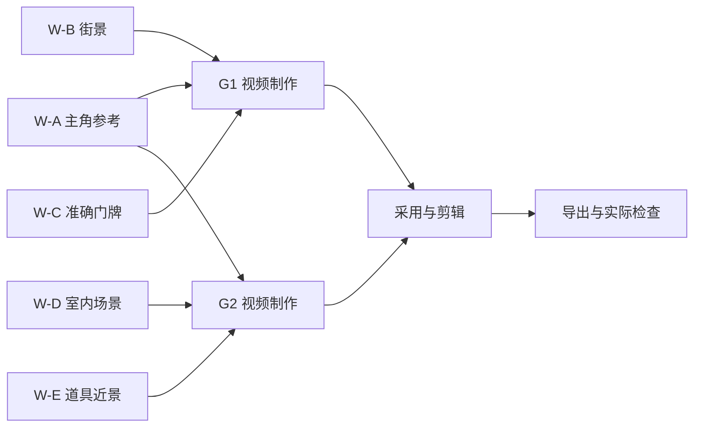

# 01B 完整推演：五个 Worker 如何交互、轮换并接上后续制作

[Multi-Agent 主章](01-multi-agent-runtime.md) · [工具目录](01a-tool-catalog.md) · [总验收](07-mastery-checklist.md)

这是按当前代码机制构造的教学案例，不是一次真实制作的 Trace。ID 是示意；t0、t1 表示事件次序，不代表测得秒数。不要把下面的工作分配、完成比例或时长写进简历当成已测结果。

## 1. 先给一个可讨论的真实业务结构

用户要求完成六镜短片。当前剧本、分镜和两个 ClipGroup 已经保存，相关工作项也已存在。第一组 G1 使用主角、街景和清晰门牌；第二组 G2 使用同一主角、室内场景和道具近景。

Leader 当前可以委派五项独立准备工作：

| 工单 | 职责与目标 | 当前已知输入 | 后续消费方 |
| --- | --- | --- | --- |
| W-A | ASSET_BUILDER：主角身份参考 | 已确认角色 brief、相关镜头需求、现有参考 | G1 与 G2 |
| W-B | ASSET_BUILDER：街景 | G1 所需空间事实、现有街景参考 | G1 |
| W-C | ASSET_BUILDER：准确门牌 | 当前要求的逐字文字、版式用途、已有底图 | G1 |
| W-D | ASSET_BUILDER：室内场景 | G2 当前空间与镜头需求 | G2 |
| W-E | ASSET_BUILDER：道具近景 | G2 道具 brief、实际现有图片 | G2 |

这里五项可以同时 ready，是因为它们的必需输入已经存在，彼此不等对方新产物。如果门牌文字还要等 Writer 新写出来，W-C 就不应被描述成完全 ready。

业务依赖图如下。图中的后续视频/剪辑节点是需要满足的业务依赖，不意味着初始 PlanRevision 已经包含全部带参数步骤。



初始 Leader 只创建输入已经足够明确的五项工作。未来图片版本、H3 task ID 和 Take ID 还没产生，就不能编造它们。等真实结果回来，再创建后续工单；`depends_on` 不会自动生成这些参数。

## 2. 派发以前，分别给五个 Worker 什么上下文

共享的是原始目标、最新指令和相关统一约束。各工单输入不是五份完整项目：

| 输入层 | W-A 角色参考 | W-C 门牌排版 | W-D 室内场景 |
| --- | --- | --- | --- |
| task_inputs | 角色 asset/work-item、相关 group ID | 门牌 asset/work-item、G1 ID | 室内 asset/work-item、G2 ID |
| required artifacts | 当前相关计划版本、身份依据 | 当前门牌用途和必要来源 | 当前空间依据、相关镜头 |
| task constraints | 保持已确定身份特征 | 逐字保留指定文字 | 满足当前已确定的出入口与方位 |
| 可调整内容 | 表现角度、适合用途的参考形式 | 确定性排版与可读性处理 | 不影响连续性的灯光/构图等选择 |
| 起始 schema | 公共读取 + ASSET_BUILDER 起始组 | 同一职责起始组；按需发现 compose_text_plate | 同一职责起始组 |
| 后续补入 | 自己的图片任务与真实结果 | 实际排版参数、图像回执 | 自己的生成状态与观察 |
| 不必默认注入 | 门牌排版全部参数、室内全部历史 | 人物全部生成失败史、G2 全部细节 | 街景全部候选、W-A 的所有工具轮次 |

W-C 需要 `image.compose_text_plate`，但它不在 ASSET_BUILDER 固定起始组中。模型可从短目录发现并请求其 schema；随后使用实际合同调用。W-A 如果需要这一工具也能发现它，角色标签不是一项禁止调用的规则。

相邻约束要写入实际能进入模型输入的字段。若 G2 的进入状态要求“主角右手已有道具”，至少应在 instructions/constraints 或结构化 task_inputs 可见，并有对应已保存事实。不能只写在当前未显式投影的 adjacent_boundaries.guidance 中就假设链路通了。

## 3. t0 到 t4：四个槽怎样服务五张工单

| 次序 | 主循环 / Executor 的动作 | 持久化结果 | 实际并行含义 |
| --- | --- | --- | --- |
| t0 | Leader 提案校验、保存计划；Runner 逐个推进就绪委派步骤 | Action 与 W-A…W-E 创建，携带 source plan/action | 并不是一个工具同时把五个模型调用丢出去 |
| t1 | Executor 选择最先符合条件的四单，登记 claim/Future | 每单进入自己的执行状态 | 假设排序为 A/B/C/D，则 E 留在 ready backlog |
| t2 | A 决策选择 image.enqueue，保存 REQUESTED；B/C/D 各自进行模型或工具操作 | A 的参数和工作笔记已落盘 | 一张工单的模型与工具按顺序；不同工单可重叠 |
| t3 | A 在持久化回合边界发现 E ready，结束本次推进 Future | A 的 next_owner 与请求仍在 | 释放槽位不取消 A，不丢图像请求 |
| t4 | 主循环收取 done Future，再选择 E 或其他合法候选 | claim 更新，E 开始自己的决策 | 由资格与排序决定轮换，不保证任意机器上的固定秒数 |

t3 可能发生在模型请求已保存后，也可能发生在某次工具结束后；核心条件是已经到安全协作边界。当前不会把 A 的同步网络请求从中间强行切断。

不要把 updated_at 排序称为严格轮转调度：它能让较久未推进的合法工单获得机会，但没有形式化的最大等待时延保证，也没有让任意工作都平均占时。

### 追问一：四个都在等远端生成，第五个怎么办

必须分两种等待：

- 工具正在同步请求远端或下载文件：线程正在执行，不能立即让出。
- 已拿到稳定 task ID，下一次轮询尚未到期：保存 REQUESTED 续接和 continuation_not_before，Future 可以结束，槽位用于其他工作。

后一种是把等待建模成状态，而不是线程里 sleep。这里节约的还有重复模型决策；下一次确定性轮询不用再问“要不要查一下”。

### 追问二：A 让出前刚写到一半，会不会被 E 覆盖

公平让出以一次调用/决策已完成并持久化为边界，不把一个 Tool handler 的数据库写入拆半。E 的工具还要经过自己的项目/参数/版本检查。不同对象的合法局部修改可保留；同一对象冲突需要实际业务合并或拒绝，不由公平调度自行解决。

## 4. t5 到 t7：工具结果如何重新变成有效上下文

假设 W-C 先完成本地排版，W-A/W-B 随后取到可用图片，W-D/W-E 还在进行。

W-C 的某个已成功工具轮次 sequence=3 返回新图片和保存回执。它可以交付：

```json
{
  "status": "COMPLETED",
  "concise_summary": "门牌文字图已保存，指定文字逐字保留，可用于 G1 的选定用途。",
  "saved_tool_result_sequences": [3],
  "deliverable": {
    "asset_id": "asset-label-demo",
    "work_item_id": "work-label-demo",
    "clip_group_id": "group-1-demo",
    "usage": "按本工单约定的门牌参考用途"
  },
  "findings": ["此结论针对当前保存图片；后续进入视频后的清晰度仍需观察。"]
}
```

这段示意只有在 sequence=3 确为本工单真实成功结果、额外交付也符合任务合同的情况下才成立。实际 Runtime 从保存回执补齐引用，不能由模型把不存在的第 3 轮说成成功。

Leader 下一次看到的是 W-C 的真实完成结果和引用；W-A/W-B 的完成也陆续进入同一机制。原图像文件不会通过模型文字在 Agent 之间“传输”。媒体以资产记录与路径保存；像素只在需要视觉判断的请求中作为实际附件使用。

如果 A 已完成而 C 还未完成，Leader 可以继续独立任务或保留在途工作，但不能把“当前有一些图”泛化成 G1 所有输入齐备。必须核对具体使用的身份、场景、准确文字和范围。

## 5. t8 到 t10：G1 不必等 G2 的全部资产

当 A/B/C 已交付当前可用输入时，Leader 可以创建 W-V1，负责 G1。W-D/W-E 不因此停止。典型控制流如下：

1. `prepare_completion_planning` 消费实际新完成工单，捕获当前计划与意图快照。
2. 后台 `plan_after_completions` 根据真实引用生成后续步骤。此时 Worker 池继续执行 D/E。
3. 返回后 `apply_completion_plan` 重新校验快照，没有被新消息或换计划淘汰才应用。
4. 新计划保留 D/E 的 active-plan 归属，并继承相关已完成 Action；W-V1 的参数使用 A/B/C 的真实结果。
5. W-V1 通过选定组上下文、准备工具或显式路线工具继续执行。

这里有三种不同的身份：A 原 Action 的 plan_revision_id 不变；当前计划保存精确 inherited_action_ids；仍在执行的 D/E 更新 active_plan_revision_id。把这三个动作全部说成“更新版本号”会漏掉归属语义和原子应用要求。

### W-V1 到底接收了什么

它需要 G1 当前镜头/时间窗、选中的图片版本、真实输入用途和上一轮有用的观察，不需要 D/E 尚未结束的图片修复流水。

`completion_selected_ids` 根据自己的 task_inputs、非宽泛 scope 引用及实际工具参数选取关联 ID。`completed_work_handoffs` 再注入有关交付。仅共享同一个 project ID 或总计划 ID 不足以匹配所有结果。

如果 C 的结果指出“门牌图片文字已验证，但合入视频后的可读性未知”，W-V1 必须保留这个区分。不能把资产观察扩张为最终视频质量保证，也不该为取回已存排版参数重新付费调用视觉模型。

## 6. W-V1 内部怎样推进 H3

在完整视频目标下，W-V1 可选择 `route.prepare_h3_group` 准备当前组，并显式决定 enqueue。该复合工具可以复用当前有效计划、选择、prompt 和路线操作记录；它的幂等标记必须结合具体操作身份理解，不是任意网络请求失败都可重放。

后续链路依真实返回决定：

| 返回事实 | 程序可以机械做什么 | 仍需要语义判断什么 |
| --- | --- | --- |
| 已保存确定任务，状态可推进 | 保存针对同 task ID 的下一生命周期动作 | 不重新决定生成内容 |
| 远端仍处理，下一次轮询未到期 | 标记 continuation_not_before，释放当前槽 | 不空转调用 Leader |
| 实际 Take 已保存 | 让 Worker 获得读取、观察、原声转写、审阅/采用 schema | 是否满足动作、叙事、声音和本次用途 |
| 输入不相容或参数有明确错误 | 返回具体错误与保存状态 | 修 prompt、换参考、修改方案或交 Leader |
| 提交状态 UNKNOWN | 保留原操作身份，沿对账路径找证据 | 不因超时或空列表推断没受理 |

W-V1 自己可以完成与任务相称的观察和采用，不必每次再加一个独立 Critic。对复杂连续性也可以委派另一个检查工单，但那是基于具体需求的计划选择。

`video.inspect_take` 观察视觉，不能证明对白说对。需要声音证据时用 `audio.transcribe_native`、相关音频检查/对齐工具；最终成片字幕或叠字是否正确，应查看实际导出而非只看源 Take。

## 7. 在图上插入一次用户纠错

现在假设 G1 已经有可用结果，G2 正在准备。用户要求：“第 6 镜红杯改蓝杯，只改这镜画面，保留原声。”同时页面已把镜头当前正文从 r12 保存为 r13。

这会同时影响四条线，不能靠一个 cancel 标记解释全部情况：

| 线 | 需要知道什么 | 当前应采取的动作 |
| --- | --- | --- |
| 用户消息 | 新要求是否已持久化并成功交接 | pending message 保存，成功交接前不丢消息 |
| 计划与工单 | 哪些目标/范围变了，哪些任务仍合法 | 保留不相关工作；旧提案复查，不强行覆盖新计划 |
| 项目内容 | 第 6 镜实际已是 r13，G1 未变 | 相关保存基于当前正文和精确来源；无关结果保留 |
| Provider 操作 | 旧 G2 请求是否开始、是否已有远端 ID | 未开始的请求可在边界停止；已开始先收尾落盘，已受理沿原 ID 查询 |

### 分支 A：旧 Worker 模型响应才刚回来

若工单已被新计划取代，PM 返回后复查会把它视为 stale，旧 Tool 请求不执行。若新消息尚在队列、尚未完成计划交接，旧决定可能先被保存成 REQUESTED；在下一次 Tool 前的控制边界仍应让出，不能把“落盘请求”混同于“已产生副作用”。

### 分支 B：旧 H3 已经受理

暂停或纠错不能撤回已发生的远端事实。继续按原 task ID 保存输出；新要求改变了相关镜头/组输入，旧候选不因此自动成为蓝杯新版本。它可以保留历史记录，但实际是否采用必须检查当前来源和用途。

### 分支 C：补充计划也在慢推理

Runner 在处理新消息前收取在途结果，旧补充计划可按 `apply=False` 收尾；计划应用本身还会对比原快照。不能仅在调用模型前检查一次版本，就让它一分钟后返回的计划无条件替换当前状态。

### G1 是否也要重做

不能只因“全片计划 revision 换了”就废掉 G1。业务上要检查具体 G1 输入是否变了、采用结果是否仍可用。新计划需要保留有效工单归属；相关组来源检查也应落在实际使用的镜头、时窗和制作输入，而不是整个项目有任何变化就全部失效。

### “保留原声”怎样落到工具与验收

该要求要进入当前 goal、相关工单约束和实际编辑参数。执行局部补拍与替换时使用确切 clip、素材窗口、timeline revision；验证新画面采用后，原音频片段和映射仍按要求保留。仅写一句“声音不变”不是验收证据。真实局部补拍案例与声音验证见[第 04 章](04-evolution-and-experiments.md)。

更完整的事务、事件、SSE 与最终回答链路见[第 02 章](02-correction-consistency-recovery.md)。

## 8. 再插入三个失败，判断该由谁接手

### 失败一：W-C 排版调用缺了必填字段

若 Registry 输入校验失败，handler 未执行。真实错误进入 working_set/protocol feedback，原 Worker 取当前 schema 修参数，不必把整片交回用户。若是 handler 已完成但 output validation 出错，则先查保存工件/receipt，不能盲目再排一次并覆盖。

### 失败二：W-A 多次局部修图仍不满足动作方案

这个问题可能不是再试一次工具就能解决。Worker 应交接已尝试方法、具体候选、仍存在缺陷和证据，提交 PARTIAL/LEADER_REPLAN。Leader 比较修图、简化中间姿势、调整镜头覆盖等方案，明确哪些叙事因果必须保留，哪些表现手段可调整。

不能把“反复修失败”包装成“系统有自动 Reflection，所以总能收敛”。当前 Reflection 更接近显式观察、记录缺陷和语义调整；没有普遍收敛证明，也没有必须跑固定轮次的 Critic。

### 失败三：进程在请求落盘后退出

- REQUESTED 尚未执行：恢复时能找到原请求，通常先沿它继续，不另问模型编出新请求。
- IN_PROGRESS：恢复不能假定未执行。当前会规范化中断状态，外部操作依其任务记录与对账路径判断。
- Provider 已成功、本地下载中断：优先 recover_output，不能把缺本地文件当成生成没发生。
- Worker 完成但 Leader 尚未消费：已保存结果仍可被发现；已消费但可选补充规划失败，不能无界重试同一完成事件。

这些保证依赖不同记录和恢复路径。不能概括成“SQLite 持久化，所以一切 exactly-once”。

## 9. 最终汇合：谁可以说完成

G1、更新后的 G2 都有可用采用结果后，后期工单读取当前 editorial 时间线。局部编辑需要真实 timeline_id、clip_id、expected_revision；整集保存必须保留其他片段，单镜头保存要按实际使用位置合并。

后期完成后有几个不同证据：

1. 时间线保存回执证明采用关系、时窗、声音和字幕的当前记录。
2. 实际导出记录证明文件确已生成，且对应哪个保存修订。
3. `timeline.read_export` 的实际解码/抽帧及相称音频观察证明检查过什么；未检查部分应保留限制。
4. AgentResult 证明这个后期工单如何报告交付，并不自动证明原目标全部完成。
5. Leader 核对当前 goal 与未解决事项；Runner 检查没有待交接新消息或仍需等待的执行，再输出最终回答。

如果在导出期间用户又补充要求，最终答复不能把旧导出直接说成已满足新要求。job 完成状态与最终聊天事件当前也不是一个覆盖全部路径的分布式原子提交；要按实际持久化点分析恢复。

## 10. 为这个案例设计评测，别只问“看起来顺不顺”

下面是建议测量项，不是本轮已跑出的成绩。

| 指标 | 明确定义 | 为什么有用 |
| --- | --- | --- |
| ready-to-start | 工单同时满足依赖、所有权、未到期限制解除等资格后，到实际开始推进的时间 | 看是否存在饥饿；等待审批或轮询到期前不应混入 |
| Worker 并发 | 每一时刻真实执行区间的数量，另记录等待轮询 | 区分 4 个登记工单与 4 个同时执行 |
| 交接延迟 | 工单结果落盘到依赖它的新工作首次开始 | 定位 Leader/结果消费瓶颈 |
| 全局规划频率 | 按完成、用户输入、失败、本地计划结束等触发原因分组 | 检测普通轮询是否诱发无效重规划 |
| 重复读取 | 同工具、同选择范围、未被相关写入失效时再次读取的次数及 token | 区分必要刷新与上下文丢失 |
| 重复副作用 | 同业务操作发生非预期重复创建或重复远端提交 | 验证恢复不能只看最终成功 |
| 交接正确性 | ID、版本、当前性、观察范围和后续选择是否匹配 | 文件存在不代表用对文件 |
| 质量与任务完成 | 门牌准确、身份/空间连续、声音保留、交付范围满足 | 不能以吞吐代替用户结果 |
| 总成本 | 外层/工具内全部模型调用、tokens、Provider 请求、墙钟、人工介入 | 多 Agent 不能只统计最外层调用 |

做同任务、同模型、同工具、同输入版本对照，控制可用预算并多次重复。单 Agent 与四 Worker 的差异可能来自更多推理预算，也可能来自隔离和并行，需分别解释。一个用例更快不证明整体成功率更高。

对故障注入，可以在 Fake service/client 中安排确定的阻塞点与返回顺序：让 C 提前完成、A/B 稍后完成、D/E 持续；在 Leader 推理期间插入纠错；在工具副作用完成但回执未保存附近模拟中断。不要依靠随机 sleep 碰运气验证竞态，也不要为测试真实重发付费生成。

## 11. 源码导航与已有测试覆盖

以下只说明已有检查入口，本轮没有执行这些测试。某项测试证明的是给定 Fake/fixture 下的性质，不自动覆盖所有真实 Provider 行为。

| 要证明的性质 | 找哪里 | 现场应读出的断言 |
| --- | --- | --- |
| 只派依赖已成功的步骤 | [test_agent_runtime.py](../../backend/tests/test_agent_runtime.py)：`test_dynamic_plan_graph_exposes_only_ready_steps` | 未满足依赖不会 ready，完成身份属于正确计划 |
| 工单具有独立上下文 | [test_agent_runtime.py](../../backend/tests/test_agent_runtime.py)：`test_structured_delegation_round_trip_and_work_order_context` | scope、决定和上下文如何保存并恢复 |
| 缺失/过期 manifest 被拒绝 | [test_agent_runtime.py](../../backend/tests/test_agent_runtime.py)：`test_exact_context_manifest_rejects_missing_or_stale_versions` | 不悄悄读成另一版本 |
| 独立决策真正并行 | [test_team_executor.py](../../backend/tests/test_team_executor.py)：`test_executor_runs_independent_specialist_decisions_in_parallel` | 重叠与进出边界，而非仅有线程池对象 |
| 剩余槽不足时不抢占全部 backlog | [test_team_executor.py](../../backend/tests/test_team_executor.py)：`test_executor_leaves_backlog_unclaimed_until_slots_are_free` | 未派发工单保持未 claim |
| 慢外部操作不锁死读取 | [test_team_executor.py](../../backend/tests/test_team_executor.py)：`test_production_manager_serializes_writes_without_blocking_external_io_or_reads` | WRITE 与 READ/EXTERNAL 的实际重叠边界 |
| 同一选择更新，不丢其他选择 | [test_partial_media_handoff.py](../../backend/tests/test_partial_media_handoff.py)：`test_latest_same_scope_updates_without_losing_other_scope_and_budget_keeps_exact_reads` | 同范围替换，异范围保留，超预算仍可精确回读 |
| 默认参数归一化不吞掉分页 | [test_harness_tool_context.py](../../backend/tests/test_harness_tool_context.py)：`test_read_identity_normalizes_defaults_but_retains_view_object_and_page` | 等价默认值去重，页面/对象/视图差异保留 |
| 增量结果与慢 Leader 并存 | [test_incremental_worker_planning.py](../../backend/tests/test_incremental_worker_planning.py) | Worker 完成可继续规划，旧提案不压过新消息 |
| 公平轮换保持原所有权与回执 | [test_worker_fairness.py](../../backend/tests/test_worker_fairness.py) | 可用 peer 才让出，任务未被重建或重复提交 |

本次新增发现的邻接 guidance 投影与失效预加载 ID，需要补针对最终 payload/目录的验证；不能拿“存储模型校验通过”作为它们已经接通的证据。

## 12. 20 分钟闭卷白板验收

建议让面试搭档按下面顺序持续打断。要求你始终在同一份对象和时间线上回答，而不是每问一次换一套抽象说法。

| 时间 | 任务 | 必须给出的关键证据 |
| --- | --- | --- |
| 0–3 分钟 | 画出 Runner、PM、Leader、Store、Executor、Worker、Tool/Provider | 区分模型决定、运行代码与业务真相；说出默认非递归拓扑 |
| 3–6 分钟 | 写 W-C 的委派字段和实际输入结构 | role/stage、task_inputs、精确 refs、constraints、验收；知道哪些字段未直接投影 |
| 6–9 分钟 | 让 W-C 发现一个未预加载工具并调用 | 短目录 → schema request → 当前定义 → REQUESTED → IN_PROGRESS → 回执 |
| 9–12 分钟 | 排五项 ready 工作，解释 E 为什么及何时开始 | 认领、4 槽、到期轮询、持久化回合让出、非抢占限制 |
| 12–15 分钟 | A/B/C 完成，D/E 未完，新增 G1 | 无整批屏障，后台 Leader，精确结果参数，继承动作和在途归属 |
| 15–18 分钟 | 插入红杯变蓝杯及旧响应晚到 | 用户队列、计划快照、内容版本、远端状态分别判断；保留 G1 |
| 18–20 分钟 | 走到实际导出与最终回答 | 工单完成不等于目标完成；当前引用、声音保留、真实文件与消息边界 |

不通过的典型回答：“大家共享一个上下文”“角色名决定工具权限”“线程池开 4 就四倍提速”“拿到新版本号重试即可”“工具返回失败就没副作用”“所有子 Agent 都可以继续创建子 Agent”。

通过后，再做一次反向讲解：从最终导出沿引用追到 adopted Take、生成任务、组输入、原资产、上游工单和用户要求。如果只能正向背流程，反向找不到任何具体身份，说明还没有掌握这套协作协议。
