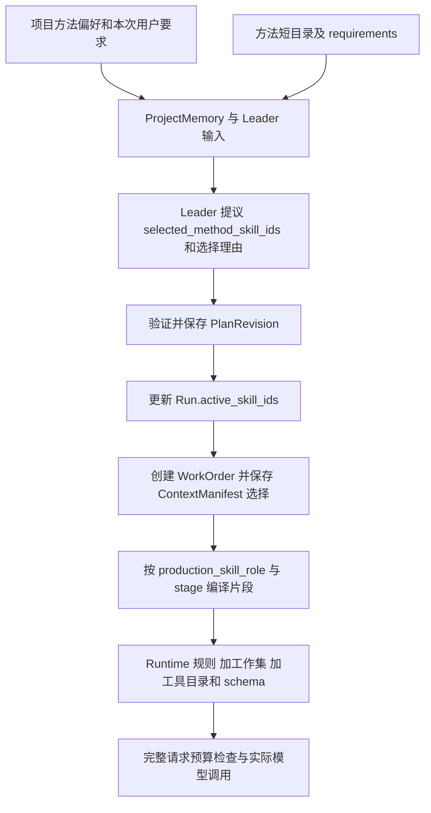

# 01C Skill 管理：从方法目录到每一次模型请求

[返回学习地图](README.md) · 配套：[Multi-Agent 主章](01-multi-agent-runtime.md)、[进度与下一步](01d-progress-and-next-action.md)、[工具全目录](01a-tool-catalog.md)

这章回答五个问题：方法放在哪里，谁选择，怎样裁剪成当前角色需要的内容，修改后何时生效，以及如何证明它确实帮助了任务。这里的 Skill 是本产品的方法系统；开发这个产品时使用的 Codex skills 是另一套宿主能力，不能混为一谈。

**核心实现是：用文件管理知识，用显式 ID 管理选择，用角色和阶段确定注入片段，用运行状态确定当前任务，用真实工具执行动作。** Skill 提供“怎么做”的专业知识；它不保存“第几镜已经完成”，也不负责把工具执行到下一步。

本文的“当前实现”来自本次检出源码；“历史结果”来自仓库报告；文末实验方案尚未执行。源码基线与材料口径见 [README](README.md)。

## 1. 先把六种容易混淆的东西拆开

| 对象 | 回答的问题 | 本项目例子 | 不承担的职责 |
| --- | --- | --- | --- |
| Runtime prompt | 作为 Leader/Worker 应怎样工作和交接？ | `prompts/runtime/common.md`、`worker.md`、协议说明 | 不承载所有题材的制片知识 |
| 专业角色 | 这次负责哪类判断？ | DIRECTOR、ASSET_BUILDER、EPISODE_REVIEWER | 不等于一个永久线程，也不自动赋予工具权限 |
| Method Skill | 这类工作有哪些方法和失败经验？ | `method.drama_series`、`method.brand_promo` | 不表示相应软件连接器已经存在 |
| Format / Style | 什么媒介、什么创作风格？ | 格式补充；项目中的风格与用户要求 | 方法不能永久覆盖用户本次明确风格 |
| Provider Skill | 目标服务具体接受什么表达？ | `providers/minimax_h3` 的输入语法与引用约定 | 不应重新创作已经确定的故事事实 |
| Tool / Harness | 能做什么，怎样保存和恢复？ | ToolRegistry、WorkOrder、SpecialistTurn | 不能靠知识文档代替真实 handler、状态和错误处理 |

例如导入 Blender 方法后，模型可以获得灯光、镜头、动画和检查知识；如果没有 Blender 与场景读写接口，它仍不能实际操作 Blender。`method.blender_workflow` 的 `requirements` 正是用来把这一条件交给规划与执行角色。项目没有因为增加这个方法就获得通用 Shell 或 Python 工具。

源码入口：[Skill 模型](../../backend/short_drama/skills/models.py)、[目录说明](../../backend/short_drama/skills/README.md)、[Blender manifest](../../backend/short_drama/skills/methods/blender_workflow/manifest.json)。

## 2. 当前目录怎样管理，为什么分这些层

```text
backend/short_drama/
  prompts/runtime/             共同规则、Leader/Worker、响应协议
  skills/
    shared/roles/              专业角色的共同职责
    shared/methods/            可复用的方法片段，例如后期判断
    methods/<用途名称>/
      SKILL.md                 方法概览与元数据入口
      manifest.json            ID、角色、阶段、来源、执行条件和章节映射
      references/              本地适配后的具体知识
    formats/                   制作类型的必要补充
    providers/minimax_h3/      H3 专属编译知识
    sources/                   上游原文、资料与来源声明
    workflows/                 跨阶段参考，不是强制执行状态机
```

当前方法目录共 **27 项**：创作 17、分析 1、图片 1、声音 1、软件 5、方法维护 2。它们是可组合的知识模块，不意味着同时启动 27 个 Agent，也不意味着每轮把 27 份全文发给模型。

`sources` 和实际注入内容分开很重要。上游文档可能含有其私有工具、旧画布或固定确认流程。保留来源有助于理解和维护知识，但当前 Agent 应收到适配本产品的章节。只有被映射的内容才进入方法正文；不能根据“文件还在仓库里”判断模型已经读到了它。

另一个陷阱是直接修改方法 `SKILL.md` 的说明正文，然后认为所有 Worker 学会了新经验。Loader 会保存这段正文供详情展示，但当前方法编译主要取 **description、requirements、角色/阶段片段、共享前后文**，不会无条件把方法概览全文拼进每个角色。需要影响行为的经验，必须进入该角色实际加载的章节。

这与格式的 `constitution` 是不同路径：`compile_production_prompt` 可以按参数注入格式原则。不要把“方法概览未整段注入”推广成“所有 SKILL.md 正文永远不参与 prompt”。

## 3. Loader 实际做了什么：解析、校验、缓存和注入是四件事

主入口：[loader.py](../../backend/short_drama/skills/loader.py)、[production_profiles.py](../../backend/short_drama/production_profiles.py)。建议按下面顺序读源码。

### 3.1 解析一个方法

1. `load_production_method_skills` 扫描 `methods/*/SKILL.md`，按路径稳定排序。
2. `_read_markdown` 读取 UTF-8 文件及简化 frontmatter。如果声明 `manifest: manifest.json`，再用 JSON 解析对应文件。
3. 合并元数据时，SKILL.md 内联字段覆盖 manifest 的同名字段。新增配置应避免把同一字段维护两份，否则只改 JSON 可能没有预期效果。
4. `_load_composable_skill` 校验角色、阶段、引用和字段类型，建立 `ComposableProductionSkill`。
5. 生成默认 `role_prompts`、特定阶段的 `stage_role_prompts`，并保留共享前后文、来源和执行条件。

这是本项目自己的声明格式和 Python loader。它不是一个完整 YAML 解释器，也不能仅凭文件名 `SKILL.md` 就宣称与所有 Agent Skills 宿主原生兼容。

### 3.2 按精确章节取知识

manifest 中的一项引用形如：

```text
references/production-method.md::空间与状态连续性
```

`_read_source_section` 查找 **标题文本完全相等且恰好出现一次** 的 Markdown 标题，取到下一个同级或更高级标题之前。因此会保留其下级小节；不是随意取固定字符，也不是向量检索。缺文件、标题不存在或同名标题重复都会报错。

`role_references` 则是完整参考文件，追加给指定角色。章节映射和完整文件引用是两个不同入口；检查上下文成本时必须一起看。当前短剧资产角色就有用户素材接收、参考图版等额外完整引用。

### 3.3 “按需加载”要说清是哪一层

首次建立方法库时，loader 会读取目录并构造各方法的角色文本，随后由 `production_profiles.py` 的 `lru_cache` 缓存。**磁盘上预先解析完整目录，与模型请求只注入当前选择的片段，可以同时成立。**

所以这里的主要节省发生在模型上下文：当前 Worker 不收到其他方法和角色的全文；不是宣称每次模型选中方法后才首次从磁盘读取那一章。27 项目录规模下缓存解析结果也能减少重复文件读取。

## 4. 一次真实选择怎样一路走到 Worker



这张图表达数据依赖，不表示所有保存都在一个数据库事务里。

### 4.1 项目偏好是规划输入

用户在设置页选中的方法保存在 `Project.preferred_method_skill_ids`。`StudioService.preferences` 验证 ID、保存去重列表、更新项目，然后刷新 ProjectMemory。空列表表示交由 Agent 按任务选择。

ProjectMemory 的约束里会保留方法偏好和创作方向。新建集会带入相关项目偏好。界面保存设置的成功，只能证明项目配置成功保存，不能证明每个在途 Worker 已经改用了新方法。

入口：[studio_service.py](../../backend/short_drama/studio_service.py)、[StudioSettings.tsx](../../frontend/features/short-drama/StudioSettings.tsx)。

### 4.2 Leader 看短目录并显式返回选择

普通 `ProductionManager.replan` 将方法目录传给 Planner，目录包含 ID、用途、支持角色、分类和执行条件等元数据。当前计划已选的方法会用于本轮 PLANNER / ORCHESTRATION 的提示词；新提议可以返回 `selected_method_skill_ids` 和 `method_selection_rationale`。

初始 Run 先带制作类型的 Skill ID。第一次普通规划不应被描述成“所有候选方法正文都已注入”：候选短目录让模型选择，后续按已保存选择编译正文。源码也有内容规划前置任务和手动提交计划等入口，应以具体调用分支为准。

方法选择具有语义判断，方法编译器则只接受显式 ID。`compile_production_prompt` 明确不按用户文字、分类或关键词猜选方法。两者分工是：**模型提议选什么，代码校验并决定实际装配什么。**

### 4.3 保存计划与更新 Run

`_replace_plan` 验证方法 ID，保存计划及选择理由，处理继承/取消的工单，再更新 Run 的活动 Skill。格式与仍需保留的叙事选择单独处理，当前方法选择从提议进入 Run。

这里有两点需要精确：

- 完整重规划可以替换方法选择；部分完成后的追加计划路径会合并已有和新增方法，不能把两条路径都讲成“每次清空重选”。
- 计划、目标摘要、活动 Skill、工单进度等有各自的保存步骤，不是一个覆盖全部状态的总事务。恢复和诊断必须看实际持久化记录。

### 4.4 工单取得创建时的选择

`runtime.create_work_order` 把当时 `run.active_skill_ids` 放进工单 `ContextManifest.selected_skill_ids`。之后 `get_work_order` 用 manifest 编译上下文，再根据显式 `production_skill_role` 和 `production_prompt_stage` 编译方法。

角色必须显式给出；没有角色时会报错，不能从 `recipient_role` 的自然语言名称猜。方法先按支持角色过滤。较底层的方法解析器也会跳过不支持请求角色的方法，不会因为“选了一个方法”就给所有人注入它的全部内容。

入口：[production_manager.py](../../backend/short_drama/production_manager.py) 的 `replan`、`_replace_plan`、`get_work_order`；[runtime.py](../../backend/short_drama/agent_runtime/runtime.py) 的 `create_work_order`、`set_run_active_skills`；[context.py](../../backend/short_drama/agent_runtime/context.py) 的工单编译路径。

## 5. 用短剧方法具体解释：同一个 Skill，五个人拿到什么

以下映射来自 [drama_series/manifest.json](../../backend/short_drama/skills/methods/drama_series/manifest.json)，是当前实际章节，不是临时设计的示例名。

| 角色与阶段 | 方法提供的核心章节 | 为什么这样分 |
| --- | --- | --- |
| PLANNER / ORCHESTRATION | 本次制作范围；渐进分镜与可选检查 | 判断用户交付边界、安排依赖与适量检查 |
| DIRECTOR / STORYBOARD | 镜头语言与情绪；表演与物理动作；空间与状态连续性；渐进分镜与可选检查 | 把故事转成可制作的动作、镜头和连续状态 |
| ASSET_BUILDER / ASSETS | 资产制作；另加该角色声明的用户素材/图版参考文件 | 获得素材制作方法，不重复整份编剧工作流 |
| VIDEO_PROMPT_COMPILER / VISUAL_GEN | 当前事实与有序引用；连续表演与角色声音签名；真实连续性与修复 | 忠实翻译当前生成组的事实与引用 |
| DIRECTOR / POST | 当前作品与最小修复；声音与字幕；精剪与情绪；当前范围检查 | 面向实际采用媒体和剪辑，不重新从空白分镜开始 |

选择顺序由 `ComposableProductionSkill.prompt_for` 实现：有 `(stage, role)` 精确覆盖就用它；否则使用该角色默认方法。**阶段覆盖不是在默认正文后再叠一份全部阶段正文。** 但角色声明的额外参考文件仍可能被加载，要看 loader 的组合过程。

POST 还有另一层隔离：共享 DIRECTOR 职责切到 `shared/roles/post_director.md`，并跳过普通格式的导演补充。这解释了为什么只替换一章方法，有时还不足以清除“继续补齐分镜”的旧倾向：共享角色和格式补充也会参与最终 prompt。

Stage 是这张工单的语境标签。一个资产 Worker 可以处于 ASSETS，另一个导演同时处于 STORYBOARD，已完成镜头的后期又可以处于 POST。系统没有要求全项目只处在一个阶段；阶段也不是任务完成百分比。

## 6. Prompt 如何组合和去重：不要只说“拼 prompt”

`compile_production_prompt` 的主干是：制作类型与显式阶段 → 当前角色共同职责 → 可选格式原则 → Planner 的简短阶段线索 → 当前格式补充 → 已选方法 → 已选叙事补充。

随后具体 Leader/Worker 调用还会组合 Runtime 职责和响应协议，并携带结构化目标、工作集、工具目录、已加载 schema。方法编译结果只是最终请求的一部分；不能拿方法文本长度当整次输入长度。

`_render_production_method_skill_prompt` 处理一个具体的重复问题：多个方法都引用同一个共享前言或后记时，使用解析后的源路径作键，按首次出现顺序只保留一次。然后逐方法加入名称、用途、执行条件和对应角色片段。

边界也要讲清：

- 这是共享前后文的确定性去重，不是对任意章节进行语义去重。
- 两个不同路径写着意思相近的规则，不会被自动识别和合并。
- 两个方法给出冲突建议，也没有一个通用“Skill 冲突求解器”保证最优解。用户意图、明确任务范围、方法适用性和代码合同仍是判断依据。
- `requirements` 会进入相关请求，但声明“需要 Blender”本身不构成运行前探测或工具安装。能力存在与否应查真实工具和连接。

可口述的取舍是：先用小而可解释的声明映射解决知识重复和角色污染；规模扩大或冲突变多后，再根据失败数据增加选择或检索机制。

## 7. 运行中改方法，到底谁什么时候能看到

| 改变 | 已持久化的内容 | 已存在工单的行为 | 可以作出的结论 |
| --- | --- | --- | --- |
| 设置页修改偏好 | `preferred_method_skill_ids`、刷新后的 ProjectMemory | 不自动重写工单 manifest | 后续规划能利用新偏好；不能保证在途请求已改变 |
| Leader 提议新的方法选择 | 新计划的选择及 Run 活动 Skill | 被沿用工单仍保留原 manifest 的选择 ID | 新建工单继承更新后的选择；需要改旧工单时必须有明确处理 |
| 修改方法 reference 文件 | 磁盘源文件 | 进程中的方法库可能仍是缓存文本 | 普通文件保存不等于生产进程热更新 |
| 进程重开后恢复旧工单 | 工单仍保存选择 ID、角色和阶段 | 再装配时使用新进程加载的文本 | 选择 ID 保持，不等于正文版本逐字冻结 |
| 用户补充新意图 | Run 最新指令等控制状态 | 每轮 Worker 会再次取得最新目标信息，旧结果还需归属检查 | 用户意图更新与方法选择更新是两条路径 |

当前 `production_profiles.py` 对格式、叙事、方法库使用 `lru_cache`；共享角色按 stage 缓存。H3 的 `_h3_prompt_skill_instructions` 也有缓存。Runtime 的 `runtime_prompt` 文件读取是另一条路径，不能把它们概括成同一种缓存策略。

本次在后端实现与测试中没有检索到方法库统一 `cache_clear` 热重载入口。已有“修改 Markdown 后重新 load”的测试证明 loader 可读取文件变化，**不证明常驻服务会自动刷新已缓存库**。

当前也没有在每张工单上钉住所有方法正文的 hash/version。面试中的正确说法是：选择和执行记录可追溯，完整请求 Trace 能帮助核对当时实际输入；若未来要求跨发布逐字复现，需要另行设计版本记录。不要为了讲高级架构，声称项目已经实现 Skill 注册中心、在线灰度或完整快照回滚。

## 8. 嵌套模型调用：Worker 知道方法，不代表内部调用自动知道

一个常见漏点是：Worker 调用“导演建议”或“H3 编译”Tool，Tool 内部再调用语言模型。若内层没有显式传递方法和阶段，它可能回到默认上下文，甚至在 POST 阶段重新讨论分镜。

本项目对这一点有具体处理和测试：`test_nested_director_inherits_work_order_method_and_post_stage_without_reloading_storyboard` 检查嵌套导演继承工单方法与后期阶段。读代码时要沿 Tool handler → 内层 prompt compiler 追下去，不能止步于外层 Worker payload。

H3 编译路径更明确：[h3_language_prompt.py](../../backend/short_drama/providers/h3_language_prompt.py) 的 `_compiler_instructions` 调用 `compile_production_prompt`，角色是 VIDEO_PROMPT_COMPILER，阶段是 VISUAL_GEN，传入本次 `method_skill_ids`，然后加入 H3 Provider Skill。

它同时约束：方法提供叙事、引用用途和声音连续性，项目提供风格，当前 Provider Skill 提供输出语法，实际 API schema 决定最终字段。编译提示词只是生成文本，不能宣称已经上传或提交了视频任务。最终请求的字符限制与字段合法性仍由适配代码检查。

这种分工解决了一个实际问题：不能让上游 Design 的固定六段格式、本地 IR 和 H3 最终语法同时争夺输出格式。保留专业知识，同时把唯一输出语法交回当前 Provider 适配。

## 9. 新增或修改一个方法，要走哪些具体步骤

下面是基于当前实现的维护流程，不是要求用户额外批准的产品工作流。

1. **从真实问题写出适用条件。** 例如“精确文字图版制作后仍重复整张重生成”，先区分方法缺失、参数不清、工具回执缺失还是 Provider 失败。后面三种不应全塞进 Skill。
2. **确定知识归属。** 通用交接归 runtime；某角色责任归 shared/roles；题材制作判断归 method；供应商字段规则归 provider；对象状态归业务存储。
3. **写可执行的判断。** 包含输入、具体动作选择、成功证据、常见失败和退出/调整条件。避免“追求高质量”这类无法改变决策的句子。
4. **配置 ID、roles、requirements 和章节映射。** 角色/阶段要覆盖真正会调用的入口；仅有漂亮概览不够。
5. **跑 loader 与最终 prompt 级检查。** 验证目标角色确实看到新章节，其他角色没有无关正文，共享规则不重复，嵌套调用也能继承。
6. **检查方法详情和打包。** HTTP 详情应能展示对应片段，Electron 包应包含 md/txt/yaml/json 和 runtime Markdown。源码存在不代表桌面包带上了新文件。
7. **用相关任务验证行为。** 从故障 fixture 开始，必要时真实制作；记录输入成本、错误率、返工和结果质量。只有 loader 测试通过时，应报告结构正确，不应报告视频质量提升。

迁移旧名称由 [skill_ids.py](../../backend/short_drama/skill_ids.py) 做旧 ID → 当前 ID 的读取兼容，避免重复维护同一方法目录。历史 Trace 保持原值。未知 ID 不会因为 alias 函数返回原字符串就变成有效方法，后续目录校验仍要拒绝它。

## 10. 方法会不会自己学习、自己更新

当前不能说“Agent 每次完成任务都会把经验自动固化成新 Skill”。存在经验记录、运行 Trace、方法创作/检查知识，不等于已经建立从试验到发布的自主学习系统。

现有可信链路是：实际运行暴露问题 → 在 Trace/报告中定位 → 工程上修改方法或代码 → 回归检查实际输入 → 必要的真实验收 → 保存结果和限制。这里“经验进入 Skill”通常是维护行为；“这次任务做到哪”由 Run/WorkOrder/Tool 状态保存。

例如“第 6 镜选中 take-42，待检查 4.2–5.1 秒字幕”应进入当前工单状态或笔记，不能写入全局方法；“判断连续性时优先看当前采用片段的真实边界，设计末态只是计划”才适合成为跨任务方法。

如果将来做自动更新，最小可验证闭环可以是：由失败轨迹提出候选修改，在固定回归集对比，确认改善和退化后再纳入方法。它仍需要能力接口、测试集和发布逻辑。把 `method.skill_authoring` 加入目录，只是提供相关知识，没有自动实现这些步骤。

## 11. 能讲成面试故事的三次实际迭代

来源：[Skills 与模型重构记录](../agent-skills-and-model-redesign.md)。以下数值都属于当时报告，不是本轮重新运行。

### 11.1 多个方法叠加，通用说明重复

重构前离线编译 PLANNER / ORCHESTRATION：只选短剧方法为 7,950 字符，再加品牌宣传方法为 10,693 字符，共享前言和后记分别出现两次。问题不是“第二个方法没有价值”，而是每个方法重复包装相同运行规则。

处理方法是让共享前后文独立保存、按来源路径只注入一次，方法只贡献适用的专业正文。已有测试 `test_shared_method_guidance_is_once_across_methods_and_roles` 验证组合结构。

**能支持的结论：**消除了这类确定性重复。**不能支持的结论：**模型准确率提高某个百分比，或当前请求固定减少多少 tokens。报告中的数字是旧组合字符数，缺少同口径效果对照。

### 11.2 文档写了经验，模型实际没有收到

旧设计把部分本地经验放在方法概览，但运行编译主要读取角色片段。于是“人看文档很完整”与“实际请求缺关键方法”同时存在。

改进是登记“原知识 → 实际章节 → role/stage 入口”，把经验迁入运行路径，增加最终编译文本检查。后期导演同时切换共享职责和方法片段，避免重新套用分镜思路；资产规划、制作、检查分别接收自己的知识。

这个故事的重点是 **验证最终模型输入**，而不只是测试 Markdown 能打开。方法库维护属于运行系统的一部分，不能只做文档验收。

### 11.3 导入更多方法，却不能导入不存在的能力

2026-09-12 的资料整理涉及本机 19 项来源：16 项成为新方法，广告、MV、H3 合并更新，方法库达到 27 项。软件接口和独立音色克隆没有随文档接通，执行条件进入目录和请求。

报告先记录 199 项相关回归，后加旧偏好 HTTP 读写检查共 200 项。覆盖目录、分类、条件、选择、片段加载、详情、旧 ID 和 Trace；还用 Fake 语言结果检查了偏好持久化和规划输入。报告明确没有付费调用，也没有验证未接通连接器。

面试可以讲“完整迁入方法管理链路并验证选择和加载”，不能讲成“实现了 16 个专业软件自动操作能力”。这些用例数也不是 200 次真实视频质量实验。

## 12. 当前怎样验证，再往前该测什么

### 12.1 本次完成的静态检查

本次用 Python 标准库读取当前目录和 JSON，没有导入后端或调用 Provider：

- 27 份方法 manifest，27 个唯一 ID，六类数量与目录一致。
- 27 份都声明 `POST.DIRECTOR` 的阶段映射。
- 410 处章节引用声明，涉及 183 个不同的“实际文件路径 + 标题”组合，目标文件均存在且标题恰好匹配一次。
- 3 处完整角色参考文件引用及声明的共享前后文路径均存在。

410 是重复计数后的引用出现次数，183 是去重后的目标章节数，二者都不是注入 token 数。这个检查确认声明没有悬空，不保证知识合理、所有分支可运行或生成质量达标。

### 12.2 对应现有测试应该怎么读

| 文件 | 优先阅读的用例/性质 | 能支持的结论 |
| --- | --- | --- |
| [test_production_method_skill_loader.py](../../backend/tests/test_production_method_skill_loader.py) | 显式选择与去重；角色过滤；精确阶段；缺文件/重复 ID；共享规则只一次 | Loader 和方法组合符合声明 |
| [test_production_skill_loader.py](../../backend/tests/test_production_skill_loader.py) | 格式隔离；角色 reference；Provider reference；打包文件规则 | 各层知识可以从文件加载，错误可定位 |
| [test_mature_skill_compilation.py](../../backend/tests/test_mature_skill_compilation.py) | POST 导演；真实本地知识；嵌套导演继承 | 实际编译入口保留关键方法与职责隔离 |
| [test_skill_catalog_migration.py](../../backend/tests/test_skill_catalog_migration.py) | 旧方法 ID、新目录与旧工单读取 | 命名迁移兼容，不复制一份旧方法库 |
| [test_studio_method_activity_drafts.py](../../backend/tests/test_studio_method_activity_drafts.py) | HTTP 方法详情与阶段知识 | 用户可查看当前方法片段 |

当前检出未提供项目后端环境，这些测试本轮仅定位和阅读，未重新执行。当前静态检查与历史 200 项回归必须分开报告。

### 12.3 如果要证明“按需 Skill 比整份知识库更好”

下面是建议实验，不是已有指标：固定模型/推理强度、工具、项目初始状态、评测集和总预算，对比 A 基础角色、B 全量方法正文、C 当前角色/阶段装配。再给 C 去掉本地经验或 requirements 做消融。

| 指标 | 如何定义 | 避免的误判 |
| --- | --- | --- |
| 装配正确率 | 用已标注任务检查必需章节出现、禁止的无关章节不出现 | 不能只数选中多少 Skill |
| 执行条件误判率 | 缺连接器时仍声称已执行或提出不可执行动作的比例 | 方法选对不代表能力存在 |
| 目标完成率 | 按实际产物和用户范围评分 | JSON 合法不等于任务完成 |
| 阶段污染率 | 后期任务重新规划无关分镜等不合范围动作的比例 | 不能只凭 prompt 中写了 POST 判零 |
| 成本与延迟 | 完整请求 input/output、首个有效动作时间、总耗时 | 不能只测 Skill 一小段字符数 |
| 返工与保真 | 无关内容被改次数、引用错误、必要重做次数、人工盲评 | 更短更便宜可能同时更差 |

同一任务多次运行并报告方差；质量比较尽量匿名，评测者不知道属于哪组。收益归因要拆开：目录描述更好、角色隔离更好、共享规则少了，或只是模型调用预算增加了。

## 13. 与公开 Skill 机制对照，怎样扩展知识面

Anthropic 的 [Agent Skills 文章](https://www.anthropic.com/engineering/equipping-agents-for-the-real-world-with-agent-skills) 强调分层发现：先给方法元数据，再在需要时读取正文和额外资源。可以借此理解为什么知识库规模不必等于每次上下文大小。此处是本次补充阅读，不据此声称本项目历史上照搬了它。

公开 [Agent Skills 规范](https://agentskills.io/specification) 描述 SKILL.md、可选 scripts/references/assets 及渐进披露。本项目则增加了自己的 manifest、专业角色和阶段章节映射。共同点是把知识从大段固定 prompt 拆成可组合资源；不同点是这里主要由代码按已选 ID 和 role/stage 编译，不能直接等同于通用 Agent 自主遍历文件和执行脚本。

对照 [Voyager 论文](https://arxiv.org/abs/2305.16291) 时，沿用 [第 06 章](06-reading-and-open-source.md) 的区别：它讨论可执行技能及环境反馈；本项目主要是制片方法知识。可以将“参数化的游戏动作技能”作为扩展设计，但不能把本项目 method 数量当作已学会的游戏行动数量。

读完应能回答：你的 Skill 是提示知识、确定性代码、工具组合还是学习得到的策略？谁激活它，谁检查前置条件，失败回到哪里，成功证据由谁给出？这四问比背格式名称更重要。

## 14. 可直接口述的回答，以及必须经得起的追问

> 我们把方法目录、运行职责、Provider 语法和工具实现分开。Leader 读取方法用途及执行条件，返回显式方法 ID；选择进入计划和 Run，新工单把当时的选择存进 ContextManifest。Worker 按自己的角色和阶段装配章节，多个方法共享的前后文只加一次。实际动作仍通过已有 ToolRegistry，导入方法不会凭空得到软件接口。
>
> 我最重视实际输入验证：之前出现过方法概览写了经验，但运行只读角色片段的问题。我们把经验映射到真正入口，并检查后期导演和嵌套调用也能拿到正确阶段。运行进度另存于工单和工具回执，不写进全局方法。当前还有缓存与版本边界：改偏好不自动改在途工单，改文件也不等于常驻服务热更新。

闭卷追问：选择短剧方法后，为什么 POST 导演不会收到全量分镜职责？旧工单继续执行时，新的方法偏好和最新用户要求分别从哪里来？只改 SKILL.md 概览为什么可能不生效？`skills.loaded` 能证明选择了什么，为什么还不能证明模型使用正确？

完整验收见 [07 的 Skill 与持续进度专项](07-mastery-checklist.md)。下一章把这里的“当前任务与进度”展开到每一次持久化、恢复和模型调用。
