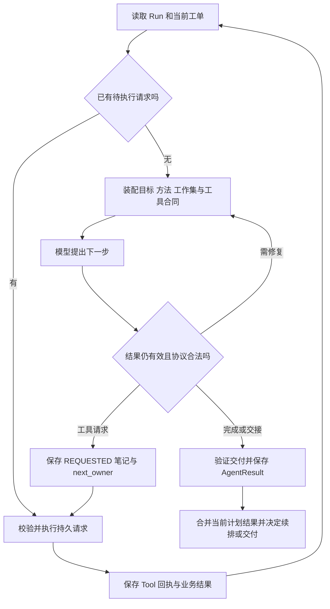

# 01D 持续进度与下一步：Agent 怎么知道现在做到哪里

[返回学习地图](README.md) · 前置：[Multi-Agent 主章](01-multi-agent-runtime.md)、[Skill 管理](01c-skills-management.md) · 交叉阅读：[纠错与恢复](02-correction-consistency-recovery.md)、[上下文与 Memory](03-context-memory-rag.md)

**本项目把持续执行做成“持久状态驱动的一系列模型决策”。** 每轮从目标、计划、工单、工具回执和相关项目内容重建输入；模型提出下一步；运行时校验、保存、执行、再把结果纳入下一轮。长程能力依赖这条闭环，不依赖某个模型调用永远保持一段不断增长的聊天。

“知道进度”还必须拆成三问：现在有哪些事实成立，这次任务还欠什么，以及下一次状态转换应由谁负责。Skill 提供方法，但这三问主要由项目存储和 Harness 回答。

## 1. 从一句用户要求拆出六个不同概念

用户说：“做成完整视频，保留原来的声音，只替换第 3 镜画面。”

| 概念 | 本例内容 | 由谁判断或保存 |
| --- | --- | --- |
| 原始目标 | 原任务要求交付完整视频 | StudioJob / AgentRun 原始要求 |
| 当前目标与最新约束 | 换第 3 镜，保留声音，继续完成交付 | 最新用户指令、goal_summary、重规划 |
| 当前世界事实 | 第 3 镜采用哪个 Take，哪些声音片段仍在时间线 | ProjectDocument、实际文件和当前剪辑 |
| 工作计划 | 补图/补拍、替换画面、必要检查、重新导出之间的依赖 | 当前 PlanRevision / PlanStep |
| 执行进度 | 已生成候选，尚未替换；或替换已保存但未导出 | WorkOrder、Tool turn、Action、业务任务 |
| 下一执行者 | Worker 继续决策、执行已保存工具、Leader 改计划、等待用户 | `WorkOrder.next_owner` 与调度逻辑 |

说“完成了 80%”不能回答这些问题。当前项目也没有一个能保证语义准确的通用完成百分比：两镜中完成一镜，耗时与工作量未必各占一半；写完剧本更不意味着完整视频完成一半。

更好的进度表达是：“新画面候选已保存，原声音未修改；待确认采用区间并更新第 3 镜画面，然后重新导出。”每项陈述都应能找到对应的保存结果或未完成项。

## 2. 状态存在哪里：不能把所有东西统称为 memory

| 层次 | 关键记录 | 谁更新 | 给模型或调度什么信息 |
| --- | --- | --- | --- |
| 产品任务 | StudioJob 的目标、范围、状态、run_id、pending_messages | StudioRunner / 产品服务 | 本次运行入口、控制请求、消息是否交接成功 |
| 总运行 | AgentRun 的 objective、goal_summary、latest_user_instructions、current_plan_revision_id、active_skill_ids | Runtime / ProductionManager | 原始目标、当前目标和当前计划归属 |
| 依赖计划 | PlanRevision 的 steps、depends_on、继承动作和工单、方法选择 | Leader 提议，代码验证保存 | 哪些新步骤可启动，哪些旧工作继续有效 |
| 实际动作 | ActionRecord 的状态、plan_step_id、plan_revision_id、产物引用 | 执行管理代码 | 哪个计划步骤实际成功、失败或仍在执行 |
| 专业工单 | WorkOrder 的任务合同、manifest、角色/阶段、working_notes、next_owner | Leader 创建，Worker 与管理器推进 | 局部目标、上下文范围、后续责任 |
| 工具调用 | SpecialistTurn 的序号、请求、状态、结果 | 请求先保存，再执行和保存结果 | 已请求但未执行、已执行、执行中断等区别 |
| 媒体业务 | GenerationTask、ProviderRun、Route、Take 等 | 业务服务与 Provider 适配 | 远端受理、轮询、回收、本地文件、采用状态 |
| 业务正文 | ProjectDocument、镜头、绑定、当前时间线 | 用户或工具经业务服务写入 | 当前内容真相，不以聊天摘要替代 |
| 紧凑记忆 | ProjectMemory、RunMemory、DecisionMemory 等 | Runtime / 相关刷新入口 | 导航、检查点、决定和线索 |
| 历史记录 | Trace、ProgressEntry、大结果快照 | 各执行边界记录 | 复盘、精确回读和诊断，不要求整段注入 |

主要类型在 [agent_runtime/models.py](../../backend/short_drama/agent_runtime/models.py)，存取在 [store.py](../../backend/short_drama/agent_runtime/store.py)，产品运行入口在 [studio_runtime.py](../../backend/short_drama/studio_runtime.py)。它们不是一个巨大的对象每次全量传给模型，而是按当前决策用途投影。

两个关键分离：

- **Action 成功与作品完成分开。** “提交生成任务”成功，可能只是远端开始工作；后面仍有回收、采用、剪辑和导出。
- **历史成功与当前有效分开。** 旧计划的动作确实成功过，也不意味着它满足用户纠错后的新要求。计划归属、对象修订和实际引用要继续检查。

## 3. 每一次 Worker 决策前，如何重建“我现在在做什么”

建议沿 [production_manager.py](../../backend/short_drama/production_manager.py) 的 `execute_work_order` → `get_work_order` → `LanguageSpecialistAgent` 阅读。

### 3.1 先决定是否真的需要再问模型

如果工单已有持久化的 REQUESTED 工具请求，恢复路径应先处理该请求；不应又让模型猜一次相同动作。如果已经有完整工具回执，下一步可以基于回执继续判断。当前代码借助 turn 状态与 `next_owner` 区分这两种情况。

如果用户已暂停、存在需要接管的新消息、工单已失效或远端任务尚未到查询时刻，则在相应控制边界处理。重新问模型并不是每一个状态变化的必要步骤。

### 3.2 装配任务合同与需要的知识

`get_work_order` 读取工单、Run 和项目，用 `ContextManifest` 得到局部 ContextPack，再以工单显式的角色与阶段编译方法。角色/阶段和任务输入来自持久记录，不靠角色名字、聊天关键词或“已经执行了多少轮”推测。

工单中的 `working_notes`、任务输入、验收标准等会随工单投影进入请求。完整 `specialist_turns` 和完整 `context_manifest` 不直接复制到 Worker payload，而由 ContextPack 与工作集提供相关内容。

### 3.3 从已保存调用折叠出 working_set

`_specialist_working_set` 根据历史 turn、进度条目、对象身份和当前读取范围，整理成：最近交接、独立读取观察、实体状态、工具检查点、待修复问题、已保存结果索引和相关引用等。

同一对象同一读取范围的新观察替代旧观察；不同镜头、不同对象、不同分页应分别保留。已知写入会使相关旧观察退休。目标是保留对下一步仍有用的状态，不是简单截取“最近十条消息”。

工作集还可以加入关联工单的完成交接和相关媒体观察。它不是所有 Worker 历史的公共广播；是否相关要通过当前选择对象和引用等条件判断，详见 [01 主章](01-multi-agent-runtime.md)。

### 3.4 临近请求时再拿当前目标

内置 Worker 构造 payload 时，会从 store 再读取 Run，并放入：

```json
{
  "goal": {
    "original_request": "制作一部完整短片",
    "current_goal": "保留原声音，替换第 3 镜画面并完成导出",
    "latest_user_instructions": ["第 3 镜改成蓝杯，其余声音保留"]
  }
}
```

这是字段形状示例，不是某次真实运行记录。三个字段分别来自 `run.objective`、`run.goal_summary`、`run.latest_user_instructions`。这样即使旧的 WorkOrderView 已创建，最新目标信息仍可进入后续请求。

这不等于整个请求都具有同一时刻的全局快照：旧任务输入、manifest 引用、刚读取的目标、已保存工作集可能形成不同时间点的组合。需要的正是后续归属检查和业务写入校验，不能仅凭“临近发送读了 Run”宣称不存在并发问题。

### 3.5 最后才做完整请求预算

Runtime instructions、角色方法、目标、工作集、工具目录与 schema 全部组装后，由 `ModelInputCompiler` 计数并处理可移出的数据。模型看到的是这次决策的输入，完整历史留在存储中。

因此“它还记得下一步”在工程上通常意味着：下一次请求依然包含正确目标、任务合同、必要观察和未完成控制状态，并且工具能取回被移出的原文。

## 4. 五类进度信息怎样更新，哪些可信度更高

### 4.1 ProjectMemory：项目导航，不是实时全量真相

`refresh_project_memory` 从当前 ProjectDocument 构造摘要、约束与工件引用。摘要函数会提取当前剧本、人物、制作链和部分镜头信息等；约束还包括制作类型、语言、画幅、方法偏好及创作方向。

它有助于快速进入项目，但刷新依赖实际调用点，并非每个字段变化都持续推送进模型的内存。需要确认某个镜头、采用媒体或具体文案时，应读对应当前对象。

入口：[artifact_resolver.py](../../backend/short_drama/agent_runtime/artifact_resolver.py) 的 `project_summary`、`project_artifact_refs`；[production_manager.py](../../backend/short_drama/production_manager.py) 的 `refresh_project_memory`。

### 4.2 RunMemory：当前运行的检查点

`runtime.checkpoint` 保存：`current_focus`、`completed_action_ids`、`blockers`、`open_questions`、`next_actions`、`artifact_refs`。

这里有三处值得解释到源码：

1. `completed_action_ids` 来自已保存 Action 的 SUCCEEDED 状态，不是从模型“我做完了”的句子中抽取。
2. 新 checkpoint 是重建当前摘要，不是永远追加列表；调用时没提供的 blockers 等可能回到默认空集合。
3. 它记录运行总体信息，已完成 action 列表并不天然只属于当前计划。真正能否让新计划某一步满足依赖，由 PlanGraph 按归属再次过滤。

`runtime.resume` 读取 Run、当前计划、Action、RunMemory 和待处理工单，补齐返回快照中的成功 action ID。它不是重放一遍所有历史工具，更不是重新执行所有“未写完成”的自然语言步骤。

`ProductionManager.advance` 会根据当前计划动作更新阻塞、就绪标题、用户问题与引用；某些 WAITING 情况保留已有阻塞/下一步提示。于是摘要仍可能带旧线索，需要结合新回执判断。不能把 checkpoint 当无条件正确的全局事实表。

### 4.3 working_notes：Worker 的短期工作笔记

字段上限是 **8,000 字符**，不是 8,000 tokens。Worker 在工具决策中可以返回 `working_notes`；管理器在确认工单仍有效后，把它和新工具请求一起保存在工单里。没有提供新值时，不会强制清空旧笔记。

合适的笔记是：

```text
本单只处理第 3 镜画面，原声音保持。
已确认当前参考是蓝杯；新候选已回收，见已保存的 task / take 引用。
接下来核对候选可用区间，再替换画面；尚未完成最终导出。
若当前第 3 镜或采用位置已改变，先回读，不使用旧时窗。
```

其中每个具体 ID 应来自真实回执；“尚未导出”也需要在后续完成时更新。它应该保存判断与下一步线索，避免复制整份工具 JSON。不要把个人运行笔记写进共享 AssetPlan 备注，导致其他 Worker 或用户的业务内容被覆盖。

笔记不是永久事实。模型可能省略更新，也可能留下错误判断；代码不能因为笔记说“完成”就跳过完成合同，更不能以笔记覆盖用户新保存内容。

### 4.4 WorkOrderProgressEntry：持久消息，紧凑投影

进度条目按 sequence 追加，带 author、summary、artifact_refs。创建工单、开始/恢复工作和提交结果都会产生相应记录，也有显式追加进度接口。追加一句“素材已完成”不会自动把业务素材项标记完成。

`_specialist_progress_checkpoint` 把这些记录分成 lifecycle、leader_handoff、worker_handoff、external_handoff，分别保留最近一项，并汇总所选条目的引用与总事件数。识别依据是特定生命周期消息和 author，不是一个额外模型把全部历史语义总结成完美事实。

如果同一个来源连续写了两条重要消息，只保留最后一条并不能保证第一条的所有约束仍然可见。因此关键合同必须在任务输入/约束/当前目标中，关键产物必须有可解析引用。完整进度历史仍可供查阅，但不要指望每条历史都进入每轮 prompt。

### 4.5 工具回执与完成凭据：从“自述”走到“可检查结果”

Tool 请求和结果保存在 SpecialistTurn；具体媒体任务、文件、当前内容另有业务状态。Worker 的最终结果可以引用已保存工具结果序号、创建/更新工件和证据。

`_submit_work_order_result_unlocked` 会准备已保存结果、验证相关引用和完成主张，记录 completion receipts。它减少“工具做完了，交接只剩一句模糊总结”的损失。

边界是：结构和文件存在性等可程序验证，叙事质量、视觉连续性、听审结论未必能从这些检查自动得出。一个视频下载成功的回执不能自动变成“人物没有穿帮”的证明。

入口：[completion.py](../../backend/short_drama/agent_runtime/completion.py)、[completion_saved_results.py](../../backend/short_drama/agent_runtime/completion_saved_results.py)、[completion_receipt_view.py](../../backend/short_drama/agent_runtime/completion_receipt_view.py)。

## 5. “应该做什么”怎样从状态变成可执行动作

分成三层判断，分别解决三个不同问题。

### 5.1 Leader：还需要哪些工作

Leader 根据目标、当前内容、已有结果、阻塞和待完成工单，提出新的依赖计划或调整已有计划。PlanStep 显式表达任务类型、目标角色、输入、预期输出和依赖。

部分工单完成时，不必等全部兄弟工单结束再续排。完成交接可以触发 prepare → 后台规划 → apply；应用时重验当前计划和未消费结果，继承仍有效的动作/工单。详细并行时间线见 [01B](01b-multi-agent-walkthrough.md)。

自然语言 `recommended_next_actions` 或 RunMemory 的 `next_actions` 只是建议/摘要。它们不会仅凭字符串就变成一次有效工具调用，必须进入当前计划或合法 Worker 请求。

### 5.2 PlanGraph 和 Executor：哪项现在能开始

[plan_graph.py](../../backend/short_drama/agent_runtime/plan_graph.py) 的 ready 判断是：

```text
先筛选：action 属于该 run、对应当前计划步骤，且来源是当前计划或明确继承
completed = 其中 SUCCEEDED 的步骤
attempted = 其中已有 action 的步骤
ready = 本身不在 completed / attempted，且所有 depends_on 都在 completed 的步骤
```

这也解释了失败步骤为什么不会仅凭“没有成功”被 ready 不停重发：已有 attempt 会排除它，需要恢复或重规划逻辑明确处理。工作线程的 claim、并发槽和可恢复等待是之后的另一层。

默认最多 4 项就绪分工由 [team_executor.py](../../backend/short_drama/team_executor.py) 推进；这是执行器并发约束，不是“模型永远同时思考四件事”。依赖未满足、工单已被 claim、等待时刻未到都可能使它暂时不能启动。

### 5.3 Worker：在自己的合同里选下一个具体动作

Worker 可以请求所需工具 schema、提出单个工具请求、提出满足独立只读约束的 batch，或交付结果。合法响应经过代码验证，后续执行责任由持久化 `next_owner` 表达：

| next_owner | 含义 | 下一步不能做什么 |
| --- | --- | --- |
| WORKER_TOOL | 已有待执行工具请求 | 不能先让模型再决定一遍相同调用 |
| WORKER_DECISION | 基于现有回执继续专业判断 | 不能假装尚未完成的远端任务已经成功 |
| LEADER_REPLAN | 需要上级调整任务或依赖 | 不应让 Worker 无限重复无法解决的局部动作 |
| USER_INPUT | 本次确需用户提供信息或决定 | 不应空转，也不应把所有普通失败都路由给用户 |

这是控制权，不是自然语言建议。`PARTIAL` 本身不能告诉调度器该问谁；PARTIAL + next_owner 才能表达接续方向。普通协议错误也可能给同一 Worker 携带反馈修复，而不是直接宣布整项任务失败。

## 6. 从模型决定到下一次决定：完整状态环



图中省略了暂停、新消息、连接退避、失效结果归档等分支；这些控制在实际边界介入，不能理解成无条件 while True。

关键写入顺序是：模型提出工具动作后，先检查工单仍属于有效工作，保存请求和笔记，标明 WORKER_TOOL，再由执行路径处理。工具完成后回执持久化，后续模型基于保存状态继续。

代码会在短锁内读/验/写，慢模型与媒体操作在锁外完成，再回来核对。不能为了让“进度一直一致”而把整个模型调用放在项目锁里，否则用户编辑和其他 Worker 都会被阻塞。

## 7. 一个必须能连续讲完的推演

下面是用于教学的事件序列，不是声称发生过的新实验。设 A 负责第 3 镜画面，B 负责另一组无关镜头，C 后续负责剪辑导出；原目标始终是完整视频。

| 时刻 | 事件与持久事实 | 下一次决策应看到什么 | 正确后续 |
| --- | --- | --- | --- |
| T0 | Leader 创建 A/B；A 选短剧方法，ASSETS 或 VISUAL_GEN 阶段由具体工单职责确定 | 原始目标、各自范围、依赖和当前选择 | A/B 在允许并发范围内执行 |
| T1 | A 已请求某生成工具；turn 为 REQUESTED，next_owner=WORKER_TOOL | 请求已保存、尚未执行 | 执行这份请求，不重新生成参数 |
| T2 | 提交工具成功，保存业务任务 ID；远端仍运行 | Tool 操作完成，但媒体任务未完成 | 按保存身份等待/查询，不能声称已有可用视频 |
| T3 | 用户保存蓝杯修改并补充“原声音保留” | 当前正文已变；消息仍需交接；旧 A 可能还在执行 | 接管新意图，核对 A 受影响范围；B 不因此当然失效 |
| T4 | 旧媒体任务回收出文件 | 旧输入对应的候选存在；未必满足蓝杯要求 | 保留记录，核对来源和适用性，不盲目覆盖当前采用 |
| T5 | Leader 应用调整后的计划，继承无关 B，安排必要新工作 | 新计划归属、最新目标、仍可复用结果 | 新工单继续，旧失效结果只保留历史交接 |
| T6 | 新候选回收，当前有效工具保存了画面替换；原声音仍在 | 精确采用结果和未完成的导出任务 | C 检查本次范围并导出，不重复生成已用媒体 |
| T7 | 应用关闭，重开读取相同 job/run | 已完成回执、待处理工单、业务任务、pending messages | 按状态恢复；暂停则仍保持暂停 |
| T8 | 最终导出文件保存，目标满足且无未处理的新意图 | 当前作品、真实导出位置、已完成与未完成的检查 | 回复实际修改、影响和交付结果 |

在 T3–T5 之间，至少区分四类“新旧”：用户意图、计划归属、镜头/素材内容修订、远端任务身份。它们不能用一个全局版本号替代。旧远端调用可能必须完成落盘，但旧结果不能自动成为当前作品；另一个无关工单则应尽量继续复用。

T8 也不能固定回复“全部检查通过”。如果只验证了文件导出和画面替换，应说明实际完成范围；静态抽帧没有证明声音正确。目标完成的陈述要与用户要求和已有证据相匹配。

## 8. 长上下文整理后，为什么还能接着工作

预算与精确回读的完整解释在 [03](03-context-memory-rag.md)。这里重点是它如何影响下一步。

模型输入接近预算时，`ModelInputCompiler` 先保存原 payload，再用 `context_ref`、JSON pointer 等定位信息替代大块数据。目标是把大量可恢复细节从当前输入移出，仍能用 `agent.read_context` 分页取回。

当前候选包含工单 task_inputs 中的字段、当前计划步骤的 arguments/instructions、大量读取观察和回执集合、部分实体/检查点/引用等；不是“所有任务说明都永远不可压缩”。原始目标、最新要求、Runtime/输出规则及未列入候选的必要字段得到保护，工作笔记也不会作为普通大结果候选被随意移走。

于是一个正确的下一步可能从“直接使用正文”变成“先回读这块精确输入，再调用保存工具”。如果模型忽略 locator，或者 locator 未暴露给正确 Tool，持久化再完整也不能保证任务成功。应测 **取回后能否继续正确执行**，而不只测 token 数变小。

这也不同于 RAG 相似检索：给定精确 context_ref 和 pointer 是按地址恢复原文；相似检索则要解决召回、时效、适用范围和证据选择。当前机制不能直接包装成成熟 NPC 向量长期记忆系统。

## 9. 为什么“持续了解”不等于实时全知

Agent 在离散决策点观察世界。两个决策之间，用户、兄弟 Worker、外部 Provider 都可能改变状态。即使上下文窗口足够大，也不会自动得到还没读取的更新。

需要区分四种证据：

- **当前读取**：对应对象当前保存的内容，适合判断现在是什么。
- **历史观察**：当时读取/检查的结果，有对象、版本、范围；适合解释当时依据，但可能过期。
- **方法或计划**：说明应该怎样做、预计会发生什么，不证明已经发生。
- **模型笔记**：压缩后的判断和提醒，需要事实支撑。

例如前镜设计写“人物出门时手里拿着伞”，而当前采用视频末尾并未观察到伞。设计末态只能作为计划；真正连续性判断应读取当前采用片段的相关观察。没有观察就是未知，不能为了给下一镜明确答案而把计划升级成事实。

当前代码确实有按对象/范围保留读取和已知写入退休旧观察的逻辑，但不是任意外部变化都能自动推导失效的通用数据库。新增工具时若没接入工作集的身份与失效规则，仍可能留下旧上下文。这是需要覆盖的工程边界。

## 10. 中断和重启：保存到哪里，决定怎样继续

| 中断位置 | 已有证据 | 恢复策略 | 不能宣称的保证 |
| --- | --- | --- | --- |
| 模型调用中，尚无合法输出 | 旧任务和此前回执 | 同一任务重新决策或有限退避 | 不能恢复模型不可见的内部思维 |
| 请求已保存、工具未开始 | REQUESTED turn、参数、笔记 | 按当前有效性执行保存请求 | 不是从聊天里猜参数 |
| 工具已开始但未有完整回执 | IN_PROGRESS 及可能已产生的业务状态 | 结合工具性质和 Provider 身份对账 | 不能统一当作“什么都没发生” |
| 工具完成且回执已保存，下一次语言连接失败 | COMPLETED turn 与产物/任务引用 | 用已保存回执继续 Worker | 不盲目重发昂贵媒体操作 |
| 新消息已入队但交接失败 | pending_messages 仍保留 | 保持同 job/run，后续再次交接 | 收到消息不等于已应用新要求 |
| 计划更新过程的多个保存步骤之间 | 部分状态已保存，部分未保存 | 检查当前计划、继承与工单记录 | 不是所有摘要/计划/方法总事务原子提交 |
| 导出已保存，最终聊天事件未完整写出 | 实际文件与导出记录 | 根据真实产物核对并完成交付说明 | 数据库终态与 UI 消息不是同一件事 |

后台 HTTP 调用不是可在任意指令位置强行迁移的协程快照。暂停/纠错在决策或 Tool 边界接管；已开始的操作可能先完成并保存。远端“已受理但本地没拿到 ID”的未知提交尤其不能以普通重试代替对账。

所以持久化检查点提供的是可恢复线索和协议，不是通用 exactly-once。对副作用的保证要分别看本地写入、请求身份、远端幂等、回收和来源校验，详见 [02](02-correction-consistency-recovery.md)。

## 11. UI 为什么也能持续显示进度，它和 Agent 记忆是什么关系

产品界面依赖后台保存状态与事件，不依赖模型每隔几秒编一句进度。`StudioWorkspace` 初始读取项目与 activity，再用 `watchStudio` 连接带 after cursor 的事件流；收到 job/worker/model 相关事件时刷新 activity，并有周期轮询补充。断连后重新连接并从 cursor 继续读取。

`StudioAgent` 将 agent.action、tool.started、tool.finished 按动作或调用身份合并展示最新状态。聊天、模型文字草稿、正式正文、任务状态各有用途：供应商文字增量只是草稿，完整结构化输出经解析保存后才成为正式内容。

代码入口：[StudioWorkspace.tsx](../../frontend/features/short-drama/StudioWorkspace.tsx)、[studio-api.ts](../../frontend/features/short-drama/studio-api.ts)、[StudioAgent.tsx](../../frontend/features/short-drama/StudioAgent.tsx)、[studio_activity.py](../../backend/short_drama/studio_activity.py)。

Agent 不会通过“看右侧进度条”决定下一步；界面与模型输入都是对后端状态的不同投影。UI 有某条成功事件，也不证明下一轮 Worker 已收到足够的对象和引用信息。反过来，界面瞬时断连不意味着已保存的工具结果丢失。

这是一条很实用的排障分叉：先查业务结果是否保存，再查控制状态是否推进，再查下一次 payload 是否包含结果，最后查 UI 是否正确显示。四层混在一起会把显示问题误修成重新执行任务。

## 12. 一次真实失败：成功已经落盘，接手者仍相信旧错误

[2026-09-17 日常生产报告](../research/2026-09-17-daily-production-goal.md) 记录首片 r21 的声音缓存问题：隔离 profile 漏了本机已有 Whisper-small / wavlm 缓存，造成转写失败。工程处理复制了现有缓存和内部链接，没有下载、没有修改项目正文。

报告记载 **05:32:22 转写自行重试成功，耗时 11.839 秒**。但另一个接手分工仍把旧错误当作当前阻塞，直到 **05:42:50** 通过原生对话补充一条“资源已恢复”的工程事实。同一个 job/run 消化消息，目标保留、pending 清空，没有重启。

这支持三个判断：

1. 工具恢复成功与跨工单理解恢复之间存在传播问题；“结果在数据库里”不充分。
2. 新用户信息的交接可以帮助恢复既有目标，不必新建任务重做全部工作。
3. 自动完成并不完全成立，这里有一次明确的工程事实介入；资源 ready、转写成功和完成听审也不能混为一谈。

它不能单独证明根因一定是某一行 summary 覆盖了新结果。本次检出没有报告所链接的完整原始运行目录，因此这里引用历史诊断，不假装重放了当时每次请求。

**面试中的改进思路**应落实为可测机制：让同一任务的新成功回执能进入接手工作集；让旧 blocker 带明确对象/尝试来源而不成为永久文字；要求当前判断参考最新有效证据。是否已经消灭这类错误，需要针对交接的回归和真实观察，不能由“加了 memory”推导出来。

## 13. 哪些失败该改 Skill，哪些该改代码

| 失败 | 更可能需要处理的位置 | 为什么 |
| --- | --- | --- |
| 后期导演仍要求全片重新写分镜 | 角色/阶段方法、继承与最终 prompt | 专业职责与实际任务不匹配 |
| 正确回执已保存，却在下一轮被同工具别的镜头覆盖 | 工作集身份键和投影 | 模型没有机会看到必要信息 |
| 旧分工晚到覆盖用户改动 | 计划归属、对象来源校验、合并与事务边界 | 不能用“尊重用户”一句提示词代替并发控制 |
| 断线后重复提交收费媒体 | 请求身份、业务任务状态、恢复路径 | 外部副作用必须由执行机制管理 |
| 已看到正确事实，但仍选了不合理镜头表达 | 方法示例、任务约束、模型能力与内容评测 | 此时才有充分理由研究知识或推理不足 |
| 进度一直说“继续完善”，没有真实状态变化 | 调度/交接与可执行动作检查 | 单纯增加更长的进度自述不能解决空转 |

这张表可以帮助你讲出工程判断：先找到信息在哪一层丢了、控制在哪一层错了，再决定改哪一层。不要把所有失败都归结为“提示词不够强”或“模型不够聪明”。

## 14. 如何验证它确实知道进度，而不是看起来一直很忙

### 14.1 现有测试给了哪些抓手

| 测试入口 | 优先阅读用例 | 对应性质 |
| --- | --- | --- |
| [test_production_manager.py](../../backend/tests/test_production_manager.py) | `test_resumed_specialist_reads_latest_user_instructions_with_an_old_work_view` | 旧视图下仍取得最新用户要求 |
| 同上 | `test_specialist_working_set_folds_old_turns_and_progress_by_entity`、`test_builtin_specialist_receives_independent_read_observations_together` | 保留独立对象观察，避免单一历史窗口覆盖 |
| 同上 | `test_replan_cancels_uncarried_work_and_keeps_late_result_as_stale_handoff` | 旧结果可追溯但不冒领新计划完成 |
| [test_studio_harness.py](../../backend/tests/test_studio_harness.py) | `test_pause_preserves_requested_tool_and_resume_executes_it_once` | 暂停后保留已请求动作并按测试条件执行一次 |
| 同上 | `test_failed_message_handoff_keeps_pending_input_and_same_run_after_restart` | 未成功交接的消息不会过早确认 |
| 同上 | `test_startup_recovers_in_progress_worker_without_replaying_completed_tool` | 重启不重复已有完成回执的工具 |
| [test_model_context_budget.py](../../backend/tests/test_model_context_budget.py) | `test_258k_budget_counts_whole_request_and_recovers_exact_overflow_after_restart` | 完整请求预算与重开后的原文回读 |

本轮只阅读和定位这些测试，没有环境运行后端测试；不能把已有用例名称当作本轮通过报告。更不能由一个 Fake 工具执行一次，推出所有远端操作都具备严格 exactly-once。

### 14.2 面向这类问题的最小评测集

以下是新增实验设计，尚未执行。先准备相同起始数据，给每条轨迹插入一个受控变化，检查下一决策与实际结果：

1. 同工具连续读取两个镜头，然后要求同时引用二者的结果。
2. 某次转写失败，之后同一任务成功；换一个 Worker 接手，检查是否仍请求修复已恢复资源。
3. 生成结果已落盘，下一次模型连接失败并重开，检查是否重复提交。
4. 对象变化发生在模型思考与工具执行之间，检查旧写入能否正确拒绝或合并。
5. 修改方法偏好同时保留旧工单，检查方法选择与最新用户目标是否被分别处理。
6. 把必要大输入移出上下文，检查 Worker 是否能精确回读并完成下一动作。
7. 用户目标只要求剧本，写完后检查是否停止；目标要求完整视频时检查是否继续必要后续。

每题要标注：当前权威事实、可用证据、未完成项、允许的下一执行者，以及禁止动作。允许多个合理工具路径，不强迫 Agent 模仿一条固定轨迹。

### 14.3 建议记录的指标

| 指标 | 定义与读法 |
| --- | --- |
| 下一执行者正确率 | 每个交接点 WORKER_TOOL / WORKER_DECISION / LEADER_REPLAN / USER_INPUT 是否符合保存状态 |
| 旧阻塞滞留 | 新的有效成功证据出现后，仍把已消除问题当阻塞的决策次数；同时报告传播延迟 |
| 已完成工作重做率 | 具有可复用有效结果却重复做同一工作的次数，区分必要重做与无效重做 |
| 重复外部副作用 | 按业务请求身份统计多余提交；不能仅用 tool 调用次数代替 |
| 恢复首个有效动作延迟 | 恢复触发到首次推进正确未完成项的耗时 |
| 无状态推进循环 | 一段决策中没有新增有效观察、状态变化、明确等待或终止原因的次数 |
| 目标漂移与错误完成 | 擅自扩大/缩小目标，或缺必要交付却宣布完成的比例 |
| 输入与质量 | 完整 token、费用、总耗时及任务质量共同报告，避免只优化 prompt 长度 |

这些是评测定义，不是当前产品内置的全套监控，也没有现成的百分比成绩。对于长程任务，除了平均成功率，还应报告最坏恢复、人工介入和不确定提交；否则几次顺利演示会掩盖真正难点。

## 15. 和公开长程 Harness 的联系，以及面试口述

Anthropic 在 [Effective harnesses for long-running agents](https://www.anthropic.com/engineering/effective-harnesses-for-long-running-agents) 中讨论跨会话工作：使用初始环境、明确功能清单、增量工作及可交接记录，减少下一会话重新猜测进度和过早宣布完成。这是本次对照阅读；本文不因此新增“项目当时照搬其实现”的历史主张。

映射到本项目，可以把“交班记录”理解为工单、笔记、回执和检查点。但视频系统还要处理远端任务、用户并行编辑和媒体来源，不能只放一个 progress.txt 就获得同等恢复能力。可迁移的是让新决策快速获得可靠状态的原则，具体载体和一致性机制由任务决定。

面试时可以这样回答：

> 我们没有让模型自己维持一段无限增长的对话。目标、计划、工单、工具请求和结果都持久化；每次决策从这些状态重建局部输入。Skill 告诉它怎么做，工作合同告诉它本单要交什么，工作集和实际回执告诉它做到哪，next_owner 告诉运行时谁继续。长结果移出后可以按精确引用回读。
>
> 最难的是状态传播的正确性：保存成功不等于下一轮已经看见，旧错误也可能继续污染交接。我们用对象级观察、明确完成回执、最新用户目标、计划归属和写入来源校验处理不同层次的问题。暂停和重启靠持久边界继续，但不声称任意外部副作用都 exactly-once。是否稳定要用旧事实覆盖、交接失败、恢复重做和目标完成的测试来验证。

掌握标准：不看材料连续讲通第 7 节时间线，并能在每个时刻指出“谁拥有下一步、哪条事实是当前的、哪个结果只是历史、哪些保存不是同一事务”。完整评分在 [07 的专项验收](07-mastery-checklist.md)。
