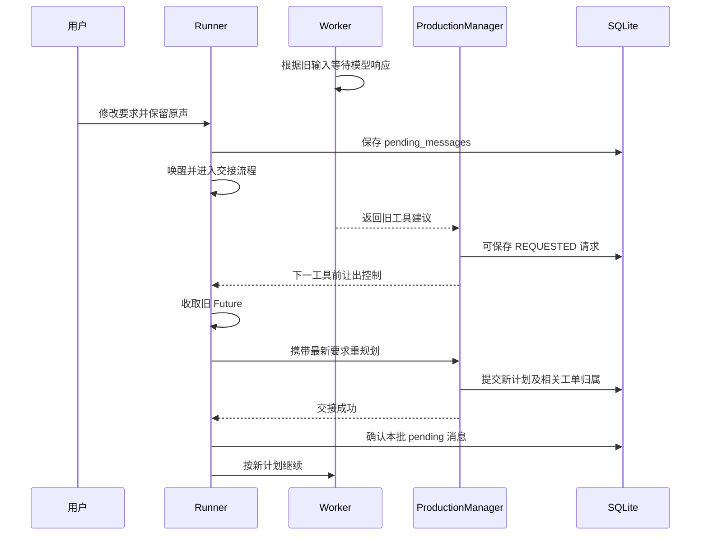

# 02 用户纠错：异步更新、事务、版本与最终回答

[返回学习地图](README.md) · 上一章：[运行架构](01-multi-agent-runtime.md) · 下一章：[上下文与记忆](03-context-memory-rag.md)

## 1. 用一个例子贯穿整条链

假设用户最初要求“做完一部短片”。镜头 S6 当前修订为 12，内容是“父亲拿起红杯”。Worker W 正在根据这个版本准备视频；另有一个 Leader 补充计划调用在等待返回。用户随后要求“杯子改成蓝色，只改这镜画面，原声不动”，并可能直接在页面保存相应修改。

以下 ID 和修订号是教学例子，不是某次历史运行的实际编号。我们要回答六个问题：

1. 新要求如何到达进行中的任务？
2. 旧模型判断返回后是否还能调用工具？
3. 已开始的工具如何收尾，谁检查来源变化？
4. 哪些写入能够一并回滚？
5. H3 若已经受理或提交结果未知，怎么处理？
6. 最终回答为何不能只是“蓝杯已经改好了”？

## 2. 先分三种入口，不能只讲一种“取消”

| 入口 | 当前实现的含义 | 不是自动发生的事 |
| --- | --- | --- |
| 聊天补充消息 | 同一未完成 StudioJob 追加 pending message，唤醒 Runner，下一控制边界交接 | 不直接把“蓝色”写入分镜；不瞬间中止正在运行的网络请求 |
| 页面直接保存 | 按当前对象与 expected revision/text 保存，更新内容和相关失效状态 | 不等于发出一条聊天指令，不自动取消全部 Worker |
| 暂停按钮 | 标为 pausing，收取已开始的操作及回执，再确认 paused | 不等于取消远端已经受理的生成任务 |

“用户纠错使什么失效”必须说出对象：旧计划提案、旧工单归属、旧内容写入、旧生成输入、旧候选采用，分别由不同检查负责。

## 3. 聊天消息在慢模型调用期间到达

### 第一步：先持久保存，立即唤醒

`StudioAgentRunner.send` 找到最新未完成 job，把消息追加进 `pending_messages`，保存 job 和 `chat.user` 事件，设置唤醒 Event。失败/暂停等任务可回到 queued，继续使用原有 job/run 和已完成结果。

此刻“消息已进入系统”不等于“新计划已接受消息”。这也是 UI 能很快收到发送结果，而真正接管需要等当前安全边界的原因。

### 第二步：在下一决策或 Tool 开始前让出控制

`execution_boundary()` 通过 ContextVar 中的 callback 查询是否需要交接；需要时抛出 `ExecutionYielded`。它继承 `BaseException`，用于控制流，不应被通用 `except Exception` 误记为业务失败。

如果 Worker 正在语言推理，不能假定 Python 已取消远端请求。结果可能返回并形成一个已保存的 `REQUESTED` Tool，但在执行这个 Tool 前还会检查控制边界。旧判断因此不能一路执行到新写入。

如果 Tool 已进入 `IN_PROGRESS`，它拥有完成与落盘的责任。`_invoke_scoped_tool` 对复合 Tool 暂时使用不让出的控制上下文，允许其内部必要模型调用完成，避免操作做了一半却没有回执。随后下一边界再交接。

这意味着：新消息不是回滚咒语。一个**已经开始**的写入或远端操作仍可能完成；新的语义要求由之后的计划修正。对“必须立刻停止任意副作用”的要求，需要另一套可中止操作合同，当前不能承诺。

### 第三步：排空旧 Future，丢弃旧补充建议

Runner 的 `_advance_until_handoff` 发现新消息时，先 `collect_finished_work`，不启动新工作；对于已开始的 Leader 补充 Future，以 `apply=False` 收取，旧建议不应用。

`has_active_work` 把已经完成但还未收取的 Future 也算 active。这可以防止“线程算完了但回执未处理，界面已宣称暂停”的竞态。后台 Leader 捕获 `ExecutionYielded` 时也必须 `future.set_exception`；否则线程退出但 Future 永远不终结，Runner 会永久等待。

### 第四步：重规划成功后再确认消息

`_apply_messages` 在没有旧在途 Future 后，复制当前队列前缀。若正在等一个 USER_INPUT Action，提交该回答；否则 `replan_agent_run`，把最新要求和作用范围传给 Leader。

只有持久化计划/输入交接成功，才从队列删除这段相同前缀。处理期间追加的新消息在尾部保留。失败时 pending 内容仍在，重启后原要求可以继续被处理。

注意：这里是“先成功交接、后确认”的顺序保证。计划保存与 pending 队列删除并不是一个包住所有过程的跨模块事务；不能由此宣布消息 exactly-once。若要进一步证明崩溃窗口内严格去重，需要逐一核对消息身份和重放行为。

### 第五步：替换计划，保护工单归属

新计划明确保留仍有价值的工单；不再相关的旧工单不能继续当当前工作执行。`source_plan_revision_id` 记录来源，`active_plan_revision_id` 表示目前归属。

Worker 返回 Tool 请求或最终结果时再次核对归属。`_work_order_stale_reason` 检查取消/当前 active plan 不匹配；晚到结果可以保存为 `stale_handoff=True` 的历史交接，但不合并为当前完成结果。

已有 H3 task、远端 ID、已保存文件不会仅因为 PlanRevision 更新就重新生成。保留工单、保留执行身份与重新验证内容适用性，是三件相连但不同的事。

### 时序图：消息接管旧决策



图中展示一种可能交错，不表示每次都必须保存旧 REQUESTED。核心是不让尚未开始的旧工具绕过新消息边界。

代码：[studio_runtime.py](../../backend/short_drama/studio_runtime.py) 的 `send/_apply_messages/_advance_until_handoff`，[execution_control.py](../../backend/short_drama/agent_runtime/execution_control.py)，[production_manager.py](../../backend/short_drama/production_manager.py) 的 `execute_work_order/_execute_pending_specialist_tool/_submit_work_order_result_unlocked`。

测试：[test_studio_harness.py](../../backend/tests/test_studio_harness.py) 的 `test_mid_decision_user_input_supersedes_stale_write_and_is_not_truncated`、`test_failed_message_handoff_keeps_pending_input_and_same_run_after_restart`、`test_pause_inside_started_composite_tool_keeps_its_receipt_and_does_not_replay`。

## 4. 页面直接保存时：别把所有情况都归给重规划

用户直接编辑 S6，并提交 `expected_revision=12`。`StudioWorkspaceService.save_shot` 在当前对象确实仍为 12 时，构建修订 13，更新引用及受影响生成组的内容；正式分镜路径也会通过 storyboard patch，相关 Take 被标记 stale，旧文件保留。

旧 Worker 随后拿修订 12 保存同一镜头时，修订检查拒绝，错误包含请求修订与当前修订。Worker 应回读当前镜头，判断自己改的字段是否仍需要，并基于最新状态重新提出必要改动；不得把 expected revision 机械改成 13 后原样覆盖。

场次保存的前置条件有所不同：`save_scene` 可检查 `expected_text`；涉及关联场次时先验证全部目标，避免前一场已改、后一场才发现冲突。修改结构化台词还要检查它确实来自正文、ID 归属唯一。只改自然语言正文而未提供一致的结构化台词时，会保留结构需同步的标记，不能假装对白绑定已自动修好。

时间线又有自己的 `expected_revision`。计划版本、镜头修订、时间线修订、媒体版本不能互相替代。

**面试追问：为什么不只用全项目 version？**

答：改 S20 的字幕不该阻止 S6 的素材登记。全局版本变化是“需要检查”的信号，但业务有效性要看实际选择的对象、字段和来源。过粗会造成无关失败和反复回读；过细但不检查依赖，又会把依赖旧对白的新镜头写进去。

源码：[studio_service.py](../../backend/short_drama/studio_service.py)、[studio_editorial.py](../../backend/short_drama/studio_editorial.py)。案例：[日常生产改进](../research/2026-09-17-daily-production-goal.md) 中《修好了》草稿组并发保存与时长修复。

## 5. 三方合并到底解决什么

Repository 读取时保存独立 `loaded_snapshot`。提交时在事务中读取最新持久内容，对三份值比较：

- `base`：这次工作开始时读到的状态。
- `proposed`：调用方基于 base 做出的修改。
- `saved`：数据库现在真实保存的状态。

简单字段规则可这样推导：

```text
proposed == base             → 本次没有改它，采用 saved
proposed == saved            → 双方已经一致，采用 saved
saved == base               → 只有本次修改，采用 proposed
双方均不同且不能递归合并       → 保留 saved，记录冲突路径
```

例如 base 是 `{cup: red, camera: wide}`，用户已保存 `{cup: blue, camera: wide}`，Worker 提出 `{cup: red, camera: close}`，最终是 `{cup: blue, camera: close}`。Worker 没改杯子，保留用户修改；机位是独立改动，可以合并。

如果 Worker 提出 `{cup: green, camera: close}`，杯子字段冲突，仍保留 blue，同时记录该路径。对象数组按稳定 `id/shot_id/character_id` 合并，不按第几个元素误配；冲突的重排也优先保留当前保存顺序。当前剧本指针变更时，另有旧剧本内容保护。

“保留用户修改”在底层的精确定义是保留当前已保存的冲突值；算法不靠作者身份判断谁更可信，也不按模型输出的自报时间选择赢家。

它**不是** CRDT，也不保证合并后的故事语义一致：摄影变近景可能与用户刚新增的动作冲突，即使字段不同。Pydantic 结构有效也不等于叙事合理。需要业务读取依赖、来源验证与必要的语义复核共同处理。

普通保存允许保留当前冲突值；媒体登记等特定路径使用 `reject_conflicts=True` 或 `validate_merged` 进行更严格的最终验证。Repository 会把实际保存后的对象回写调用方，并在 `content.updated` 中记录 `kept_user_edits`；调用方不能仅根据自己的 proposed 文本向用户宣称全部改动均已生效。

源码：[document_merge.py](../../backend/short_drama/document_merge.py)、[repository.py](../../backend/short_drama/repository.py) 的 `_save_project_on_connection`。

## 6. 锁和事务要分别说清

| 机制 | 当前作用 | 不能保证什么 |
| --- | --- | --- |
| Runner 的锁 | 保护 job、消息队列、控制状态等局部操作 | 不包住整次模型与远端请求 |
| run lock | 保护计划/工单状态的短读取与更新；慢 Worker 决策和增量 Leader 请求在锁外 | 不应笼统声称所有重规划路径均已改为锁外 |
| 项目写入通道 | 串行执行直接内容写工具，慢外部操作自己管理短保存 | 不等于每个工具一个跨系统事务 |
| SQLite `BEGIN IMMEDIATE` | 串行写事务，提交或回滚同一连接上的相关写入 | 不回滚外部媒体请求和已经产生的文件 |
| `repository.atomic()` | 在线程本地复用一个连接；嵌套失败标记可让外层整体回滚 | 不跨线程传播，也不自动涵盖未进入该上下文的路径 |

三个有证据支持的原子边界：

1. 新 PlanRevision、Run 当前指针、继承 WorkOrder 归属：`AgentRuntimeStore.append_plan_revision`。
2. AgentResult 与对应工单状态：`AgentRuntimeStore.save_agent_result`。
3. 接受用户审阅修改时，正文修改、Take 失效、决定和事件：`studio_changes.decide_change` 外层 `repository.atomic()`。

第三项只有用户明确使用审阅功能时才存在，不是给所有写入增加审批门。直接 `save_scene/save_shot` 的方法体主要用锁，并顺序调用 `mark_takes_stale`、`save_project`；没有外围 atomic 时，不应声称这些调用天然共享一个总事务。`save_project` 自己的内容与内容事件写入有事务，不能据此扩张成整个业务链全原子。

还有两个同样重要的边界：新计划应用和消息确认是分开的；最终 job 完成和最终聊天 Trace 也是顺序操作。当前可讲的是各路径的实际保护及恢复，不能说“任何崩溃点都绝不重复/绝不丢展示”。

若被要求进一步改进，可提出：针对具体多写入路径使用现有 atomic；为“业务终态与最终事件”考虑同事务写入或可重建的交付记录；为消息引入明确消费身份。但这些是后续方案，不能写成当前已经实现通用 outbox 或完整事件溯源。

测试证据：[test_incremental_plan_state.py](../../backend/tests/test_incremental_plan_state.py) 的回滚用例，[test_studio_record_storage.py](../../backend/tests/test_studio_record_storage.py) 与[存储验收报告](../research/2026-09-16-storage-improvements.md)。历史测试使用真实 SQLite 触发器制造提交失败；它能验证事务，而不是只让一个 fake 函数返回失败。

## 7. 用户改了杯子，H3 已经开始生成怎么办

### 本地准备与真正提交是两个不同状态

正常路径可以简化为：

```text
QUEUED
  → 准备媒体与请求
SUBMITTING + PREPARED
  → 保存 submission_attempt_state=STARTED
  → 发送 HTTP
ACKNOWLEDGED + provider_task_id
  → 查询同一任务
RUNNING
  → 回收真实文件
SUCCEEDED + Take
```

`PREPARED` 明确还没开始发送；重启可按已保存请求继续。`STARTED` 表示可能已经跨越远端副作用边界；进程崩溃或响应丢失不能据本地没 ID 就判断未提交。

`_submit` 先查本地 fingerprint 对应的已知远端 ID；有则复用。发送前再检查实际输入是否仍适用。明确请求拒绝与 `H3SubmissionUnknown` 分开，后者进入 `SUBMIT_UNKNOWN`，不自动再次发送。

**fingerprint 的边界：** 它用于本地请求身份、去重记录和推进锁。当前代码不能证明供应商按这个指纹提供全局幂等。如果远端建单成功但响应未到，数据库事务无法抹掉这个不确定窗口。

### 已经受理的旧输入如何处理

用户修改源内容后，旧远端任务仍可能完成。`_output_freshness` 根据当前 `input_staleness_reason` 判断输出是否 stale；文件可保留为候选，但是否采用须基于当前内容与实际结果判断。

不要把“过期”说成“文件损坏”，也不要把“文件可读”说成“符合蓝杯要求”。例如生成结果碰巧已经出现蓝杯，仍需要实际检查与明确采用合同，而不是凭旧请求状态自动认定适用。

来源保护应落到当前生成组。其他镜头修订或全片绝对时间顺移，不应让内容和源窗未变的组全部失效；真正变了本组镜头、图片版本、对白映射或源窗，则应拒绝旧输入。见[当前 H3 来源合同测试](../../backend/tests/test_h3_current_source_contract.py)、[成片位置变化测试](../../backend/tests/test_h3_source_position.py)。

### 提交未知如何恢复

1. 保留原本地任务、请求指纹、提交尝试与未知状态。
2. 有明确远端 ID 时直接查询并检查模型、时长、分辨率、比例、任务类型和输入模态等兼容性。
3. 无 ID 时可有界分页查候选，回执保存查询范围和停止原因。
4. 候选相容不等于身份已证明；候选列表不会自动绑定。
5. 空页只说明该次读取为空，不能证明远端从未建单。
6. 只有获得足够依据后，才对账绑定或明确记录未创建；不要用一次超时/空列表绕过 UNKNOWN 重发。

当前 `resolve_not_submitted` 要求理由，但非空字符串本身不是“远端未创建”的机器证明。把判断责任与接口结构约束分开，是回答这个问题的深度所在。

历史《修好了》确实出现两次列表为空仍保留 UNKNOWN 的记录；截至用户暂停，另一个补拍成功也没有替原 UNKNOWN 消除不确定性。见[日常生产报告](../research/2026-09-17-daily-production-goal.md)、[分页对账报告](../research/2026-09-16-h3-reconciliation-pagination.md)、[h3_worker.py](../../backend/short_drama/h3_worker.py)。

## 8. 暂停、崩溃与重启：分别恢复什么

| 崩溃/暂停位置 | 已知事实 | 合理恢复 |
| --- | --- | --- |
| Worker 决策未返回 | 没有新工具请求 | 使用已保存目标、笔记和回执重新判断 |
| 请求为 REQUESTED | 已决定但尚未开始 | 保留同一请求；恢复后先检查用户/计划边界再执行 |
| 普通 Tool 为 IN_PROGRESS | 本地不能确定执行是否完成 | 标为 INTERRUPTED 并检查业务落盘，不盲目重放副作用 |
| Tool 回执已完成，下次 LM 失败 | 工具结果已经存在 | 有限重试语言判断，不重复已完成写入 |
| H3 PREPARED | 已准备，发送尚未开始 | 继续相同请求的提交准备链 |
| H3 STARTED 且没有已知 ID | 可能已经在远端建单 | UNKNOWN/对账 |
| H3 有远端 ID | 受理身份已知 | 查询同一任务，下载缺失文件时走恢复输出 |
| 用户暂停后重开 | 暂停意图仍有效 | 保持暂停；继续时复用同 job/run/task |

`_recover_interrupted_operations` 按动作类型和当前领域记录做恢复，不是简单把 RUNNING 全改为 PENDING。连续语言传输故障使用同任务的有限 3/8/20 秒退避，成功语言请求会重置这段连续失败计数；不是限制整个任务一生只能重试三次。语义错误、非法参数和远端未知不能全部塞进同一个 retry 循环。

历史局部补拍中，H3 取得远端 ID 后暂停、退出、重开、继续，沿用同一任务查询，没有重复提交。这是特定恢复场景的真实验收，不等于覆盖任意机器断电和供应商事故。

## 9. 前端如何看到事实，为什么 SSE 不是事务

后端把事件写入 `studio_events`。完整路由 `GET /api/short-drama/studio/projects/{project_id}/events?after=...` 从持久事件表按游标读取，用 SSE 发送 ID。前端保存最大 cursor，按 event ID 合并去重；触发内容变化时去读当前项目。内容刷新有短暂合并延时，另有活动状态轮询和断线重连。

这说明事件是通知，数据库当前内容才是事实。浏览器断线不应让 Agent 工作丢失；刷新收到旧项目响应也要检查当前集/请求通道，不能把 A 集响应写到 B 集。未保存草稿另外保留，不能被后台刷新抹掉。

SSE 断线重连、客户端去重和数据库提交分别解决不同问题。不能因为前端看见 `tool.finished` 就认为全片已采用，也不能把 UI 快照渲染成功当作内容持久成功。

源码：[studio.py](../../backend/_routes/studio.py) 的 `events`，[StudioWorkspace.tsx](../../frontend/features/short-drama/StudioWorkspace.tsx) 的 `appendEvents/refreshActivity`。

## 10. 最终回答必须从当前结果形成

Runner 看见 AgentRun 完成后，还会检查活跃 Worker、待审事项、新消息和暂停状态，保存 job 完成，再输出当前计划 summary。它不是用一个正则看到“完成”就结束。

但 summary 仍然是模型生成的交付说明。Worker 的引用/完成合同、实际文件/采用记录与最终文本一致性都重要；不能声称当前系统已经形式化证明所有自然语言承诺准确。

对本章例子，合格的回答需要区分：

> 第 6 镜设计中的杯子已改成蓝色，已采用对应的新画面；原有声音和字幕保留。旧请求返回的红杯候选已保留但未采用。当前成片已重新导出，修改范围之外的片段保持。

只有这些事实实际成立才这样回复。如果只改了设计、视频还在生成，应说清这个状态；若用户只要文字修改，完成文字即可结束。原始目标、新消息和实际持久结果共同决定后续边界。

## 11. 连续追问的合格收尾

面试官问“你怎么保证用户修改不丢”，不要只答“三方合并”。应依次回答：

1. 新消息先持久保存，未开始动作在控制边界停止；已开始操作收尾。
2. 新计划应用前检查归属，旧结果不自动回流。
3. 内容保存检查对象修订/原文和实际来源；无关字段可以三方合并。
4. 明确哪些本地写入同事务，哪些跨越远端副作用边界。
5. 已提交远端任务按身份恢复，UNKNOWN 不猜成失败。
6. 当前结果经事件通知前端，最终回复只描述实际已完成及仍待处理部分。
7. 指出剩余边界：单进程控制、非抢占、非全链 exactly-once、语义质量不能靠版本号保证。

能够在这七步之间来回接受追问，才算真正掌握这条链。
