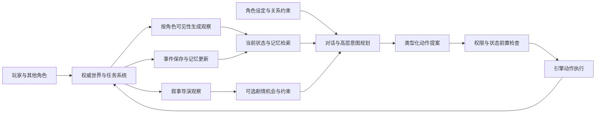

# 05 把工程经验迁移到游戏 Agent，并设计能检验它的评测

[返回学习地图](README.md)

本章是面试系统设计与实验设计练习，不是已经交付的游戏功能。可以说“这个制片项目让我具备了哪些相关经验，我会怎样迁移”；不能说已经部署过拥有百万玩家长期记忆的 NPC。

## 1. 先承认游戏环境与制片环境的差别

| 问题 | 当前制片项目 | 游戏 Agent 需要补什么 |
| --- | --- | --- |
| 时间尺度 | 允许秒到分钟级模型/媒体任务 | 对话响应、战斗动作、移动与世界 tick 的不同延迟预算 |
| 状态变化 | 用户与多个 Worker 改项目，Provider 异步返回 | 玩家、NPC、物理、任务和服务器都在持续改变世界 |
| 知识范围 | Worker 根据工作范围读取项目 | NPC 不应知道没看见的事；导演可能知道但不能泄漏 |
| 身份 | 制片角色是任务职责 | NPC 有稳定人格、关系、信念、秘密和角色弧线 |
| 完成边界 | 剧本、指定修改或导出完成 | 对话可结束，NPC 与世界仍持续存在，任务还会再次激活 |
| 错误代价 | 覆盖人工修改、重复生成、耗时与费用 | 错误发奖励、重复交易、剧情越级、反应迟缓与角色失真 |

可以迁移的核心是“模型决定与权威执行分离、持久动作身份、状态前置条件、事件驱动恢复、上下文按需装配”。不能照搬所有制片工作流，也不能让每个 NPC 都运行一套分钟级制片团队。

## 2. 一套可讨论的 NPC 架构

以下模块按职责划分，不意味着每个模块都要单独调用一次模型。



把执行分成三种时间尺度较容易解释：

- **即时动作层**：碰撞、寻路、动画、攻击窗口、资源扣除等由引擎确定性系统执行；模型不逐帧决定鼠标坐标或骨骼角度。
- **角色决策层**：接近谁、提出什么交易、如何回应玩家、下一阶段目标是什么；模型读取有限观察生成高层意图。
- **长期更新层**：关系变化、经历归纳、角色计划与叙事机会；按有意义事件触发，不每一帧总结全世界。

这里的“快/慢”是设计职责，具体毫秒目标需要基于游戏类型、设备和服务部署测量。对战 NPC、叙事伙伴和离线模拟不能共用一个拍脑袋延迟指标。

## 3. Planning：规划能变化，但不能把世界随口写成自己想要的样子

案例：玩家请求阿遥取回钥匙。阿遥可以形成“确认钥匙位置 → 找持有者交涉 → 取得钥匙 → 交还”的高层计划。实际是否能取、能否转移所有权，由世界系统裁定。

规划应包含目标、必要前置条件、动作依赖、预期观察和需要重新决策的事件。不要把“钥匙现在在仓库”写成永不检查的事实。玩家在模型思考期间先拿走了钥匙，旧动作必须失效，但关于承诺的对话上下文不必全部重建。

可复用制片项目的三个经验：

1. **依赖粒度准确**：只因其他地图区域变动，不必废掉当前交涉；钥匙所有权变动则要检查。
2. **部分完成继续推进**：已经确认持有者，可以边沟通边准备后续，而不用等所有可选背景查询结束。
3. **失败归属明确**：寻路受阻、对方拒绝、工具接口错误、旧状态冲突分别决定重试、换计划或向玩家解释。

ReAct 提供的是推理、动作和观察交替推进的思路；不意味着把模型的自由文本推理当作可执行状态，更不要求向用户展示私有推理。项目可类比这一循环，但具体持久化、校验与恢复是额外工程。[ReAct](https://arxiv.org/abs/2210.03629)

## 4. Action / Tool Use：给面试官一个能落地的动作合同

下面是建议接口示意，不是现有项目 API：

```json
{
  "command_id": "npc-ayao-turn-42-transfer-1",
  "actor_id": "npc-ayao",
  "action": "transfer_item",
  "arguments": {
    "item_id": "key-17",
    "recipient_id": "player-3"
  },
  "expected": {
    "item_revision": 28,
    "quest_stage": "return_key"
  },
  "valid_until_tick": 90320
}
```

引擎收到后检查角色是否具有该动作权限、钥匙是否仍归角色、双方是否在可交互范围、任务条件是否满足、提案是否过期。**物品转移、任务进度及命令结果记录**可在同一个本地权威事务里完成；同一个 command_id 重试返回已有结果，防止重复发物品。

“模型说玩家同意了”不能绕过交易规则；从记忆检索到一段承诺也不能自动执行资源修改。模型生成参数，只是动作提案。

对于移动这种持续动作，不应把发起请求当到达。可以返回 action_id，后续事件区分 STARTED、PROGRESS、ARRIVED、BLOCKED、CANCELLED。玩家改变目标时，未开始命令直接失效；已经移动到半路时由动作系统在允许的边界停止或转向。攻击动画进入不可取消窗口也需要按引擎规则收尾，不能假设取消 Future 就撤销了世界效果。

同样要区别本地事务与跨服务动作。若交易涉及独立经济服务或外部任务服务，仅在 NPC 进程保存 command_id 不会创造跨服务原子性。需要服务端幂等身份、状态查询及具体业务补偿；不能把补偿设计成“无条件反向转账”，因为玩家可能已经花掉物品。

## 5. Persona、State Tracking 与 Reflection 怎么分工

**Persona 是行为倾向和角色边界。** “谨慎、守约、不会泄露师门秘密”比每句加同一个口头禅更接近角色一致性。需要区分稳定人格、当前情绪、所处关系与角色已知事实。受惊会改变语气，不等于人格已经重写；经历重大事件可以形成角色弧线，但必须有因果依据。

**State Tracking 是可验证状态。** 任务到哪一步、承诺何时到期、哪个动作仍在执行、当前关系值、哪些事实已经确认，都不能只存在自然语言聊天总结里。重要字段由引擎或任务系统保存，模型描述与它冲突时不能自动覆盖。

**Reflection 是在证据上修正策略。** 玩家拒绝了交易，NPC 可以记下“这次价格对这个玩家不可接受”，而不是总结“玩家永远讨厌我”。反思输入应包含真实反馈、适用范围与失败类型，输出是可修订经验。只有会改变下次决定时才值得追加推理，不每轮固定“执行者—批评者—再执行”循环。

Reflexion 研究使用语言反馈形成跨尝试经验，无需通过每次失败更新模型权重。可以据此解释“语言化经验学习”与“微调/RL”的区别；本项目的错误反馈与 working_notes 并不构成对该论文算法的完整实现。[Reflexion](https://arxiv.org/abs/2303.11366)

自检还可能共享原生成者的盲点。复用同一模型做 Reviewer 可以增加一个观察角度，但不能宣称统计独立；“另一个角色同意了”不是客观证明。交易结果用状态断言，角色语气用校准过的评分，内容审美再结合人工反馈。

## 6. Multi-Agent 应该在哪里出现

### 6.1 三种用途不能混淆

| 用途 | Agent 之间的关系 | 适合的机制 |
| --- | --- | --- |
| 同一个目标的分工 | 查询不同线索、生成不同场景、独立检查 | Leader/Worker、依赖计划、隔离上下文、完成回执 |
| 世界里的多个角色 | 目标可能不同，各有私有信息与关系 | 独立感知、角色状态、显式交互与资源竞争 |
| 导演与角色 | 导演管理叙事机会，角色维持局部合理性 | 信息边界、剧情约束、受控事件接口 |

当前项目最接近第一种。多个 LLM 角色不等于 Multi-Agent Reinforcement Learning：没有因此就具备联合策略训练、奖励优化或去中心化执行学习。可以使用部分可观察决策过程作为分析语言，但必须说明自己是在建模系统，不是在宣称训练了 MARL 算法。

### 6.2 叙事导演的权力要明确

导演可以提出“让玩家有机会在集市遇到守卫”的事件候选，检查故事前提和节奏；不能直接让所有 NPC 知道钥匙真相，或反复改写已发生的剧情来迫使玩家走唯一结局。

角色响应要同时满足当前可见信息、人格、关系和可执行动作。开放叙事允许多种合理路径；评测不能只接受编剧预想的那一句回答。关键剧情状态、唯一物品与奖励仍由任务系统管理。

### 6.3 什么时候少用一个 Agent

一个明确的字幕读取、一个已知 ID 的库存查询、一次确定性轮询，都不需要先开专家再回报总指挥。强依赖链上的多个 Agent 可能只增加上下文交接和协调。可独立搜集的线索、上下文庞大且互不干扰的子问题，才更可能受益。

较新的受控研究比较不同任务与协作拓扑，发现协作收益高度依赖任务结构，顺序性与工具开销会改变结果。本次查阅的是 2026 年 4 月 v3；应借鉴其控制变量方法，不把某个 benchmark 的提升比例套到本项目。[Towards a Science of Scaling Agent Systems](https://arxiv.org/abs/2512.08296v3)

## 7. Eval：先定义任务、尝试、轨迹与世界终态

一个评测 case 至少包含初始世界状态、玩家输入/行为规则、角色可见范围、可用工具、可接受终态、禁止破坏的不变量、失败注入点以及评判器版本。一次 trial 是从隔离初态开始的一次运行；trace 是过程；outcome 是运行后的实际世界状态。

NPC 说“钥匙还给你了”，而背包没有钥匙，应判动作目标未完成。反过来，经过不同合法对话路线交还了钥匙，不应因 tool 调用顺序和标准答案不同而判错。代码判定、模型评分与人工评价各自用于适合的部分。[Anthropic Agent Evals](https://www.anthropic.com/engineering/demystifying-evals-for-ai-agents)

**用户不能只是被动聊天模拟器。** 玩家会在 Agent 思考时移动、抢先完成任务、取消交易或修改选择。τ²-bench 特意研究用户与 Agent 都能改变共享环境的情况，模拟用户行为受实际工具和状态约束。它与本项目“用户直接改正文，Worker 同时返回”在系统结构上很接近。[τ²-bench](https://arxiv.org/abs/2506.07982)

## 8. 岗位要求的五类指标怎样落到测试里

| 维度 | 可操作的判定 | 不足与补充 |
| --- | --- | --- |
| 任务完成 | 最终状态满足目标，关键不变量未破坏；分别统计自主完成与需介入完成 | 终态完成不能抹掉中途重复扣费、越权或人工救援 |
| 角色一致性 | 给定 Persona、关系、已知信息，标注是否违背核心约束及证据 | 模型评分需与人工校准；情绪变化不自动算人格错误 |
| 叙事合理性 | 因果前提成立、时间顺序合理、秘密与知情者一致、承诺及任务线可解释 | 多种合理分支应允许，不能只做字符串匹配 |
| 工具/环境交互 | 参数正确、真实效果、冲突恢复、重复副作用、过期动作、无效调用占比 | 正确拒绝过期写入应与模型选错工具分开 |
| 安全与可控性 | 玩家/工具内容不能授予额外权限；取消后不继续新动作；秘密不跨角色泄露 | 以具体产品风险设用例，不另造与任务无关的大框架 |

补充性能指标：首个有用响应时间、任务墙钟 P50/P95、控制消息到生效边界延迟、模型次数、输入/输出/缓存用量、重读次数、重规划次数、重复媒体/世界动作数、人工介入次数及耗时。

“有用响应”应定义为可见的有效内容或动作结果，不是“正在思考”占位文字。长任务至少同时量首个有用产出和最终交付，不能只优化其中一个。

## 9. 两种 pass 指标，方向完全不同

假设同一任务每次独立成功概率 p=0.9：

    三次中至少成功一次：1 - (1 - p)^3 = 0.999
    三次全部成功：p^3 = 0.729

前者表达多次尝试能不能找到成功解，常记为 pass@k；后者表达重复可靠性，τ-bench 使用 pass^k 这类视角。NPC 不能每次交易随机失败十分之一，仅靠“试三次总会成功”就宣称稳定。[τ-bench](https://arxiv.org/abs/2406.12045)

这些公式假设固定任务、独立且同分布的尝试。实际任务难度不同、共享 Provider 故障或缓存状态会造成相关性，不能把所有任务平均成功率直接幂运算当严格估计。应按任务重复、保存每次结果，再汇总重复成功情况和不确定性。

五部不同版本影片完成与 pass^5 不是同一个实验。即使固定版本独立做五次都成功，样本也太少，不能据此保证高可靠率。定量结论需要样本设计和区间，而不是一个漂亮百分数。

## 10. 一个可以执行的起步评测设计

以下规模是建议，不是已经跑过的数据。先做 30 个开发场景和 15 个保留场景，每类覆盖普通成功及一个关键反例；开发集用于改接口与提示，保留集用于比较。每个场景至少重复三次以暴露非确定性，后续对高风险场景增加重复。这个规模适合发现问题，仍不足以承诺生产级罕见故障率。

建议场景族：

1. 信息不足时主动澄清，信息已在世界状态里时先查。
2. 对话中纠正名字、目标或道具，保留不相关承诺。
3. 玩家直接改变状态，旧模型响应在随后到达。
4. 同一物品同时被两个 Agent 申请，最多一次成功转移。
5. 动作已成功、响应丢失，重试只返回原回执。
6. 进程重启，已完成动作不重做，未执行提案可恢复。
7. 过去事实被纠正，索引尚未更新也不使用旧事实。
8. NPC 没看到秘密事件，相关性很高也不能泄露。
9. 失败后反思改变策略，但不总结虚构的世界规则。
10. 角色可接受多种合理对话，评分器不偏好固定措辞。

每次 trial 固定记录：代码/模型/配置版本、环境初态、事件调度、工具定义、记忆快照、检索命中及来源、动作回执、最后世界状态、token/时间、失败原因、评分与人工复核意见。只有 API 实际提供随机种子时才记录可控 seed；没有 seed 也必须记录重复次数，不假装模型完全可重放。

比较的 baseline 可以是：

| 变体 | 想检验什么 | 控制什么 |
| --- | --- | --- |
| 单 Agent + 相同工具与记忆 | 多 Agent 是否真有价值 | 模型、任务、可用证据、总预算和输出标准 |
| Leader + Worker，共享长上下文 | 分工本身的效果 | 不让独立上下文成为隐含变量 |
| Leader + Worker，按任务隔离上下文 | 隔离是否减少干扰、节省输入 | 同等工具、模型与任务范围 |
| 关闭增量推进/公平轮换的回放 | 调度机制对等待与尾延迟的作用 | 相同工具延迟与到达事件 |
| 精确状态检索 vs 加语义记忆 | 记忆是否改善跨会话任务 | 当前状态、Persona、测试事件一致 |
| 无 Reflection vs 条件触发 Reflection | 反思是否改善下一次决策 | 计入额外调用成本，保留错误证据 |

不要一口气全因子穷举。先根据失败选一个假设，固定其他变量做配对实验；对于随机模型，用同一 case 的重复结果比较。评测预算可以有限，产品正常工作不因此增加未经用户要求的硬预算门槛。

## 11. 如何给主观叙事做评分，避免 Judge 自说自话

先建立具体 rubric。例如“角色是否泄漏秘密”给出秘密内容、角色是否知情和实际对白；“承诺是否一致”给出承诺、时间、后续动作；“叙事合理”拆成原因存在、行动可执行、因果先后与转折是否有依据。

模型 Judge 输出分数、证据片段、理由和无法判断项；缺声音或未观察完整片段时允许 UNKNOWN，不能默认 PASS。把生成方案的身份隐藏，交换成对比较的左右顺序，检查长度偏好和固定模型偏好；抽样由熟悉角色与剧情的人复核。检查评分一致性和已知好/坏样例的区分力，再决定是否自动用于回归。

生成者与评判者共用模型可能相关，多个 Judge 的票数也不是独立统计证据。确定性状态断言优先用于物品、任务、时间、权限，Judge 只处理代码难以表达的质量维度。

对制片项目还要保留媒体证据层次：静帧看构图，音频分析看波形或可辨识对白，完整播放看接点与叙事节奏。不能把抽帧观察替代听审或精确口型验收。

## 12. 数据闭环怎样从线上失败落回工程改进

建议流程：保存失败 trace 与真实终态 → 按最早可确认原因归类 → 缩成保留因果的最小 fixture → 加入确定性回归或模型评测 → 只改变一个机制 → 比较结果与成本 → 在新真实任务中继续观察。

故障 taxonomy 至少分清：规划不当、工具发现/参数错误、有效输入的执行错误、并发来源失效、远端不确定性、交接缺失、检索缺证据、正确证据被读错、Persona/叙事冲突、环境配置问题、评分器错误。

若一条链先丢了 completed handoff，后面导致两次重复检查，不应算成三个独立根因；同时保留两次检查的实际资源成本。遇到工具主动拒绝旧状态，要检查 Agent 是否合理恢复，而不是把拒绝规则删掉来提高“工具成功率”。

当前仓库已积累真实失败报告与 Fake 回归，说明具备这个闭环的基础；还缺固定版本、保留任务集、重复 trial 与统一质量 rubric。这是值得明确说出的下一步。

## 13. Code / GUI / Browser Agent 经验怎么表述才准确

当前产品具备 Multi-Agent 制片运行时，工程验收使用过浏览器或原生界面操作。它不等于已经开发通用 GUI Agent，也不等于把 LTX 编辑器接入就拥有 Computer Use 能力。

可以讨论的迁移差异：

- 领域 API 提供对象 ID、typed 参数和版本条件；GUI 需要识别当前页面、坐标或可访问性节点，并确认点击真的产生效果。
- Browser Agent 有网页导航、DOM 状态、异步加载和会话；游戏 Agent 有角色观察、tick、移动与世界状态。两者都不能把陈旧观察直接用于不可逆动作。
- Code Agent 有文件、测试、构建与提交结果；SWE-agent 强调为 Agent 设计合适的计算机接口，而不只是给一条无限制 shell。
- GUI 评测需要可重置环境与真实执行后状态；OSWorld 的价值在这类任务组织与执行验证，不能以几张成功截图替代完整结果。

这些是可学习和类比的经验。若个人确实还做过独立的 Code/GUI 项目，再补充具体动作空间、观测方式、失败恢复和评测；不要把本次阅读变成未经实际开发的简历条目。[SWE-agent](https://arxiv.org/abs/2405.15793) · [OSWorld](https://arxiv.org/abs/2404.07972)

本章验收：给你一个“玩家取走钥匙、NPC 旧动作晚到、另一角色还不知道”的场景，能够同时设计状态/信念、工具合同、并发处理、最终对白和评测；能解释为什么某个部分需要多个 Agent、另一个部分只需要一个确定性接口。
