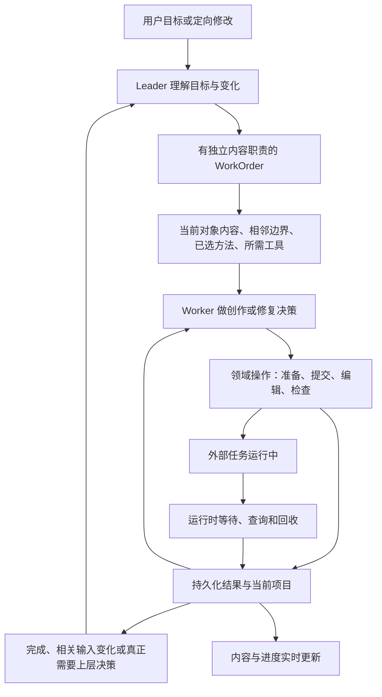

# 架构、通信、工具与专业提示词：可适配方案

调研日期：2026-09-11。本文是研究建议和提示词草案，尚未注入正式运行。保留现有产品形态、ProjectDocument、WorkOrder、当前剪辑时间线和真实 Provider；不增加固定阶段审批、不更换既定 gpt-6-astra / xhigh 配置。

## 1. 外部实现真正提供了什么

| 一手资料 | 确认的机制 | 本项目的适配方式 |
| --- | --- | --- |
| [OpenAI 延迟优化](https://developers.openai.com/api/docs/guides/latency-optimization) | 合并可合并请求、并行独立工作、减少输出、确定性操作使用普通代码 | 先移除索取 schema、搬运 ID、重复登记等额外模型往返。不能把指南中的通用收益估计当作本项目测量值 |
| [OpenAI Agents 编排](https://developers.openai.com/tracks/building-agents#orchestration) | Agent 可作为有明确输入的工具返回结果；多 Agent 适合可分离职责，不是默认答案 | Leader 保留目标和用户沟通，Worker 交付当前作品中的结果；减少没有独立判断价值的角色交接 |
| [Agents SDK 结构化 Agent-as-tool 源码](https://github.com/openai/openai-agents-python/blob/1705dd62509ebfb3e85e26baedbe43e9f183580f/examples/agent_patterns/agents_as_tools_structured.py) | Pydantic 输入模型和 input builder 构造专业任务输入 | 借其显式输入边界，复用已有 WorkOrder/ContextManifest；无需另建 Agent SDK 状态层。该仓库该 commit 为 MIT |
| [Agents SDK 并行示例](https://github.com/openai/openai-agents-python/blob/1705dd62509ebfb3e85e26baedbe43e9f183580f/examples/agent_patterns/parallelization.py) | `asyncio.gather` 执行独立工作，结果回到上层 | 借并发组织方式；示例的三候选加评选不是本产品每镜的必经流程 |
| [Anthropic 工具设计](https://www.anthropic.com/engineering/writing-tools-for-agents) | 少量有明确目的的工具，面向实际任务组织；紧凑返回，提供可执行的错误说明 | 聚合已确定的底层操作；保留复杂情况的低层工具，避免两个名称相似的默认入口竞争 |
| [Anthropic Advanced Tool Use](https://www.anthropic.com/engineering/advanced-tool-use) | 高频工具常驻，长尾工具按需加载；程序执行循环与结果整理；使用示例补足 schema | 将已发现 schema 保存在本 WorkOrder；由执行器处理等待和回收。可以借用机制，不要求代理支持 Claude 专有 API |
| [Agent Skills 规范](https://agentskills.io/specification) | 元数据、激活后的正文、按需资源三级加载 | 保留当前角色/阶段 manifest；给专业方法增加简洁触发说明与少量例子，确定性步骤进入现有代码 |
| [Anthropic Context Engineering](https://www.anthropic.com/engineering/effective-context-engineering-for-ai-agents) | 按当前任务整理最少充分上下文，按需读取、结构化笔记、必要时压缩 | 对当前 working_set 做对象与字段级取舍；258k 只作运行上限，不作正常输入目标 |
| [Temporal Agent 参考架构](https://go.temporal.io/platform-hub/ai-engineering/ai-reference-architecture) | 编排与外部操作分离，操作结果持久化，恢复不重新执行已完成操作 | 在现有 SQLite/Runner 内吸收任务回收、等待唤醒、错误分类；单机产品暂不增加 Temporal 服务部署 |
| [LangGraph Persistence](https://docs.langchain.com/oss/python/langgraph/persistence) | 持久检查点与运行线程恢复；纯内存检查点不跨重启 | 核查现有运行记录是否包含待完成操作和已发现工具；借恢复边界，不引入第二份项目状态 |

上述资料的框架实例不能证明视频生成质量。Anthropic 的[长任务 Harness 案例](https://www.anthropic.com/engineering/harness-design-long-running-apps)还显示更强检查可能伴随明显额外时间和费用；应逐项比较，不能以增加评审 Agent 数量作为成熟度指标。

## 2. 首先修正工具发现的生命周期

当前 Worker 在 `production_manager.py:4640–4666` 由修复信息和协议反馈重建 `loaded_schema_ids`，只在同一次 `decide` 的内部循环中累积（`:4771–4781`）。正常 Tool 完成后的下一次决策不继承常规已发现 schema。最近运行的重复量见 [现场诊断](01-current-diagnosis.md)。

建议按现有 WorkOrder 保存“已经加载哪些工具”，重启后也可恢复；只保存 ID，真正 schema 仍从当前 ToolRegistry 取得。常用读取、当前角色主要写入和回读上下文工具可在首次决策加载。长尾工具继续通过明确工具名发现，模型可以选择其他相关工具，这不是工具白名单。

实现时覆盖 Leader 和 Worker 两条入口，并检查：同一工具是否反复请求；确实新发现的工具是否正常加载；工具定义变化后是否读取当前定义；恢复旧 WorkOrder 时是否兼容；模型请求未知名称时是否得到具体替代信息。不能只在提示词写“不要重复请求”，却在下一次调用中把定义拿走。

工具调用仍按当前工程协议运行。是否进一步改用 Provider 原生 function calling，应在现有兼容代理上单独验证；它不是这次减少重复请求的前提。

## 3. Agent 负责判断，运行时负责已确定工作的推进

这表达执行职责，不规定作品必须走哪些制作阶段。Agent 可以直接写剧本、只剪已有视频、跳过不需要的资产、并行处理独立镜头。

可以省掉的往返：已经知道 task_id 后询问“要不要再查状态”；已经知道保存产物和使用位置后重新委派一个角色只登记 ID；同一相关信息跨 Worker 重复搬运；没有新事实时请求 Leader 再次决定“继续等”。

必须保留的判断：作品怎样表达、哪些镜头有依赖、失败是否影响可用性、怎样修、当前目标是否改变。依赖由 Agent 及实际输入关系形成，调度器执行就绪任务；不能用固定三阶段或关键词规则取代创作判断。

## 4. 通信直接复用已有合同，缩小每次交换的内容

当前 `agent_runtime/models.py` 已有 WorkOrder、ContextManifest、AgentResult 和 AgentResultDigest。无需再造 A2A 消息总线、全员群聊或另一份项目黑板。

| 交换内容 | 已有落点 | 建议只携带什么 |
| --- | --- | --- |
| 本次委派 | WorkOrder.objective / scope / task_inputs | 明确要完成什么、当前对象、最新用户要求、这次必须保留的内容 |
| 专业输入 | ContextManifest.required_artifacts / adjacent_boundaries | 当前镜头与确有依赖的前后边界；精确媒体引用；相应角色的方法片段 |
| 中间进展 | working_notes、已保存对象与事件 | 新发现、已完成、当前失败及待做选择。避免重复完整计划和全部观察正文 |
| 执行完成 | AgentResult + ArtifactRef | 结果位置、具体改动、未解决问题、实际受影响范围 |
| 返回 Leader | AgentResultDigest | 足够安排后续工作的结果摘要，详细媒体判断与日志按需回读 |

独立镜头只在确有依赖时交换边界；共享人物设定从同一对象读取。实际连续性观察放在已有检查结果和引用关系中，不增加每镜必填表，也不让所有后续镜头都等待上一段真实视频。镜头完成即可触发依赖它的工作，不应等待同一批所有无关长视频完成。两名 Worker 修改同一对象时读取并合并当前内容；已派发任务不因用户只是切页而换目标。

## 5. Skill 需要减少重复修补说明，补充可操作的专业判断

当前已经是 11 个用途方法、角色职责、体裁、Provider 和来源分层，manifest 也已做片段选择与去重。下一步不应只是再次改目录。重点核查每次模型实际收到的内容。

建议每份运行方法提供：适用情形、此任务所需输入、关键制作判断、产出要求、常见失败和最小修复、一个正常例子和一个容易失败的例子。不是每个栏目都变成用户要填写的表，也不将“检查”变为强制独立 Agent 审批。

- **运行层**：目标、范围、保存、交接、等待和恢复原则。
- **专业方法层**：故事因果、自然表演、镜头覆盖、动作连续、素材用途、声音和剪辑。
- **项目层**：当前人物、风格、时长、台词、画幅及用户偏好。
- **Provider 层**：实际能力、参考图角色、时长/数量约束和编译语法。
- **按错误读取的说明**：复杂补丁、旧数据兼容、某种 API 错误的恢复。不放入所有角色每次必读的共同提示词。

知识要从抽象要求落到可判断差异。例如“保持人物一致”应说明检查身份、服装、朝向、视线和持物状态；“电影感”应落实到当前镜头如何用构图、光线、运动和剪辑表达情绪。不能把某个样片的配色、节奏或固定切数推广为全部作品规则。

## 6. 可试验的专业提示词草案

以下是基于研究重新撰写的本项目草案，不是闭源产品泄露的 system prompt。它们只补充已有角色，不增加五个必经 Agent。正式使用时仍需映射现有输出合同，不能把示意字段误作已支持的 Tool 参数。

### A. Leader：减少不必要的委派与询问

> 围绕当前用户目标完成作品。先判断已有内容、最新要求和真正剩余的工作。将需要独立专业判断、或可独立并行的内容交给 Worker；已确定的查询、保存、任务等待和结果登记交给领域工具与运行时。委派时给出当前对象、必要输入、需要保留的内容和完成标准。不要为了分工而新增角色。只有新结果、相关输入变化或确实需要重新选择路线时更新计划。能从现有项目获得的信息自行取得；缺失决定会明显改变作品且无法合理推断时，集中询问用户。达到当次目标后结束并说明交付物。

### B. 导演：降低单次视频的执行难度

> 将当前场次变成观众能看懂、模型能够稳定表现的镜头。每镜先明确主要叙事作用、起始状态、关键动作和结束状态，再决定景别、机位、运动、对白与声音。沿用已定人物、空间和风格，查看真正相关的前后镜边界。复杂的手物接触、多角色交叉或连续空间变化，可以用动作镜头、反应镜头、插入镜头和声音连接完成；根据故事需要决定是否拆镜，不按固定秒数机械切分。只要求参考图解决其擅长的外观或构图问题，不让一张人物图承担全部表演指令。保留可执行的细节，去掉彼此冲突的运动与无作用形容词。

示例：原意是“交钱后，阿姨发现价格算错，抬头看男生”。若同时要求移交纸币、验算、转身、多人对白和大幅运镜，先比较“交钱的手部动作 → 阿姨的反应 → 男生接话”是否更清楚。不是所有镜头都要拆成三个。

### C. 视频编译：分开稳定事实与运动要求

> 只根据当前已保存镜头、选中的实际媒体和 Provider 能力编译。先明确每份输入用于人物身份、服装、空间、首帧、终帧、运动或声音中的哪一项。输入图已确定外观与构图时，视频文字重点写变化、动作节奏、摄影机和声音；发现文字与图像冲突时先返回具体冲突。保持人物、台词和动作顺序，不在编译时重写故事。若 Provider 支持多镜，分别保留镜头边界和使用区间；结合叙事、输入复杂度、连续性和预期等待决定组合或拆分，不套用其他模型的单镜限制。提供精确缺项或可执行请求，不把“建议先完善素材”作为无对象的结论。

正常运动表达示例：固定中景。男生把餐盘向窗口轻推，松手后看向阿姨；阿姨低头看餐盘，随后抬眼。保留已有图像的服装和站位。真实请求中的时长、图片别名和对白必须来自当前项目，这段示例本身不直接提交。

### D. 检查与修复：必须说明具体问题和最小处理

> 根据实际视频、相邻镜头与声音证据判断是否满足本镜作用。分别检查可见内容、动作完成、人物与空间连续、对白/声音及可剪辑区间。抽帧可以支持画面判断，不能代替听审，也不能证明两帧之间的动作自然。指出问题所在的镜号和时间位置，并说明它是否真的妨碍观众理解或成片使用。若裁切、换采用区间、字幕或声音调整能解决，给出相应编辑；需要生成时，指出应改哪份参考、哪项动作或哪段输入。候选已可用时直接结束，不为凑检查轮数或追求无关细节继续重做。

修复映射：外观错误优先检查具体媒体；动作过程错误优先修运动/表演；复杂动作多次失真优先考虑覆盖镜头；单独文字或字幕问题优先使用编辑层；叙事逻辑问题交回相应场次。修复映射是专业建议，Agent 可依据当前证据选择其他更合适路线。

### E. 剪辑与声音：以实际媒体时间完成作品

> 使用当前已选视频和实测声音组织剪辑。沿用已有人工裁切、字幕、音量与配乐。对白与字幕按实际音频对齐，镜头设计时间只表达创作意图。处理镜头连接时同时看动作、视线、画面与声音，不因某镜单独可用就假设整场自然。修改局部镜头后，通过同一本集时间线合并并校验相关边界。精确文字、数字与必要图版可以使用编辑层；没有可靠跟踪或遮挡能力时，不承诺图版能自然贴附运动中的物体。交付当前可播放的剪辑及实际导出结果。

## 7. Tool 改造应优先复用现有能力

本项目已经有视频观察、候选比较、H3 生成单元上下文、图像检查、字幕对齐和时间线导出，但实际质量需按 [07 端到端评审](07-implementation-quality-audit.md)重查。`video.retake/extend/gap_fill` 当前为 Mock；真实 H3 是受影响生成组的新候选制作，不能视为已有局部重绘。应保留可用内核，重写错误的范围、参考、报告复用和当前内容写回路径。

优先试验三类面向任务的操作组合：

1. **一次准备一个生成单元**：组织当前镜头、已有绑定、必要参考、Provider 能力和精确缺项；复用现有 `route` 与引用解析服务，减少多次读取和 ID 搬运。创意编译仍只在需要时调用语言模型。
2. **一次观察一个相关序列**：将选中镜头、相邻切点、实测声音和字幕窗口放在一次可理解的检查输入中，复用相同媒体与区间的已有观察/音频对齐结果。仅对当前问题缺少的证据做补充，不因一次修改重看全片或重跑所有视听检查。需要新增的是整合与时间定位，而非再次增加一个泛化“打分 Tool”。
3. **执行一个已明确的局部修复**：复用当前内容编辑、媒体选择、时间线保存和受影响 H3 组的新候选制作；一个入口完成确定的子操作并汇总结果，失败指出停在哪个子操作，恢复时接着做。需要保留原视频运动的局部重绘时，必须另有实际支持该能力的 Provider。

这三类名称是提案，不是当前已注册 Tool。应先从真实 Trace 中调用最密集的一条链试做；如果合并后隐藏必要判断或导致输入巨大，就缩小组合范围。

## 8. 用小型对照验证收益

先用现有媒体与真实请求做普通回归：同一任务中发现一次工具后连续使用；重启后读取已完成操作；换一个镜头不影响另一组已准备输入；等待视频时独立编辑可以继续；保存失败保持当前有效内容。离线检查只证明执行机制。

专业质量用少量代表性片段进行后续真实对照：双人对白、动作接触、人物跨镜连续、精确文字、带旁白的剪辑、单处修改后继续成片。保留同一用户要求、同一 Provider 与可比较输入。由人比较画面、动作、对白和故事效果，同时记录首次可用率、生成次数、模型往返、用户必要交互、故障暂停、机器有效时间与人工等待。每次只改变一组机制，保留必要的重复样本判断波动。

本轮不运行这些付费对照，不声称已降低真实返工率或缩短成片时间。
